# BÀI HỌC 01: 01_Bài 1. Tập hợp_(page 5_8)

[Video]: https://youtu.be/d6V8FOwtSMQ

Số Học

# TẬP HỢP CÁC SỐ TỰ NHIÊN

Khi tính toán với những số nhỏ, người xưa chỉ cần dùng đến các ngón tay. Nhưng khi gặp các số lớn thì sao? Các hệ đếm xuất hiện để giúp con người tính toán với những số lớn. Chương này sẽ giúp các em làm quen với hệ (đếm) thập phân để biểu diễn và tính toán với các số tự nhiên. Thật dễ dàng và thuận tiện!

## TẬP HỢP

#### KHÁI NIỆM, THUẬT NGỮ

Tập hợp, phần tử

#### KIẾN THỨC, KĨ NĂNG

- Nhận biết tập hợp và các phần tử của nó.
- Mô tả một tập hợp (cho một tập hợp).
- Sử dụng kí hiệu và cách diễn đạt toán học nhờ tập hợp.

*Tập hợp* gồm các bông hồng trong lọ hoa *Hình 1.1* 

*Tập hợp* gồm ba con cá vàng trong bình *Hình 1.2* 

Bài này sẽ giúp các em tìm hiểu về tập hợp, một khái niệm cơ bản của Toán học.

<section name="1. Tập hợp và phần tử của tập hợp">
### 1. TẬP HỢP VÀ PHẦN TỬ CỦA TẬP HỢP

## C C

#### Tập hợp

- Trên Hình 1.1 (H.1.1) ta có tập hợp các bông hồng trong lọ hoa.
- Trên Hình 1.2 ta có tập hợp các con cá vàng trong bình cá.
- Hình 1.3 biểu diễn tập hợp gồm các số 4; 1; 9 và 8. Nếu kí hiệu *M* là tập hợp này thì các số 4; 1; 9 và 8 là các phần tử của tập hợp *M*.
- Gọi B là tập hợp các chữ cái viết thường trong tiếng Việt.
  Khi đó a, b, c,... là những phần tử của tập hợp B.

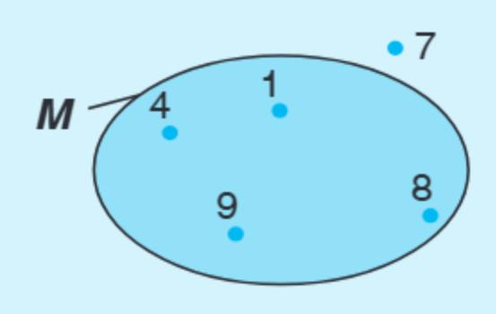

*[Hình ảnh: 01___page_1_Picture_7.jpeg]*

Hình 1.3

Một <mark>tập hợp</mark> (gọi tắt là <mark>tập</mark>) bao gồm những đối tượng nhất định. Các đối tượng ấy được gọi là những phần tử của tập hợp.

x là một phần tử của tập A, kí hiệu là  $x \in A$  (đọc là x thuộc A).

y **không** là phần tử của tập A, kí hiệu là  $y \notin A$  (đọc là y không thuộc A).

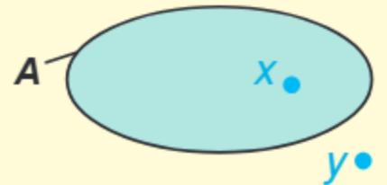

*[Hình ảnh: 01___page_1_Picture_12.jpeg]*

Chú ý. Khi x thuộc A, ta còn nói "x nằm trong A", hay "A chứa x".

#### Ví dụ

Với tập hợp M trên Hình 1.3, ta có 4 ∈ M, 1 ∈ M, 7 ∉ M.

Người ta thường đặt tên tập hợp bằng chữ cái in hoa.

#### Luyện tập 1

Gọi **B** là tập hợp các bạn tổ trưởng trong lớp em. Em hãy chỉ ra một bạn thuộc tập **B** và một bạn không thuộc tập **B**.

</section>

<section name="2. Mô tả một tập hợp">
#### 2. MÔ TẢ MỘT TẬP HỢP

Mô tả một tập hợp là cho biết cách xác định các phần tử của tập hợp đó. Ta thường dùng hai cách mô tả tập hợp sau:

#### Hai cách mô tả một tập hợp

Cách 1. Liệt kê các phần tử của tập hợp, tức là viết các phần tử của tập hợp trong dấu ngoặc { } theo thứ tự tuỳ ý nhưng mỗi phần tử chỉ được viết một lần.

Ví dụ, với tập **P** gồm các số 0; 1; 2; 3; 4; 5 ở Hình 1.4, ta viết:

Cách 2. Nêu dấu hiệu đặc trưng cho các phần tử của tập hợp Ví dụ, với tập **P** (xem H.1.4) ta cũng có thể viết:

 $P = \{n \mid n \text{ là số tự nhiên nhỏ hơn 6}\}.$ 

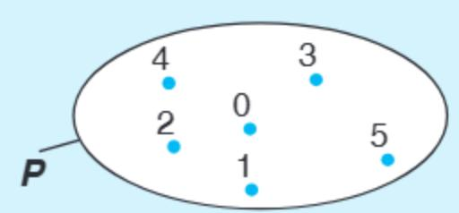

*[Hình ảnh: 01___page_1_Picture_29.jpeg]*

Hình 1.4. Tập hợp P

Khi mô tả tập hợp L các chữ cái trong từ NHA TRANG bằng cách liệt kê các phần tử, bạn Nam viết:

 $L = \{N; H; A; T; R; A; N; G\}.$ 

Theo em, bạn Nam viết đúng hay sai?

#### Ta viết các phần tử của một tập hợp cách nhau bởi dấu ";".

#### Chú ý

- ❶ Gọi N là tập hợp gồm các số tự nhiên 0; 1; 2; 3;... Ta có thể viết tập  $\mathbb{N}$  như sau:  $\mathbb{N} = \{0; 1; 2; 3; ...\}$ .
- **2** Ta viết  $n \in \mathbb{N}$  có nghĩa n là một số tự nhiên. Chẳng hạn, tập **P** các số tự nhiên nhỏ hơn 6 có thể viết là:

 $P = \{n \mid n \in \mathbb{N}, n < 6\}$  hoặc  $P = \{n \in \mathbb{N} \mid n < 6\}.$ 

⑤ Ta còn dùng kí hiệu N\* để chỉ tập hợp các số tự nhiên khác 0, nghĩa là N\* = {1; 2; 3;...}.

#### Luyện tập 2

Viết các tập hợp sau bằng cách liệt kê các phần tử của chúng:

 $A = \{x \in \mathbb{N} \mid x < 5\};$ 

**B** =  $\{x \in \mathbb{N}^* \mid x < 5\}.$ 

#### Luyện tập 3

Gọi *M* là tập hợp các số tự nhiên lớn hơn 6 và nhỏ hơn 10.

- a) Thay thế dấu "?" bằng kí hiệu ∈ hoặc ∉ : 5 ? M; 9 ? M;
- b) Mô tả tập hợp M bằng hai cách.

</section>

<section name="Bài tập cuối bài">
## **BÀI TẬP**

#### 1.1. Cho hai tập hợp:

$$A = \{a; b; c; x; y\} \text{ và } B = \{b; d; y; t; u; v\}.$$

Dùng kí hiệu "∈" hoặc "∉" để trả lời câu hỏi: Mỗi phần tử a, b, x, u thuộc tập hợp nào và không thuộc tập hợp nào?

1.2. Cho tập hợp

$$U = \{x \in \mathbb{N} \mid x \text{ chia h\'et cho 3}\}.$$

Trong các số 3; 5; 6; 0; 7, số nào thuộc và số nào không thuộc tập *U*?

- 1.3. Bằng cách liệt kê các phần tử, hãy viết các tập hợp sau:
- a) Tập hợp K các số tự nhiên nhỏ hơn 7;
- b) Tập hợp **D** tên các tháng (dương lịch) có 30 ngày;
- c) Tập hợp M các chữ cái tiếng Việt trong từ "ĐIỆN BIÊN PHỦ".

- 1.4. Bằng cách nêu dấu hiệu đặc trưng, hãy viết tập hợp A các số tự nhiên nhỏ hơn 10.
- 1.5. Hệ Mặt Trời gồm có Mặt Trời ở trung tâm và 8 thiên thể quay quanh Mặt Trời gọi là các hành tinh, đó là Thuỷ tinh, Kim tinh, Trái Đất, Hoả tinh, Mộc tinh, Thổ tinh, Thiên Vương tinh và Hải Vương tinh.

Gọi **S** là tập các hành tinh của Hệ Mặt Trời. Hãy viết tập **S** bằng cách liệt kê các phần tử của **S**.

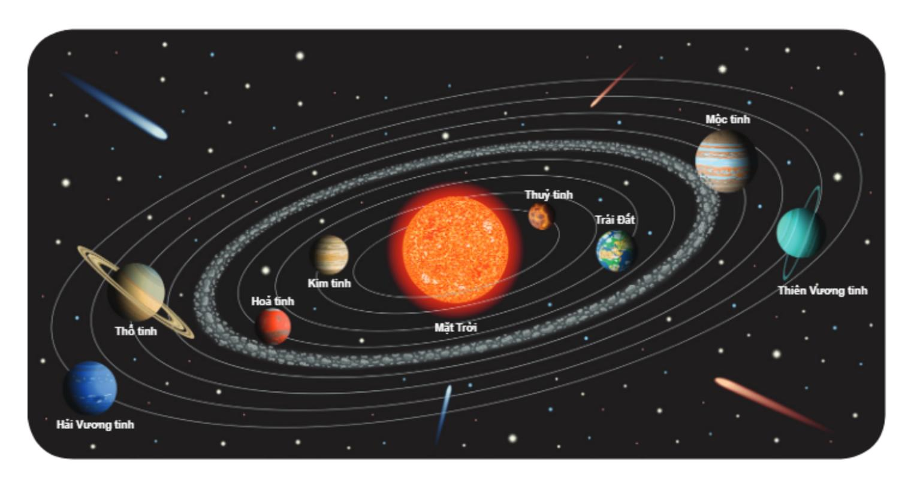

*[Hình ảnh: 01___page_3_Picture_3.jpeg]*

#### EM CÓ BIẾT?

#### Nhà toán học Cantor

Con người biết đến toán học từ hàng nghìn năm trước Công nguyên. Nhưng mãi đến cuối thế kỉ XIX, lí thuyết tập hợp mới được phát triển nhờ các nghiên cứu của nhà toán học Cantor (Căng-to), người Đức. Từ đó lí thuyết tập hợp đã nhanh chóng trở thành nền tảng của Toán học hiện đại.

#### Tập hữu hạn và tập vô hạn

Ta thấy:

Tập  $X = \{x; y\}$  có 2 phần tử;

Tập  $Y = \{1; 2; 3; ...; 50\}$  có 50 phần tử.

X và Y là những tập hợp có một số hữu hạn phần tử. Ta gọi chúng là những *tập hữu hạn*.

Khác với tập X, Y, tập hợp có vô số phần tử là tập vô hạn. Tập  $\mathbb N$  là tập vô han.

#### Giao của hai tập hợp

Gọi C là tập hợp gồm các phần tử chung của hai tập A và B

Ta gọi tập C là *giao* của hai tập A và B, kí hiệu  $C = A \cap B$ .

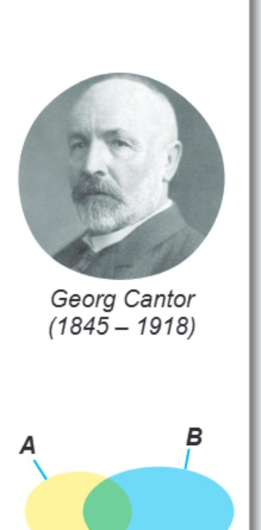

*[Hình ảnh: 01___page_3_Picture_16.jpeg]*

</section>

---

# BÀI HỌC 02: 02_Bài 2. Cách ghi số tự nhiên_(page 9_12)

[Video]: https://youtu.be/08Z_LM2SBuo

# CÁCH GHI SỐ TỰ NHIÊN

### KHÁI NIỆM, THUẬT NGỮ

Hệ thập phân Chữ số

Số La Mã, chữ số La Mã

#### KIẾN THỨC, KĨ NĂNG

- Nhận biết giá trị các chữ số của một số tự nhiên viết trong hệ thập phân.
- Biểu diễn mỗi số tự nhiên thành tổng giá trị các chữ số của nó.
- Đoc và viết số La Mã từ 1 đến 30.

Trong lịch sử loài người, số tự nhiên bắt nguồn từ nhu cầu đếm và có từ rất sớm. Nhưng trải qua nhiều thế kỉ người ta mới có được cách ghi số tự nhiên như ngày nay, vừa dễ đọc, vừa sử dụng thuận tiện trong khoa học. Cách ghi số tự nhiên đó như thế nào?

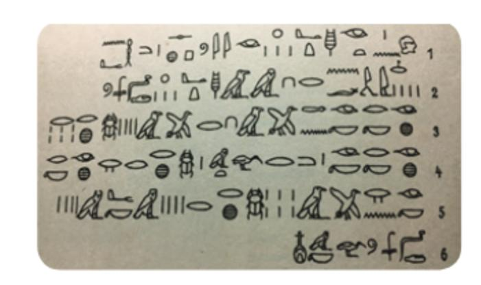

*[Hình ảnh: 02___page_0_Picture_10.jpeg]*

<section name="1. Hệ thập phân">
# 1. HỆ THẬP PHÂN

## Cách ghi số tự nhiên trong hệ thập phân

- Trong hệ thập phân, mỗi số tự nhiên được viết dưới dạng một dãy những chữ số lấy trong 10 chữ số 0; 1; 2; 3; 4; 5; 6; 7; 8 và 9; vị trí của các chữ số trong dãy gọi là hàng.
- Cứ 10 đơn vị ở một hàng thì bằng 1 đơn vị ở hàng liền trước nó. Chẳng hạn, 10 chục thì bằng 1 trăm; 10 trăm thì bằng 1 nghìn;...

# Chú ý. Khi viết các số tự nhiên, ta quy ước:

- 1. Với các số tự nhiên khác 0, chữ số đầu tiên (từ trái sang phải) khác 0.
- 2. Để dễ đọc, đối với các số có bốn chữ số trở lên, ta viết tách riêng từng lớp. Mỗi lớp là một nhóm ba chữ số kể từ phải sang trái.

Chẳng hạn, số 221 707 263 598 (đọc là hai trăm hai mươi mốt tỉ, bảy trăm linh bảy triệu, hai trăm sáu mươi ba nghìn, năm trăm chín mươi tám) có các lớp, hàng nêu trong Bảng 1.

| Lớp    | Tî         |            |    | Triệu         |               |       | Nghìn         |               |       | Đơn vị |      |           |
|--------|------------|------------|----|---------------|---------------|-------|---------------|---------------|-------|--------|------|-----------|
| Hàng   | Trăm tỉ | Chục tỉ | Τỉ | Trăm triệu | Chục triệu | Triệu | Trăm nghìn | Chục nghìn | Nghìn | Trăm   | Chục | Đơn vị |
| Chữ số | 2          | 2          | 1  | 7             | 0             | 7     | 2             | 6             | 3     | 5      | 9    | 8         |

Bảng 1

🙀 Chỉ dùng ba chữ số 0; 1 và 2, hãy viết tất cả các số tự nhiên có ba chữ số, mỗi chữ số chỉ viết một lần.

## Giá trị các chữ số của một số tự nhiên

HĐ1 Trong số 32 019, ta thấy:

"Chữ số 2 nằm ở hàng nghìn và có giá trị bằng 2 × 1 000 = 2 000". Hãy phát biểu theo mẫu câu đó đối với các chữ số còn lại.

HĐ2 Viết số 32 019 thành tổng giá trị các chữ số của nó.

Mỗi số tự nhiên viết trong hệ thập phân đều biểu diễn được thành *tổng giá trị các chữ số của nó*.

Các chữ số mà chúng ta đang dùng được gọi là chữ số Ả Rập. Tuy nhiên, người Ả Rập không sáng tạo ra chúng. Họ có công học cách viết đó của người Ấn Độ và truyền bá vào châu Âu.

#### Ví du

$$= (2 \times 100) + (3 \times 10) + 6;$$

$$\overline{ab} = (a \times 10) + b$$
,  $v \circ i = 0$ .

$$\overline{abc} = (a \times 100) + (b \times 10) + c$$
,  $v \circ i \ a \neq 0$ .

Trong đó:  $\overline{ab}$  là kí hiệu số tự nhiên có hai chữ số, hàng chục là a, hàng đơn vị là b;  $\overline{abc}$  là kí hiệu số tự nhiên có ba chữ số, hàng trăm là a, hàng chục là b, hàng đơn vị là c.

## Luyện tập

Viết số 34 604 thành tổng giá trị các chữ số của nó.

Bác Hoa đi chợ. Bác chỉ mang ba loại tiền: loại (có mệnh giá) 1 nghìn (1 000) đồng, loại 10 nghìn (10 000) đồng và loại 100 nghìn (100 000) đồng. Tổng số tiền bác phải trả là 492 nghìn đồng. Nếu mỗi loại tiền, bác mang theo không quá 9 tờ thì bác sẽ phải trả bao nhiêu tờ tiền mỗi loại, mà người bán không phải trả lại tiền thừa?

*[Hình ảnh: 02___page_1_Picture_18.jpeg]*

*[Hình ảnh: 02___page_1_Picture_19.jpeg]*

</section>

<section name="2. Số La Mã">
# 2. Số LA MÃ

Ngoài cách ghi số trong hệ thập phân, người ta còn có những cách ghi số khác. Cách ghi số La Mã xuất hiện trong nhiều công trình kiến trúc ở châu Âu hay trên mặt đồng hồ theo phong cách cổ điển. Trong nhiều văn bản và sách báo, số La Mã thường được dùng để đánh số thứ tự.

### Cách viết số La Mã

• Để viết các số La Mã không quá 30, ta dùng ba kí tự I, V và X (gọi là những chữ số La Mã). Ba chữ số ấy cùng với hai cụm chữ số là IV và IX là năm thành phần dùng để ghi số La Mã. Giá trị của mỗi thành phần được ghi trong bảng sau và không thay đổi, dù nó đứng ở bất kì vị trí nào:

| Thành phần                        | I | V | Х  | IV | IX |
|-----------------------------------|---|---|----|----|----|
| Giá trị (viết trong hệ thập phân) | 1 | 5 | 10 | 4  | 9  |

Dưới đây là các số La Mã biểu diễn các số từ 1 đến 10:

| I | Ш | III | IV | V | VI | VII | VIII | IX | Х  |
|---|---|-----|----|---|----|-----|------|----|----|
| 1 | 2 | 3   | 4  | 5 | 6  | 7   | 8    | 9  | 10 |

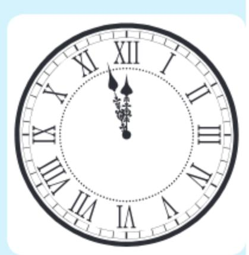

*[Hình ảnh: 02___page_2_Picture_6.jpeg]*

• Để biểu diễn các số từ 11 đến 20, ta thêm X vào bên trái mỗi số từ I đến X:

| ΧI | XII | XIII | XIV | XV | XVI | XVII | XVIII | XIX | XX |
|----|-----|------|-----|----|-----|------|-------|-----|----|
| 11 | 12  | 13   | 14  | 15 | 16  | 17   | 18    | 19  | 20 |

• Để biểu diễn các số từ 21 đến 30, ta thêm XX vào bên trái mỗi số từ I đến X:

| XXI | XXII | XXIII | XXIV | XXV | XXVI | XXVII | XXVIII | XXIX | XXX |
|-----|------|-------|------|-----|------|-------|--------|------|-----|
| 21  | 22   | 23    | 24   | 25  | 26   | 27    | 28     | 29   | 30  |

#### Nhận xét

- 1. Mỗi số La Mã biểu diễn một số tự nhiên bằng tổng giá trị của các thành phần viết nên số đó. Chẳng hạn, số XXIV có ba thành phần là X, X và IV tương ứng với các giá trị 10, 10 và 4. Do đó XXIV biểu diễn số 24.
- 2. Không có số La Mã nào biểu diễn số 0.

- a) Viết các số 14 và 27 bằng số La Mã.
  - b) Đọc các số La Mã XVI, XXII.

Sử dụng đúng 7 que tính, em xếp được những số La Mã nào?

</section>

<section name="Bài tập cuối bài">
# **BÀI TẬP**

- **1.6.** Cho các số: 27 501; 106 712; 7 110 385; 2 915 404 267 (viết trong hệ thập phân).
- a) Đọc mỗi số đã cho;
- b) Chữ số 7 trong mỗi số đã cho có giá trị là bao nhiêu?
- 1.7. Chữ số 4 đứng ở hàng nào trong một số tự nhiên nếu nó có giá trị bằng:
- a) 400;
- b) 40;
- c) 4.
- 1.8. Đọc các số La Mã: XIV; XVI; XXIII.
- 1.9. Viết các số sau bằng số La Mã: 18; 25.

- 1.10. Một số tự nhiên được viết bởi ba chữ số 0 và ba chữ số 9 nằm xen kẽ nhau. Đó là số nào?
- 1.11. Dùng các chữ số 0; 3 và 5, viết một số tự nhiên có ba chữ số khác nhau mà chữ số 5 có giá tri là 50.
- 1.12. Trong một cửa hàng bánh kẹo, người ta đóng gói kẹo thành các loại: mỗi gói có 10 cái kẹo; mỗi hộp có 10 gói; mỗi thùng có 10 hộp. Một người mua 9 thùng, 9 hộp và 9 gói kẹo. Hỏi người đó đã mua tất cả bao nhiều cái kẹo?

# EM CÓ BIÉT?

#### Hệ La Mã

Ngoài các chữ số I, V, X và cụm chữ số IV, IX hệ La Mã còn có các chữ số khác là L, C, D, M (tương ứng với 50, 100, 500 và 1 000) và các cụm chữ số XL, XC, CD, CM (tương ứng với 40, 90, 400 và 900). Các chữ số và cụm chữ số ấy là các thành phần dùng để ghi số La Mã theo các quy tắc sau:

- Trong một số La Mã, mỗi chữ số V, L và D có mặt không quá một lần; mỗi chữ số I, X, C và M không lặp lại quá ba lần liên tiếp.
- 2. Mỗi số La Mã là một dãy các thành phần. Giá trị của mỗi thành phần đều không nhỏ hơn giá trị của thành phần liền kề bên phải.
- 3. Mỗi số La Mã biểu diễn số tự nhiên bằng tổng giá trị của các thành phần viết nên số đó. Ví dụ, số MMXIX gồm bốn thành phần là M, M, X và IX tương ứng với các giá trị 1 000, 1 000, 10 và 9. Vậy số MMXIX biểu diễn số 1 000 + 1 000 + 10 + 9 = 2 019.

## Ghi số trong hệ nhị phân

Để ghi số trong *hệ nhị phân*, ta chỉ dùng hai chữ số là 0 và 1. Mỗi số tự nhiên được viết dưới dạng một dãy chữ số chỉ gồm 0 và 1. Chẳng hạn, trong hệ nhị phân, hai số 100 và 1 001 lần lượt biểu diễn số 4 và 9 trong hệ thập phân.

Hai chữ số 1 và 0 tương ứng với hai trạng thái "đóng" và "mở" của mạch điện. Do đó hệ nhị phân được sử dụng nhiều trong khoa học máy tính.

*[Hình ảnh: 02___page_3_Picture_22.jpeg]*

</section>

---

# BÀI HỌC 03: 03_Bài 3. Thứ tự trong tập hợp các số tự nhiên_(page 13_14)

[Video]: https://youtu.be/y1clwcvhBAU

# THỨ TỰ TRONG TẬP HỢP CÁC SỐ TỰ NHIÊN

### KHÁI NIỆM, THUẬT NGỮ

Điểm biểu diễn một số Hai số tự nhiên liên tiếp Số liền trước, số liền sau

### KIẾN THỨC, KĨ NĂNG

- Nhận biết thứ tự trong tập hợp các số tự nhiên.
- So sánh hai số tư nhiên.

Mỗi khi có trận bóng đá hay, người dân lại xếp hàng dài chờ mua vé. Nhìn dòng người xếp hàng một, rất dài, Hà tự hỏi: dòng người xếp hàng ấy và dãy số tự nhiên đang học có gì giống nhau nhỉ?

*[Hình ảnh: 03___page_0_Picture_8.jpeg]*

## 2C

<section name="Thứ tự của các số tự nhiên">
## Thứ tự của các số tự nhiên

Ta đã biết tập hợp tất cả các số tự nhiên được kí hiệu là  $\mathbb{N}$ , nghĩa là  $\mathbb{N}$  = {0; 1; 2; 3;...}. Mỗi phần tử 0; 1; 2; 3;... của  $\mathbb{N}$  được biểu diễn bởi một điểm trên tia số gốc O như Hình 1.5.

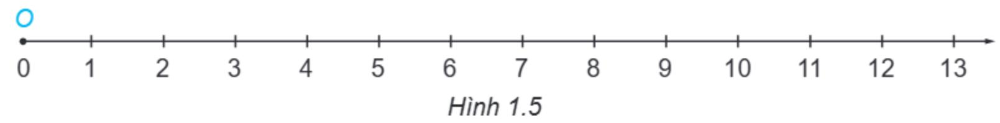

*[Hình ảnh: 03___page_0_Figure_12.jpeg]*

Trên tia số, điểm biểu diễn số tự nhiên a gọi là điểm a. Chẳng hạn, điểm 3, điểm 6,...

- HĐ1 Trong hai điểm 5 và 8 trên tia số, điểm nào nằm bên trái, điểm nào nằm bên phải điểm kia?
- HĐ2 Điểm biểu diễn số tự nhiên nào nằm ngay bên trái điểm 8? Điểm biểu diễn số tự nhiên nào nằm ngay bên phải điểm 8?
- HĐ3 Cho *n* là một số tự nhiên nhỏ hơn 7. Theo em, điểm *n* nằm bên trái hay bên phải điểm 7?

Tia số là hình ảnh trực quan giúp chúng ta tìm hiểu về thứ tự của các số tự nhiên.

- Trong hai số tự nhiên khác nhau, luôn có một số nhỏ hơn số kia. Nếu số a nhỏ hơn số b thì trên tia số nằm ngang điểm a nằm bên trái điểm b. Khi đó, ta viết a < b hoặc b > a. Ta còn nói: điểm a nằm trước điểm b, hoặc điểm b nằm sau điểm a.
- Mỗi số tự nhiên có đúng một số liền sau, chẳng hạn 9 là số liền sau của 8 (còn 8 là số liền trước của 9). Hai số 8 và 9 là hai số tự nhiên liên tiếp.
- Nếu a < b và b < c thì a < c (tính chất bắc cầu). Chẳng hạn a < 5 và 5 < 7 suy ra a < 7.

Chú ý. Số 0 không có số tự nhiên liền trước và là số tự nhiên nhỏ nhất.

Nhận xét. Trong tình huống ban đầu, ta có thể dùng số tự nhiên 1, 2, 3,... để đánh số thứ tự người xếp hàng: người thứ nhất, người thứ hai, người thứ ba,...

#### Luyện tập

a) Hãy so sánh hai số tự nhiên sau đây, dùng kí hiệu "<" hay ">" để viết kết quả:

 $m = 12\,036\,001$  và  $n = 12\,035\,987$ .

b) Trên tia số (nằm ngang), trong hai điểm m và n, điểm nào nằm trước?

Hãy so sánh từng cặp chữ số ở cùng một hàng kể từ trái sang phải.

#### Vận dụng

Theo dõi kết quả bán hàng trong ngày của một cửa hàng, người ta nhận thấy:

Số tiền thu được vào buổi sáng nhiều hơn vào buổi chiều;

Số tiền thu được vào buổi tối ít hơn vào buổi chiều.

Hãy so sánh số tiền thu được (đều là các số tự nhiên) của cửa hàng đó vào buổi sáng và buổi tối.

</section>

<section name="Các kí hiệu "≤" và "≥"">
## Các kí hiệu "≤" và "≥"

Ta còn dùng kí hiệu a ≤ b (đọc là "a nhỏ hơn hoặc bằng b") để nói "a < b hoặc a = b".</li>
Ví du:

 $\{x \in \mathbb{N} \mid x < 4\} = \{0; 1; 2; 3\},\$  $\{x \in \mathbb{N} \mid x \le 4\} = \{0; 1; 2; 3; 4\}.$ 

- Tương tự, kí hiệu a ≥ b (đọc là "a lớn hơn hoặc bằng b") có nghĩa là "a > b hoặc a = b".
- Tính chất bắc cầu còn có thể viết: nếu  $a \le b$  và  $b \le c$  thì  $a \le c$ .

Trong các số 3; 5; 8; 9, số nào thuộc tập hợp  $\mathbf{A} = \{x \in \mathbb{N} \mid x \ge 5\}$ , số nào thuộc tập hợp  $\mathbf{B} = \{x \in \mathbb{N} \mid x \le 5\}$ ?

</section>

<section name="Bài tập cuối bài">
## **BÀI TẬP**

- 1.13. Viết thêm các số liền trước và số liền sau của hai số 3 532 và 3 529 để được sáu số tự nhiên rồi sắp xếp sáu số đó theo thứ tự từ bé đến lớn.
- **1.14.** Cho ba số tự nhiên *a, b, c*, trong đó *a* là số nhỏ nhất. Biết rằng trên tia số, điểm *b* nằm giữa hai điểm *a* và *c*. Hãy dùng kí hiệu "<" để mô tả thứ tự của ba số *a, b* và *c*. Cho ví dụ bằng số cụ thể.
- 1.15. Liệt kê các phần tử của mỗi tập hợp sau:
- a)  $M = \{x \in \mathbb{N} \mid 10 \le x < 15\};$
- b)  $K = \{x \in \mathbb{N}^* \mid x \le 3\};$
- c)  $L = \{x \in \mathbb{N} \mid x \le 3\}.$

1.16. Ba bạn An, Bắc, Cường dựng cố định một cây sào thẳng đứng rồi đánh dấu chiều cao của các bạn lên đó bởi ba điểm. Cường đặt tên cho các điểm đó theo thứ tự từ dưới lên là A, B, C và giải thích rằng điểm A ứng với chiều cao của bạn An, B ứng với chiều cao của Bắc và C ứng với chiều cao của Cường. Biết rằng bạn An cao 150 cm, bạn Bắc cao 153 cm, bạn Cường cao 148 cm. Theo em, Cường giải thích như thế có đúng không? Nếu không thì phải sửa như thế nào cho đúng?

</section>

---

# BÀI HỌC 04: 04_Bài 4. Phép cộng và phép trừ số tự nhiên_(page 15_16)

[Video]: https://youtu.be/HLXw1jaDUog

# PHÉP CỘNG VÀ PHÉP TRỪ SỐ TỰ NHIÊN

### KHÁI NIỆM, THUẬT NGỮ

Phép cộng, số hạng, tổng Phép trừ, số bị trừ, số trừ, hiệu

Tính chất giao hoán, kết hợp của phép cộng

### KIẾN THỨC, KĨ NĂNG

- Thực hiện phép cộng và phép trừ số tự nhiên.
- Áp dụng tính chất giao hoán, kết hợp của phép cộng để tính nhẩm, tính hợp lí.
- Giải quyết một số vấn đề thực tiễn gắn với việc thực hiện phép cộng và phép trừ.

Mai đi chợ mua cà tím hết 18 nghìn đồng, cà chua hết 21 nghìn đồng và rau cải hết 30 nghìn đồng. Mai đưa cho cô bán hàng tờ 100 nghìn đồng thì được trả lại bao nhiêu tiền?

<section name="1. Phép cộng số tự nhiên">
## 1. PHÉP CỘNG SỐ TỰ NHIÊN

## Cộng hai số tự nhiên

- Phép cộng hai số tự nhiên a và b cho ta một số tự nhiên gọi là tổng của chúng, kí hiệu là a + b.
- Có thể minh hoạ phép cộng nhờ tia số, chẳng hạn phép cộng 3 + 4 = 7 được minh hoạ như hình bên (H.1.6).

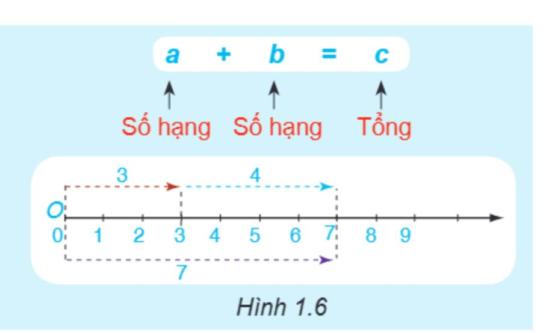

*[Hình ảnh: 04___page_0_Figure_15.jpeg]*

## Vận dụng 1

Diện tích gieo trồng lúa vụ Thu Đông năm 2019 vùng Đồng bằng sông Cửu Long ước tính đạt 713 200 ha, giảm 14 500 ha so với vụ Thu Đông năm 2018 (theo *Tổng cục Thống kê – nay là Cục Thống kê*, 10-2019).

Hãy tính diện tích gieo trồng lúa vụ Thu Đông năm 2018 của Đồng bằng sông Cửu Long.

## Tính chất của phép cộng

**HĐ1** Cho a = 28 và b = 34.

a) Tính a + b và b + a.

b) So sánh các kết quả nhận được ở câu a).

**HĐ2** Cho a = 17, b = 21, c = 35.

a) Tính (a + b) + c và a + (b + c). b) So sánh các kết quả nhận được ở câu a).

Phép cộng số tự nhiên có các tính chất:

Giao hoán: a + b = b + a.

Kết hợp: (a + b) + c = a + (b + c).

## Chú ý

- a + 0 = 0 + a = a.
- Tổng (a + b) + c hay a + (b + c) gọi là tổng của ba số a, b, c và viết gọn là a + b + c.

#### Ví du

Tính một cách hợp lí: 66 + 289 + 134 + 311.

#### Giải

Khi cộng nhiều số, ta nên nhóm những số hạng có tổng là số tròn chục, tròn trăm, ... (nêu có).

## Luyện tập 1

Tính một cách hợp lí: 117 + 68 + 23.

</section>

<section name="2. Phép trừ số tự nhiên">
## 2. PHÉP TRỪ SỐ TỰ NHIÊN

## Trừ hai số tự nhiên

 Với hai số tự nhiên a, b đã cho, nếu có số tự nhiên c sao cho a = b + c thì ta có phép trừ a - b = c.

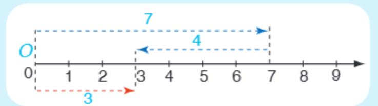

*[Hình ảnh: 04___page_1_Figure_13.jpeg]*

Hình 1.7

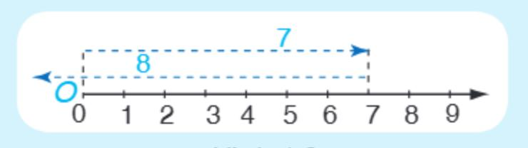

*[Hình ảnh: 04___page_1_Figure_15.jpeg]*

Luyện tập 2

Tính: 865 279 – 45 027.

## Vận dụng 2

Giải bài toán mở đầu.

Hình 1.8 Trong tập hợp N, phép trừ a - b chỉ thực hiện

được nếu *a* ≥ *b*.

</section>

<section name="Bài tập cuối bài">
# **BÀI TẬP**

**1.17.** Tính:

a) 63 548 + 19 256;

b) 129 107 – 34 693.

1.18. Thay "?" bằng số thích hợp:

? + 2895 = 2895 + 6789.

1.19. Tìm số tư nhiên x thoả mãn:

a) 7 + x = 362;

b) 25 - x = 15;

c) x - 56 = 4.

1.20. Dân số Việt Nam năm 2019 là 96 462 106 người. Năm 2020, dân số Việt Nam tăng 876 473 người so với năm 2019. Tính dân số Việt Nam năm 2020.

(Theo danso.org).

1.21. Nhà ga số 1 và nhà ga số 2 của một sân bay có thể tiếp nhận tương ứng khoảng 6 526 300 và 3 514 500 lượt hành khách mỗi năm. Nhờ đưa vào sử dụng nhà ga số 3 mà mỗi năm sân bay này có thể tiếp nhận được khoảng 22 851 200 lượt hành khách. Hãy tính số lượt hành khách mà nhà ga số 3 có thể tiếp nhận mỗi năm.

1.22. Tính một cách hợp lí:

a) 285 + 470 + 115 + 230;

b) 571 + 216 + 129 + 124.

</section>

---

# BÀI HỌC 05: 05_Bài 5. Phép nhân và phép chia số tự nhiên_(page 17_19)

[Video]: https://youtu.be/NXv7nHLI8FI

# PHÉP NHÂN VÀ PHÉP CHIA SỐ TỰ NHIÊN

#### KHÁI NIỆM, THUẬT NGỮ

Phép nhân, thừa số, tích

Tính chất giao hoán, kết hợp của phép nhân

Tính chất phân phối của phép nhân đối với phép cộng

Phép chia hết, phép chia có dư Số bị chia, số chia, thương, số dư

#### KIẾN THỨC, KĨ NĂNG

- Thực hiện phép nhân hai số tự nhiên.
- Thực hiện phép chia hai số tự nhiên (chia hết và chia có dư).
- Áp dụng tính chất của phép nhân và phép chia trong tính toán (tính nhẩm, tính hợp lí).
- Giải quyết được những vấn đề thực tiễn gắn với việc thực hiện phép nhân và phép chia số tự nhiên.

Mẹ em mua một túi 10 kg gạo ngon loại 20 nghìn đồng một kilôgam. Hỏi mẹ em phải đưa cho cô bán hàng bao nhiều tờ 50 nghìn đồng để trả tiền gạo?

<section name="1. Phép nhân số tự nhiên">
## 1. PHÉP NHÂN SỐ TỰ NHIÊN

### Nhân hai số tự nhiên

 Phép nhân hai số tự nhiên a và b cho ta một số tự nhiên gọi là tích của a và b, kí hiệu là a × b hoặc a · b:

$$a \cdot b = a + a + \dots + a$$
 (b số hạng).

Ví dụ: 
$$5 \cdot 4 = 5 + 5 + 5 + 5 = 20$$
.

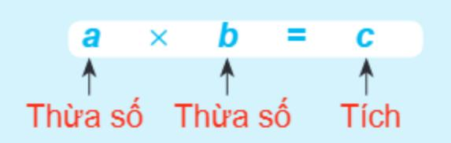

*[Hình ảnh: 05___page_0_Picture_19.jpeg]*

**Chú ý.** Nếu các thừa số đều bằng chữ, hoặc chỉ có một thừa số bằng số thì ta có thể không viết dấu nhân giữa các thừa số. Chẳng hạn,  $a \cdot b = ab$ ;  $2 \cdot m = 2m$ .

## Ví dụ 1

Đặt tính nhân: 738 · 48

$$\begin{array}{cccccccccccccccccccccccccccccccccccc$$

## Luyện tập 1

Tính: a) 834 · 57;

## Vận dụng 1

Giá tiền in một trang giấy khổ A4 là 350 đồng. Hỏi bác Thiệp phải trả bao nhiêu tiền nếu in một tập tài liệu khổ A4 dày 250 trang?

## Tính chất của phép nhân

**HĐ1** Cho a = 12 và b = 5.

Tính a · b, b · a và so sánh hai kết quả.

HĐ2 Tìm số tự nhiên c sao cho  $(3 \cdot 2) \cdot 5 = 3 \cdot (2 \cdot c)$ .

HĐ3 Tính và so sánh 3 · (2 + 5) và 3 · 2 + 3 · 5

Phép nhân có các tính chất:

Giao hoán: ab = ba. Kết hợp: (ab)c = a(bc).

Phân phối của phép nhân đối với phép cộng: a(b + c) = ab + ac.

#### Chú ý.

- $a \cdot 1 = 1 \cdot a = a$ ;  $a \cdot 0 = 0 \cdot a = 0$ ;
- Tích (ab)c hay a(bc) gọi là tích của ba số a, b, c và viết gọn là abc.

## Ví dụ 2

Tính nhẩm: 24 · 25.

**Giải.**  $24 \cdot 25 = (6 \cdot 4) \cdot 25 = 6 \cdot (4 \cdot 25) = 6 \cdot 100 = 600$ .

## Luyện tập 2

Tính nhẩm: 125 · 8 001 · 8.

Trong tính nhẩm ta thường sử dụng các kết quả sau:

 $2 \cdot 5 = 10;$   $4 \cdot 25 = 100;$  $8 \cdot 125 = 1000.$ 

## Vận dụng 2

Một trường học lên kế hoạch thay tất cả các bóng đèn sợi đốt bình thường bằng bóng đèn LED cho 32 phòng học, mỗi phòng 8 bóng. Nếu mỗi bóng đèn LED có giá 96 000 đồng thì nhà trường phải trả bao nhiêu tiền mua số bóng đèn LED để thay đủ cho tất cả các phòng học?

</section>

<section name="2. Phép chia hết và phép chia có dư">
## 2. PHÉP CHIA HẾT VÀ PHÉP CHIA CÓ DƯ

## 🎖 Chia hai số tự nhiên

HĐ4 Thực hiện các phép chia 196 : 7 và 215 : 18.

HĐ5 Trong hai phép chia trên, hãy chỉ ra phép chia hết và phép chia có dư. Trong mỗi trường hợp, hãy cho biết số bị chia, số chia, thương và số dư (nếu có).

Với hai số tự nhiên a và b đã cho (b khác 0), ta luôn tìm được đúng hai số tự nhiên q và r sao cho a = bq + r, trong đó  $0 \le r < b$ .

Nếu r = 0 thì ta có phép chia hết a : b = q; a là số bị chia, b là số chia, q là thương. Nếu  $r \neq 0$  thì ta có phép chia có dư a : b = q (dư r); a là số bị chia, b là số chia, q là thương và r là số dư.

#### Ví dy 3

Đặt tính rồi thực hiện các phép chia sau:

và

5 580 : 157.

Giải

Trong phép chia có dư, số dư bao giờ cũng nhỏ hơn số chia.

Vậy, 4 847 : 131 = 37.

Vậy, 5 580 : 157 = 35 (dư 85).

#### Luyện tập 3

Thực hiện các phép chia sau:

a) 945: 45;

b) 3 121:51.

#### Ví du 4

Phải dùng ít nhất bao nhiêu xe ô tô 45 chỗ ngồi để chở hết 487 cổ động viên của một đôi bóng?

#### Giải

Vì 487 : 45 = 10 (dư 37) nên xếp đủ 10 xe thì còn thừa 37 người và phải dùng thêm 1 xe nữa để chở nốt những người này.

Vậy, cần dùng ít nhất là 10 + 1 = 11 (xe).

## Vận dụng 3

Giải bài toán mở đầu.

</section>

<section name="Bài tập cuối bài">
# **BÀI TẬP**

1.23. Thực hiện các phép nhân sau:

- a) 951 · 23;
- b) 47 · 273;
- c) 845 · 253;
- d) 1 356 · 125.

**1.24.** Tính nhấm:

- a) 125 · 10;
- b) 2 021 · 100;
- c) 1 991 · 25 · 4; d) 3 025 · 125 · 8.

**1.25.** Tính nhẩm:

- a) 125 · 101. Hướng dẫn: viết 101 = 100 + 1.
- b) 21 · 49. Hướng dẫn: viết 49 = 50 − 1.
- 1.26. Một trường Trung học cơ sở có 50 phòng học, mỗi phòng có 11 bộ bàn ghế, mỗi bộ bàn ghế có thể xếp cho 4 học sinh ngồi. Trường có thể nhận nhiều nhất bao nhiêu học sinh?

1.27. Tìm thương và số dư (nếu có) của các phép chia sau:

- a) 1 092 : 91;
- b) 2 059:17.
- 1.28. Tổng điều tra dân số ngày 1-4-2019, tỉnh Bắc Giang (nay thuộc tỉnh Bắc Ninh) có 1803 950 người (theo Tổng cục Thống kê nay là Cục Thống kê). Biết rằng hai lần số dân tỉnh Bắc Giang kém số dân Thanh Hoá 32 228 người. Tính số dân tỉnh Thanh Hoá.
- 1.29. Một trường Trung học cơ sở có 997 học sinh tham dự lễ tổng kết cuối năm. Ban tổ chức đã chuẩn bị những chiếc ghế băng 5 chỗ ngồi. Phải có ít nhất bao nhiêu ghế băng như vậy để tất cả học sinh đều có chỗ ngồi?
- 1.30. Một nhà máy dùng ô tô chuyển 1 290 kiện hàng tới một cửa hàng. Nếu mỗi chuyến xe chở được 45 kiện thì phải cần ít nhất bao nhiêu chuyển xe để chuyển hết số kiện hàng trên?

</section>

---

# BÀI HỌC 06: 06_Luyện tập chung_(page 20_21)

[Video]: https://youtu.be/6akaMY5NJnQ

# LUYỆN TẬP CHUNG

## Ví du 1

Cho số n = 280 650.

- a) Tìm chữ số hàng nghìn và chữ số hàng trăm nghìn của n;
- b) Viết tập hợp **M** các chữ số của n;
- c) Chữ số 8 và chữ số 6 trong số n có giá trị bằng bao nhiêu?
- d) Hãy biểu diễn số n thành tổng giá trị các chữ số của nó.

#### Giải

- a) Chữ số hàng nghìn của n là 0; chữ số hàng trăm nghìn của n là 2.
- b)  $M = \{2; 8; 0; 6; 5\}.$
- c) Chữ số 8 nằm ở hàng chục nghìn nên có giá trị bằng 8 · 10 000 = 80 000; Chữ số 6 nằm ở hàng trăm nên có giá trị bằng 6 · 100 = 600.
- d) Ta có  $280\,650 = 2 \cdot 100\,000 + 8 \cdot 10\,000 + 0 \cdot 1\,000 + 6 \cdot 100 + 5 \cdot 10 + 0 \cdot 1$ , viết gọn là:  $280\,650 = 2 \cdot 100\,000 + 8 \cdot 10\,000 + 6 \cdot 100 + 5 \cdot 10$ .

## Ví dụ 2

Số khách du lịch quốc tế đến nước ta trong quý I và quý II của một năm lần lượt là 6 526 300 người và 3 514 500 người. Để hoàn thành kế hoạch cả năm đón 22 000 000 khách du lịch quốc tế, hai quý cuối năm đó ngành du lịch Việt Nam phải phần đấu có bao nhiều khách du lịch quốc tế đến thăm đất nước ta?

#### Giải

Trong hai quý đầu năm, số khách du lịch quốc tế đến Việt Nam là

Để đạt kế hoạch 22 000 000 du khách, số khách du lịch quốc tế đến Việt Nam trong hai quý cuối năm cần đạt là

22 000 000 - 10 040 800 = 11 959 200 (người).

# Ví dụ 3

Ánh sáng đi từ Mặt Trời đến Trái Đất hết khoảng 8 phút 19 giây, mỗi giây ánh sáng đi được khoảng 300 000 km (theo *vnexpress.net*). Hỏi Trái Đất cách Mặt Trời khoảng bao nhiêu kilômet?

#### Giải

1 phút = 60 giây; 8 phút = 60 giây  $\cdot$  8 = 480 (giây).

Thời gian ánh sáng đi từ Mặt Trời đến Trái Đất khoảng 480 + 19 = 499 (giây).

Mỗi giây ánh sáng đi được khoảng 300 000 km nên Mặt Trời cách Trái Đất khoảng:

499 · 300 000 = 149 700 000 (km).

<section name="Bài tập cuối bài">
# **BÀI TẬP**

- 1.31. Gọi A là tập hợp các số tự nhiên lớn hơn 3 và không lớn hơn 7.
- a) Viết tập hợp A bằng hai cách: Liệt kê các phần tử và nêu dấu hiệu đặc trưng cho các phần tử;
- b) Trong các số tự nhiên nhỏ hơn 10, những số nào **không phải** là phần tử của tập  $\boldsymbol{A}$ ?

### 1.32.

- a) Viết số tự nhiên nhỏ nhất có bốn chữ số;
- b) Viết số tự nhiên nhỏ nhất có bốn chữ số khác nhau;
- c) Viết số tự nhiên nhỏ nhất có bốn chữ số khác nhau và đều là số chẵn;
- d) Viết số tự nhiên nhỏ nhất có bốn chữ số khác nhau và đều là số lẻ.
- 1.33. Ta đã biết: Giá trị của mỗi chữ số của một số tự nhiên viết trong hệ thập phân phụ thuộc vào vị trí của nó. Chẳng hạn, chữ số 2 có giá trị bằng 2 nếu nó nằm ở hàng đơn vị, có giá trị bằng 20 nếu nó nằm ở hàng chục,... Tuy nhiên, có một chữ số mà giá trị của nó không thay đổi dù nó nằm ở bất kì vị trí nào, đó là chữ số nào?
- 1.34. Một xe ô tô chở 30 bao gạo và 40 bao ngô. Biết rằng mỗi bao gạo nặng 50 kg, mỗi bao ngô nặng 60 kg. Hỏi xe ô tô đó chở tất cả bao nhiêu kilôgam gạo và ngô?
- 1.35. Trong tháng 7 nhà ông Khánh dùng hết 115 số điện. Hỏi ông Khánh phải trả bao nhiêu tiền điện? Cho biết đơn giá điện như sau:

Giá tiền cho 50 số đầu tiên là 1 678 đồng/số;

Giá tiền cho 50 số tiếp theo (từ số 51 đến số 100) là 1 734 đồng/số;

Giá tiền cho 100 số tiếp theo (từ số 101 đến số 200) là 2 014 đồng/số.

</section>

---

# BÀI HỌC 07: 07_Bài 6. Lũy thừa với số mũ tự nhiên_(page 22_24)

[Video]: https://youtu.be/7Vq1S0Sy-9c

# LUÝ THÙA VỚI SỐ MỮ TỰ NHIÊN

#### KHÁI NIỆM, THUẬT NGỮ

Luỹ thừa

Cơ số; Số mũ

Bình phương; Lập phương

### KIẾN THỨC, KĨ NĂNG

- Thực hiện phép nâng lên luỹ thừa với số mũ tự nhiên.
- Nhân, chia hai luỹ thừa cùng cơ số với số mũ tự nhiên.
- Giải quyết được những vấn đề thực tiễn gắn với thực hiện phép tính luỹ thừa với số mũ tự nhiên.

Truyền thuyết Ấn Độ kể rằng, người phát minh ra bàn cờ vua đã chọn phần thưởng là số thóc rải trên 64 ô của bàn cờ vua như sau: ô thứ nhất để 1 hạt thóc, ô thứ hai để 2 hạt, ô thứ ba để 4 hạt, ô thứ tư để 8 hạt,... Cứ như thế, số hạt ở ô sau gấp đôi số hạt ở ô trước.

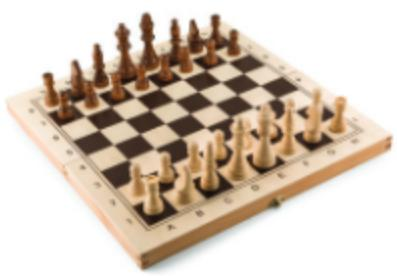

*[Hình ảnh: 07___page_0_Picture_11.jpeg]*

Liệu nhà vua có đủ thóc để thưởng cho nhà phát minh đó hay không?

Bàn cờ vua

<section name="1. Lũy thừa với số mũ tự nhiên">
### 1. LUÝ THÙA VỚI SỐ MŨ TỰ NHIÊN

### Phép nâng lên luỹ thừa

Bảng sau đây chỉ ra cách tính số hạt thóc ở một số ô trong bàn cờ trong bài toán mở đầu:

| Ô thứ | Phép tính tìm số hạt thóc | Số hạt thóc |
|-------|---------------------------|-------------|
| 1     | 1                         | 1           |
| 2     | 2                         | 2           |
| 3     | 2 · 2                     | 4           |
| 4     | 2 · 2 · 2                 | 8           |
| 5     | 2 · 2 · 2 · 2             | 16          |
|       |                           |             |

HĐ1 Để tìm số hạt thóc ở ô thứ 8, ta phải thực hiện phép nhân có bao nhiêu thừa số 2?

Luỹ thừa bậc *n* của số tự nhiên *a* là tích của *n* thừa số bằng nhau mỗi thừa số bằng *a*:

$$\mathbf{a}^n = \underbrace{\mathbf{a} \cdot \mathbf{a} \cdot \dots \cdot \mathbf{a}}_{\mathbf{n} \text{ the line of } \hat{\mathbf{a}}} \quad (n \in \mathbb{N}^*)$$

 $a^n$  đọc là "a mũ n" hoặc "a luỹ thừa n", a là cơ số, n là số mũ.

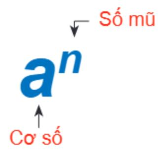

*[Hình ảnh: 07___page_0_Picture_23.jpeg]*

Phép nhân nhiều thừa số bằng nhau gọi là phép nâng lên luỹ thừa.

Chú ý. Ta có  $a^1 = a$ .

a² cũng được gọi là a bình phương (hay bình phương của a);
a³ cũng được gọi là a lập phương (hay lập phương của a).

### Ví dy 1

- a) Viết biểu thức  $3 \cdot 3 \cdot 3 \cdot 3 \cdot 3$  dưới dạng luỹ thừa. Hãy chỉ ra cơ số và số mũ của luỹ thừa đó.
- b) Tính 112.

#### Giải

- a)  $3 \cdot 3 \cdot 3 \cdot 3 \cdot 3 = 3^5$ , cơ số là 3, số mũ là 5.
- b)  $11^2 = 11 \cdot 11 = 121$ .

### Luyện tập 1

Hoàn thành bảng bình phương của các số tự nhiên từ 1 đến 10.

| а              | 1 | 2 | 3 | 4 | 5 | 6 | 7 | 8 | 9 | 10 |
|----------------|---|---|---|---|---|---|---|---|---|----|
| a 2 | ? | ? | ? | ? | ? | ? | ? | ? | ? | ?  |

### Vận dụng

- Tính số hạt thóc có trong ô thứ 7 của bàn cờ nói trong bài toán mở đầu.
- ② Hãy viết mỗi số tự nhiên sau thành tổng giá trị các chữ số của nó bằng cách dùng các luỹ thừa của 10 theo mẫu:

$$4257 = 4 \cdot 10^3 + 2 \cdot 10^2 + 5 \cdot 10 + 7$$
.

a) 23 197;

b) 203 184.

</section>

<section name="2. Nhân và chia hai lũy thừa cùng cơ số">
### 2. NHÂN VÀ CHIA HAI LUÝ THỪA CÙNG CƠ SỐ

## Nhân hai luỹ thừa cùng cơ số

HĐ2 a) Viết kết quả phép nhân sau dưới dạng một luỹ thừa của 7:

$$7^2 \cdot 7^3 = (7 \cdot 7) \cdot (7 \cdot 7 \cdot 7) = ?$$

b) Nêu nhận xét về mối liên hệ giữa các số mũ của 7 trong hai thừa số và trong tích tìm được ở câu a).

Khi nhân hai luỹ thừa cùng cơ số, ta giữ nguyên cơ số và cộng các số mũ:

$$a^m \cdot a^n = a^{m+n}$$

### Ví dụ 2

$$5^6 \cdot 5^3 = 5^{6+3} = 5^9$$
;  $10^5 \cdot 10^4 \cdot 10^2 = 10^{5+4+2} = 10^{11}$ .

### Luyện tập 2

Viết kết quả phép tính dưới dạng một luỹ thừa:

- a)  $5^3 \cdot 5^7$ ;
- b)  $2^4 \cdot 2^5 \cdot 2^9$ ;
- c)  $10^2 \cdot 10^4 \cdot 10^6 \cdot 10^8$ .

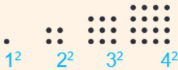

*[Hình ảnh: 07___page_1_Picture_32.jpeg]*

Người ta đã tính được rằng tổng số thóc cần rải trên bàn cờ là 264 – 1 hạt thóc và toàn bộ khối lượng thóc này nặng tới 369 tỉ tấn. Một con số khổng lồ!

Ta có:  $100 = 10^2$   $1000 = 10^3$  $10000 = 10^4$ ,

### Chia hai luỹ thừa cùng cơ số

**HĐ3** a) Giải thích vì sao có thể viết  $6^5 = 6^3 \cdot 6^2$ .

- b) Sử dụng câu a) để suy ra 65 : 63 = 62. Nêu nhận xét về mối liên hệ giữa các số mũ của 6 trong số bị chia, số chia và thương.
- c) Viết thương của phép chia 107 : 104 dưới dạng luỹ thừa của 10.

Khi *chia* hai luỹ thừa cùng cơ số (khác 0), ta giữ nguyên cơ số và lấy số mũ của số bị chia trừ số mũ của số chia.

$$a^{m}: a^{n} = a^{m-n}$$
 (với  $a \neq 0, m \geq n$ ).

**Chú ý.** Người ta quy ước  $a^0 = 1$  (với  $a \neq 0$ ).

#### Ví dy 3

$$2^6: 2^3 = 2^{6-3} = 2^3$$
;

$$10^7: 10^4 = 10^{7-4} = 10^3.$$

### Luyên tập 3

Viết kết quả các phép tính dưới dạng một luỹ thừa:

</section>

<section name="Bài tập cuối bài">
## **BÀI TÂP**

**1.36.** Viết các tích sau dưới dạng một luỹ thừa:

a)  $9 \cdot 9 \cdot 9 \cdot 9 \cdot 9$ ; b)  $10 \cdot 10 \cdot 10 \cdot 10$ .

c)  $5 \cdot 5 \cdot 5 \cdot 25$ ; d)  $a \cdot a \cdot a \cdot a \cdot a \cdot a$ .

1.37. Hoàn thành bảng sau vào vở:

| Luỹ thừa | Cơ số | Số mũ | Giá trị của luỹ thừa |
|----------|-------|-------|----------------------|
| 43       | ?     | ?     | ?                    |
| ?        | 3     | 5     | ?                    |
| ?        | 2     | ?     | 128                  |

**1.38.** Tính: a) 25;

b)  $3^3$ ; c)  $5^2$ ; d)  $10^9$ .

1.39. Viết các số sau thành tổng giá trị các chữ số của nó bằng cách dùng các luỹ thừa của 10: 215; 902; 2 020; 883 001.

**1.40.** Tính 112, 1112. Từ đó hãy dự đoán kết quả của 1 1112.

**1.41.** Biết  $2^{10} = 1024$ . Hãy tính  $2^9$  và  $2^{11}$ .

**1.42.** Tính: a)  $5^7 \cdot 5^3$ ; b)  $5^8 : 5^4$ .

**1.43.** Ta có:  $1 + 3 + 5 = 9 = 3^2$ .

Viết các tổng sau dưới dạng bình phương của một số tự nhiên:

a) 1+3+5+7; b) 1+3+5+7+9.

1.44. Trái Đất có khối lượng khoảng 60 · 1020 tấn. Mỗi giây Mặt Trời tiêu thụ 6 · 106 tấn khí hydrogen (theo vnexpress.net). Hỏi Mặt Trời cần bao nhiêu giây để tiêu thụ một lượng khí hydrogen có khối lượng bằng khối lượng Trái Đất?

1.45. Theo các nhà khoa học, mỗi giây cơ thể con người trung bình tạo ra khoảng 25 · 105 tế bào hồng cầu (theo www.healthline.com). Hãy tính xem mỗi giờ, bao nhiêu tế bào hồng cầu được tạo ra.

### EM CÓ BIÉT?

Trong âm nhạc, người ta ghi các bản nhạc bằng cách dùng các nốt nhạc. Quan hệ về trường độ của chúng như sau:

1 tròn =  $2^1$  trắng =  $2^2$  đen =  $2^3$  móc đơn =  $2^4$  móc kép.

1 trắng =  $2^1$ đen =  $2^2$  móc đơn =  $2^3$  móc kép =  $2^4$  móc ba.

(Theo Sự kì diệu của Toán học, Theoni Pappas, NXB Dân Trí, 2014)

</section>

---

# BÀI HỌC 08: 08_Bài 7. Thứ tự thực hiện các phép tính_(page 25_26)

[Video]: https://youtu.be/lki5jqY5mPI

# THỨ TỰ THỰC HIỆN CÁC PHÉP TÍNH

### KHÁI NIỆM, THUẬT NGỮ

Biểu thức

Giá trị của một biểu thức

#### KIẾN THỨC, KĨ NĂNG

- Nhận biết thứ tự thực hiện các phép tính.
- Tính giá trị của một biểu thức.

## 5 + 3 x 2 bằng mấy?

Bằng 16, mình cộng trước, nhân sau.

Bằng 11, mình nhân trước, cộng sau.

Để tránh tình trạng trên, ta cần có quy ước thống nhất về thứ tự thực hiện các phép tính.

<section name="Thứ tự thực hiện các phép tính trong một biểu thức">
## Thứ tự thực hiện các phép tính trong một biểu thức

- Đối với các biểu thức không có dấu ngoặc:
- Nếu chỉ có phép cộng và phép trừ (hoặc chỉ có phép nhân và phép chia) thì thực hiện các phép tính từ trái qua phải, chẳng hạn:

$$42 - 30 + 8 = 20$$
;  $100 : 5 \cdot 2 = 20 \cdot 2 = 40$ .

 Nếu có các phép tính cộng, trừ, nhân, chia, nâng lên luỹ thừa thì ta thực hiện phép nâng lên luỹ thừa trước, rồi đến nhân và chia, cuối cùng đến cộng và trừ. Chẳng hạn:

$$1 + 2 \cdot 3^2 = 1 + 2 \cdot 9 = 1 + 18 = 19$$
.

- Đối với biểu thức có dấu ngoặc:
- Nếu chỉ có một dấu ngoặc thì ta thực hiện phép tính trong dấu ngoặc trước. Chẳng hạn:

$$(10 + 5) : 5 = 15 : 5 = 3.$$

Nếu có các dấu ngoặc tròn (), dấu ngoặc vuông [], dấu ngoặc nhọn {} thì ta thực hiện các phép tính trong dấu ngoặc tròn trước, rồi thực hiện các phép tính trong các dấu ngoặc vuông, cuối cùng thực hiện các phép tính trong dấu ngoặc nhọn. Chẳng hạn:

$$\{15 + 2 \cdot [8 - (5 - 3)]\} : 9 = \{15 + 2 \cdot [8 - 2]\} : 9$$
  
=  $\{15 + 2 \cdot 6\} : 9$   
=  $\{15 + 12\} : 9$   
=  $27 : 9 = 3$ .

- Với các biểu thức không có dấu ngoặc: Luỹ thừa → Nhân và chia → Cộng và trừ.
- Với các biểu thức có dấu ngoặc: trong ngoặc trước, ngoài ngoặc sau

$$(\quad) \to [\quad] \to \{\quad\}.$$

🕜 Trong tình huống mở đầu, bạn nào làm đúng theo quy ước trên?

#### Ví du

Tính giá trị của các biểu thức sau:

a) 
$$8 + 36 : 3 \cdot 2$$
; b)  $[1 + 2 \cdot (5 \cdot 3 - 2^3)] \cdot 7$ .

Giải

a) 
$$8 + 36 \cdot 3 \cdot 2 = 8 + 12 \cdot 2 = 8$$

a) 
$$8 + 36 : 3 \cdot 2 = 8 + 12 \cdot 2 = 8 + 24 = 32$$
.

b) 
$$[1 + 2 \cdot (5 \cdot 3 - 2^3)]$$

b) 
$$[1+2\cdot(5\cdot3-2^3)]\cdot7=[1+2\cdot(5\cdot3-8)]\cdot7$$
  $\leftarrow$  Thực hiện trong ngoặc trước;

$$= [1 + 2 \cdot (15 - 8)] \cdot 7 = [1 + 2 \cdot 7] \cdot 7$$

$$= [1 + 14] \cdot 7 = 15 \cdot 7 = 105.$$

## Luyện tập 1

Tính giá trị của các biểu thức sau:

a) 
$$25 \cdot 2^3 - 3^2 + 125$$
;

a) 
$$25 \cdot 2^3 - 3^2 + 125$$
; b)  $2 \cdot 3^2 + 5 \cdot (2 + 3)$ .

### Vận dụng

Một người đi xe đạp trong 5 giờ. Trong 3 giờ đầu, người đó đi với vận tốc 14 km/h; 2 giờ sau, người đó đi với vận tốc 9 km/h.

- a) Tính quãng đường người đó đi được trong 3 giờ đầu; trong 2 giờ sau.
- b) Tính quãng đường người đó đi được trong 5 giờ.

Chú ý. Trong một biểu thức có thể có chứa chữ. Để tính giá trị của biểu thức đó khi cho giá trị của các chữ, ta thay thế giá trị đã cho vào biểu thức rồi tính giá trị của biểu thức nhận được.

## Luyên tập 2

- a) Lập biểu thức tính diện tích của hình chữ nhật ABCD (hình bên).
- b) Tính diện tích của hình chữ nhật đó khi a = 3 cm.

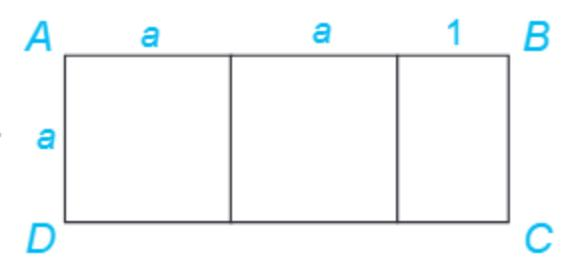

*[Hình ảnh: 08___page_1_Figure_25.jpeg]*

</section>

<section name="Bài tập cuối bài">
## **BÀI TẬP**

#### **1.46.** Tính:

a) 
$$235 + 78 - 142$$
;

b) 
$$14 + 2 \cdot 8^2$$
;

c) 
$$\{2^3 + [1 + (3-1)^2]\}$$
: 13.

**1.47.** Tính giá trị của biểu thức:

$$1 + 2(a + b) - 4^3$$
 khi  $a = 25$ ;  $b = 9$ .

1.48. Trong 8 tháng đầu năm, một cửa hàng bán được 1 264 chiếc ti vi. Trong 4 tháng cuối năm, trung bình mỗi tháng cửa hàng bán được 164 chiếc ti vi. Hỏi trong cả năm, trung bình mỗi tháng cửa hàng đó bán được bao nhiêu chiếc ti vi? Viết biểu thức tính kết quả.

1.49. Căn hộ nhà bác Cường diện tích 105 m². Ngoại trừ bếp và nhà vệ sinh diện tích 30 m², toàn bộ diện tích sàn còn lại được lát gỗ như sau: 18 m² được lát bằng gỗ loại 1 giá 350 nghìn đồng/m²; phần còn lại dùng gỗ loại 2 có giá 170 nghìn đồng/m2. Công lát là 30 nghìn đồng/m2.

Viết biểu thức tính tổng chi phí bác Cường cần trả để lát sàn căn hộ như trên. Tính giá tri của biểu thức đó.

</section>

---

# BÀI HỌC 09: 09_Luyện tập chung_(page 27_27)

[Video]: https://youtu.be/KImvVbfc69Y

## LUYỆN TẬP CHUNG

## Ví dy 1

Tính giá trị của biểu thức  $120 + [55 - (11 - 3 \cdot 2)^2] + 2^3$ .

### Giải

$$120 + [55 - (11 - 3 \cdot 2)^{2}] + 2^{3}$$

$$= 120 + [55 - (11 - 6)^{2}] + 2^{3}$$

$$= 120 + [55 - 5^{2}] + 2^{3}$$

$$= 120 + [55 - 25] + 2^{3}$$

$$= 120 + 30 + 2^{3}$$

$$= 150 + 8$$

$$= 158.$$

← Trong ngoặc (): nhân → trừ

← Trong ngoặc []: luỹ thừa → trừ

Vậy biểu thức có giá trị bằng 158.

## Ví dy 2

Hình khối bên được ghép bằng những khối lập phương cạnh 3 cm.

- a) Lập biểu thức tính số khối lập phương tạo thành hình khối.
- b) Tính thể tích của hình khối.

### Giải

Cách 2: Tính từ phía trước về phía sau, hình khối được tạo thành bởi 7 lớp khối lập phương. Lớp đầu tiên có 4 khối. Số khối của lớp thứ hai bằng hai lần số khối lớp thứ nhất và bằng 2 · 4. Lớp thứ ba có 3 · 4 khối. Bốn lớp sau cùng, mỗi lớp có 4 · 4 khối.

Tổng số khối là  $4 + 2 \cdot 4 + 3 \cdot 4 + 4 \cdot 4 \cdot 4$  (khối).

b) Mỗi khối lập phương có thể tích 3³ (cm³). Hình khối đã cho có thể tích bằng

$$(4 \cdot 4 + 4 \cdot 5 + 4 \cdot 6 + 4 \cdot 7) \cdot 3^3 = 4 \cdot (4 + 5 + 6 + 7) \cdot 27 = 4 \cdot 22 \cdot 27 = 2376 \text{ (cm}^3).$$

<section name="Bài tập cuối bài">
# **BÀI TẬP**

## 1.50. Tính giá trị của biểu thức:

b) 
$$2 \cdot 3^2 + 24 : 6 \cdot 2$$
;

c) 
$$2 \cdot 3^2 - 24 : (6 \cdot 2)$$
.

1.51. Viết kết quả phép tính dưới dạng một luỹ thừa:

c) 
$$8^3 \cdot 8^2$$
; d)  $5^4 \cdot 5^3 : 5^2$ .

1.52. Viết biểu thức tính diện tích toàn phần của hình hộp chữ nhật (hình dưới) theo a, b, c. Tính giá trị biểu thức đó khi a = 5 cm; b = 4 cm; c = 3 cm.

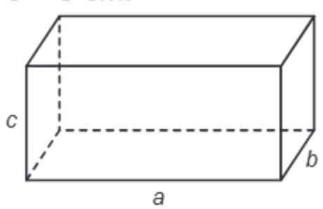

*[Hình ảnh: 09___page_0_Picture_29.jpeg]*

#### **1.53.** Tính:

a) 
$$110 - 7^2 + 22 : 2$$
; b)  $9 \cdot (8^2 - 15)$ ;

c) 
$$5 \cdot 8 - (17 + 8) : 5$$
; d)  $75 : 3 + 6 \cdot 9^2$ .

</section>

---

# BÀI HỌC 10: 10_Bài tập cuối chương I_(page 28_28)

[Video]: https://youtu.be/owjM9oMuXH4

<section name="Bài tập cuối bài">
## BÀI TẬP CUỐI CHƯƠNG I

- 1.54. Viết số tự nhiên a sau đây: Mười lăm tỉ hai trăm sáu mươi bảy triệu không trăm hai mươi mốt nghìn chín trăm linh tám.
- a) Số a có bao nhiều chữ số? Viết tập hợp các chữ số của a;
- b) Chữ số hàng triệu là chữ số nào?
- c) Trong a có hai chữ số 1 nằm ở những hàng nào? Mỗi chữ số ấy có giá trị bằng bao nhiêu?

## 1.55.

- a) Số 2 020 là số liền sau của số nào, là số liền trước của số nào?
- b) Cho số tự nhiên a khác 0. Số liền trước của a là số nào? Số liền sau của a là số nào?
- c) Trong các số tự nhiên, số nào *không có* số liền sau? Số nào *không có* số liền trước?
- 1.56. Tìm tích, thương và số dư (nếu có):
- a) 21 759 · 1 862;
- b) 3 789: 231;
- c) 9 848 : 345.
- 1.57. Tính giá trị của biểu thức:

$$21 \cdot [(1\ 245 + 987) : 2^3 - 15 \cdot 12] + 21.$$

- 1.58. Khối 6 có 320 học sinh đi tham quan. Nhà trường cần thuê ít nhất bao nhiêu xe ô tô 45 chỗ ngồi để đủ chỗ cho tất cả học sinh?
- 1.59. Một phòng chiếu phim có 18 hàng ghế, mỗi hàng có 18 ghế. Giá một vé xem phim là 50 000 đồng.
- a) Tối thứ Bảy, tất cả các vé đều được bán hết. Số tiền bán vé thu được là bao nhiêu?
- b) Tối Chủ nhật còn 41 vé không bán được. Hỏi số tiền bán vé thu được là bao nhiêu?
- c) Tối thứ Hai, số tiền bán vé thu được là 10 550 000 đồng. Hỏi có bao nhiêu vé không bán được?

</section>

---

# BÀI HỌC 11: 11_Bài 8. Quan hệ chia hết và tính chất_(page 29_33)

[Video]: https://youtu.be/ItJDjChVYuI

Hình vẽ trên mô tả quá trình mã hoá một văn bản. Việc mã hoá được dùng trong điện thoại di động, thẻ tín dụng, máy tính,... Một trong những khái niệm toán học được dùng nhiều để mã hoá thông tin là số nguyên tố mà chúng ta sẽ tìm hiểu trong chương này. Ngoài ra, chương này còn giúp các em bước đầu tìm hiểu về hợp số, ước chung và bội chung là những khái niệm quan trọng của số học.

Ewrdk,;k ;osdfp

ojklnva86t87t9s

dgxdzvbxzgdgd

Mã hoá

you today

at 4.00 pm

# QUAN HỆ CHIA HẾT VÀ TÍNH CHẤT

### KHÁI NIỆM, THUẬT NGỮ

Chia hết

Ướс

Bội

### KIẾN THỨC, KĨ NĂNG

Nhận biết quan hệ chia hết, khái niệm ước và bội.

Giải mã

- Tìm các ước và bội của một số tự nhiên.
- Nhận biết tính chia hết của một tổng cho một số.

Trong đợt tổng kết học kì I, lớp 6A được Hội cha mẹ học sinh thưởng 50 cái bút. Trường lại thưởng thêm cho lớp 4 hộp bút nữa (số bút trong mỗi hộp là như nhau). Các bạn đề nghị chia đều phần thưởng cho 4 tổ. Nếu không biết số bút trong mỗi hộp, ta có thể chia đều số bút đó cho 4 tổ được không?

you today

at 4.00 p.m

<section name="1. Quan hệ chia hết">
# 1. QUAN HỆ CHIA HẾT

### Khi nào thì a chia hết cho b?

Trong hai số 15 và 16, số nào chia hết cho 3, số nào không chia hết cho 3?

Số 15 chia hết cho 3 vì 15:3 = 5 và không còn dư. Số 16 không chia hết cho 3 vì 16 chia 3 bằng 5 dư 1.

Cho hai số tự nhiên a và b ( $b \neq 0$ ).

Nếu có số tự nhiên k sao cho a = kb thì ta nói a chia hết cho b và kí hiệu là  $a \notin b$ . Nếu a không chia hết cho b ta kí hiệu là a ½ b.

Ví dụ: 15:3; 16 / 3.

Tìm kí hiệu thích hợp (:, ٪) thay cho dấu "?":

24 ? 6 45 ? 10 35 ? 5 42 ? 4.

### Ví dy 1

Nhân dịp sinh nhật, mẹ cho Việt 12 gói kẹo để liên hoan với các bạn, mỗi gói có 35 chiếc. Biết lớp Việt có 5 tổ, hỏi Việt có thể chia đều số kẹo cho các tổ không?

#### Giải

Việt có số kẹo là 12 · 35. Vì 35 : 5 nên (12 · 35) : 5, do đó Việt có thể chia đều số kẹo cho mỗi tổ.

Trong một tích, nếu có một thừa số chia hết cho một số thì tích chia hết cho số đó.

## Ước và bôi

*[Hình ảnh: 11___page_1_Picture_21.jpeg]*

Nếu a chia hết cho b, ta nói b là ước của a và a là bội của b.

Ta kí hiệu U(a) là tập hợp các ước của a và B(b) là tập hợp các bội của b.

Bạn Vuông hay Tròn đúng nhỉ?

5 là ước của 15

6 là ước của 15

# Cách tìm ước và bội

- HĐ1 Lần lượt chia 12 cho các số từ 1 đến 12, em hãy viết tập hợp tất cả các ước của 12.
- HĐ2 Bằng cách nhân 8 với 0; 1; 2;... em hãy viết các bội của 8 nhỏ hơn 80.
  - Muốn tìm các ước của a (a > 1), ta lần lượt chia a cho các số tự nhiên từ 1 đến a để xem a chia hết cho những số nào thì các số đó là ước của a.
  - Ta có thể tìm các bội của một số khác 0 bằng cách nhân số đó lần lượt với 0; 1; 2; 3; ...

### Ví dy 2

- a) Lần lượt chia 15 cho các số từ 1 đến 15, ta thấy 15 chia hết cho 1; 3; 5; 15 nên Ư(15) = {1; 3; 5; 15}.
- b) Lần lượt nhân 6 với 0; 1; 2; 3; 4; 5; 6,... ta được các bội của 6 là: 0; 6; 12; 18; 24; 30; 36;... Các bội của 6 nhỏ hơn 30 là: 0; 6; 12; 18; 24.

### Luyện tập 1

- a) Hãy tìm tất cả các ước của 20;
- b) Hãy tìm tất cả các bội nhỏ hơn 50 của 4.

Hãy tìm ba ước khác nhau của 12 sao cho tổng của chúng bằng 12.

</section>

<section name="2. Tính chất chia hết của một tổng">
## 2. TÍNH CHẤT CHIA HẾT CỦA MỘT TỔNG

# Trường hợp chia hết

- HĐ3 Viết hai số chia hết cho 5. Tổng của chúng có chia hết cho 5 không?
- HĐ4 Viết ba số chia hết cho 7. Tổng của chúng có chia hết cho 7 không?

#### Tính chất 1

Nếu tất cả các số hạng của một tổng đều chia hết cho cùng một số thì tổng chia hết cho số đó.

- Nếu a: m và b: m thì (a + b): m.
- Nếu a:m, b:m và c:m thì (a + b + c):m.

Chú ý. Tính chất 1 cũng đúng với một hiệu, chẳng hạn 30 : 3 và 18 : 3, suy ra (30 – 18) : 3.

#### Ví dy 3

Không thực hiện phép tính, hãy cho biết 6 + 15 + 30 có chia hết cho 3 không. Vì sao? **Giải** 

Vì 6:3, 15:3 và 30:3 nên (6 + 15 + 30):3.

#### Luyện tập 2

Không thực hiện phép tính, hãy cho biết:

- a) 24 + 48 có chia hết cho 4 không. Vì sao?
- b) 48 + 12 36 có chia hết cho 6 không. Vì sao?

#### Vận dụng 1

Hãy tìm x thuộc tập {1; 14; 16; 22; 28}, biết tổng 21 + x chia hết cho 7.

## Trường hợp không chia hết

- HĐ5 Hãy viết hai số, trong đó một số chia hết cho 5 và số còn lại không chia hết cho 5. Tổng của chúng có chia hết cho 5 không?
- HĐ6 Hãy viết ba số, trong đó hai số chia hết cho 4 và số còn lại không chia hết cho 4. Tổng của chúng có chia hết cho 4 không?

#### Tính chất 2

Nếu có một số hạng của một tổng không chia hết cho một số đã cho, các số hạng còn lại đều chia hết cho số đó thì tổng không chia hết cho số đã cho.

- Nếu a: m và b ½ m thì (a + b) ½ m.
- Nếu a: m, b: m và c // m thì (a + b + c) // m.

Chú ý. Tính chất 2 cũng đúng với một hiệu, chẳng hạn:

45:5 và 7 ½ 5, suy ra (45 – 7) ½ 5; 15 ½ 4 và 8:4, suy ra (15 – 8) ½ 4.

### Ví dy 4

Không thực hiện phép tính, hãy cho biết 5 + 45 + 2 019 có chia hết cho 5 không. Vì sao?

#### Giải

Vì 5:5, 45:5 và 2 019 % 5 nên (5 + 45 + 2 019) % 5.

## Ví dụ 5

Trở lại tình huống mở đầu, vì số bút trong các hộp bút bằng nhau nên tổng số bút trong 4 hộp là một số chia hết cho 4. Vì 50 không chia hết cho 4 nên tổng số bút lớp 6A được thưởng không chia đều được cho 4 tổ.

*[Hình ảnh: 11___page_3_Picture_25.jpeg]*

### Luyện tập 3

Không thực hiện phép tính, hãy cho biết:

- a) 20 + 81 có chia hết cho 5 không. Vì sao?
- b) 34 + 28 12 có chia hết cho 4 không. Vì sao?

### Vận dụng 2

Tìm x thuộc tập  $\{5; 25; 39; 54\}$  sao cho tổng 20 + 45 + x không chia hết cho 5.

#### Tranh luận

Hai số không chia hết cho 4 thì tổng của chúng cũng không chia hết cho 4.

### Còn bạn thì sao?

</section>

<section name="Bài tập cuối bài">
# **BÀI TẬP**

- 2.1. Hãy tìm các ước của mỗi số sau: 30; 35; 17.
- 2.2. Trong các số sau, số nào là bội của 4? 16; 24; 35.
- 2.3. Tìm các số tự nhiên x, y sao cho:
- a)  $x \in B(7)$  và x < 70;
- b)  $y \in U'(50)$  và y > 5.
- 2.4. Không thực hiện phép tính, hãy cho biết tổng nào sau đây chia hết cho 5:
- a) 15 + 1 975 + 2 019;
- b) 20 + 90 + 2 025 + 2 050.
- 2.5. Không thực hiện phép tính, hãy cho biết hiệu nào sau đây chia hết cho 8:
- a) 100 40;
- b) 80 16.
- 2.6. Khẳng định nào sau đây là đúng?
- a) 219 · 7 + 8 chia hết cho 7;
- b) 8 · 12 + 9 chia hết cho 3.

2.7. Cô giáo muốn chia đều 40 học sinh thành các nhóm để thực hiện các dự án học tập. Hoàn thành bảng sau vào vở (bỏ trống trong trường hợp không chia được).

| Số nhóm | Số người ở một nhóm |
|---------|---------------------|
| 4       | ?                   |
| ?       | 8                   |
| 6       | ?                   |
| 8       | ?                   |
| ?       | 4                   |

2.8. Đội thể thao của trường có 45 vận động viên. Huấn luyện viên muốn chia thành các nhóm để tập luyện sao cho mỗi nhóm có ít nhất 2 người và không quá 10 người. Biết rằng các nhóm có số người như nhau, em hãy giúp huấn luyện viên chia nhé.

#### 2.9.

- a) Tìm *x* thuộc tập {23; 24; 25; 26}, biết 56 *x* chia hết cho 8;
- b) Tìm *x* thuộc tập {22; 24; 45; 48}, biết 60 + *x* không chia hết cho 6.

</section>

---

# BÀI HỌC 12: 12_Bài 9. Dấu hiệu chia hết_(page 34_37)

[Video]: https://youtu.be/SpTe8bwh7Ys

# DẤU HIỆU CHIA HẾT

#### KIẾN THỨC, KĨ NĂNG

Vận dụng được dấu hiệu chia hết cho 2; 5; 9; 3 để xác định một số đã cho có chia hết cho 2; 5; 9; 3 hay không.

Tìm số dư của phép chia 71 001 cho 9.

Phép chia này không có dư vì 71 001 chia hết cho 9.

Sao bạn Tròn trả lời nhanh vậy nhỉ?

<section name="1. Dấu hiệu chia hết cho 2, cho 5">
## 1. DẤU HIỆU CHIA HẾT CHO 2, CHO 5

Ta có:

 $120 = 12 \cdot 10 = 12 \cdot 2 \cdot 5$  chia hết cho 2 và cho 5;

2 010 = 201 · 10 = 201 · 2 · 5 chia hết cho 2 và cho 5.

Ta nhận thấy các số 120 và 2 010 có chữ số tận cùng là 0 đều chia hết cho 2 và 5. Vậy các số có chữ số tận cùng như thế nào thì chia hết cho 2? Các số có chữ số tận cùng như thế nào thì chia hết cho 5?

## 2.cc

## Dấu hiệu chia hết cho 2, cho 5

Xét số  $n = \overline{23^*}$  (\* là chữ số tận cùng của n). Ta viết n = 230 + \*.

HĐ1 Số 230 có chia hết cho 2 và chia hết cho 5 không?

HĐ2 Vận dụng tính chất chia hết của một tổng, hãy cho biết:

- a) Thay dấu  $^*$  bởi chữ số nào thì n chia hết cho 2?
- b) Thay dấu \* bởi chữ số nào thì *n* chia hết cho 5?
- Các số có chữ số tận cùng là 0, 2, 4, 6, 8 thì chia hết cho 2 và chỉ những số đó mới chia hết cho 2.
- Các số có chữ số tận cùng là 0 hoặc 5 thì chia hết cho 5 và chỉ những số đó mới chia hết cho 5.

#### Ví dụ 1

- a) Các số 1 930; 1 954 đều chia hết cho 2 vì có chữ số tận cùng là số chẵn.
- b) Các số 1 975; 2 021 đều không chia hết cho 2 vì có chữ số tận cùng là số lẻ.
- c) Các số 1 930; 1 945 đều chia hết cho 5 vì có chữ số tận cùng là 0 hoặc 5.
- d) Các số 1 954; 1 972 đều không chia hết cho 5 vì có chữ số tận cùng khác 0 và 5.

#### Ví dụ 2

Không thực hiện phép tính, em hãy cho biết tổng (hiệu) sau có chia hết cho 2 không.

- a) 1 985 + 2 020;
- b) 1 968 1 930.

#### Giải

- a) Số 1 985 có chữ số tận cùng là 5 nên không chia hết cho 2; số 2 020 có chữ số tận cùng là 0 nên chia hết cho 2. Vậy tổng 1 985 + 2 020 không chia hết cho 2.
- b) Số 1 968 có chữ số tận cùng là 8 nên chia hết cho 2; số 1 930 có chữ số tận cùng là 0 nên chia hết cho 2. Vậy hiệu 1 968 1 930 chia hết cho 2.

#### Luyện tập 1

- 1 Không thực hiện phép tính, em hãy cho biết tổng (hiệu) sau có chia hết cho 2 không.
- a) 1 954 + 1 975;
- b) 2 020 938.
- 2 Không thực hiện phép tính, em hãy cho biết tổng (hiệu) sau có chia hết cho 5 không.
- a) 1 945 + 2 020;
- b) 1 954 1 930.

</section>

<section name="2. Dấu hiệu chia hết cho 9, cho 3">
## 2. DẤU HIỆU CHIA HẾT CHO 9, CHO 3

Hà nhận thấy số 180 chia hết cho 9 và tổng các chữ số của nó là 1 + 8 + 0 = 9 cũng chia hết cho 9. Liệu những số chia hết cho 9 đều có tính chất này không?

## Dấu hiệu chia hết cho 9

Cho các số 27; 82; 195; 234.

- HĐ3 Hãy sắp xếp các số trên thành hai nhóm: Nhóm các số chia hết cho 9 và nhóm các số không chia hết cho 9.
- HĐ4 Tính tổng các chữ số của mỗi số và xét tính chia hết cho 9 của các tổng đó trong mỗi nhóm.

Các số có tổng các chữ số chia hết cho 9 thì chia hết cho 9 và chỉ những số đó mới chia hết cho 9.

#### Ví dụ 3

Trở lại tình huống mở đầu, số 71 001 có tổng các chữ số chia hết cho 9 nên 71 001 chia hết cho 9. Như vậy, em đã biết vì sao bạn Tròn trả lời nhanh rồi nhỉ.

## Luyện tập 2

Thay dấu \* bởi một chữ số để được số  $\overline{12^*}$  chia hết cho 9.

#### Vận dụng

Trên một bờ đất dài 108 m, một bác nông dân có kế hoạch trồng một số cây dừa thành một hàng sao cho hai cây cách đều nhau là 9 m và luôn có cây ở vị trí đầu và cuối của bờ đất. Hỏi bác nông dân có trồng được như vậy không? Nếu được, bác cần bao nhiêu cây dừa để trồng?

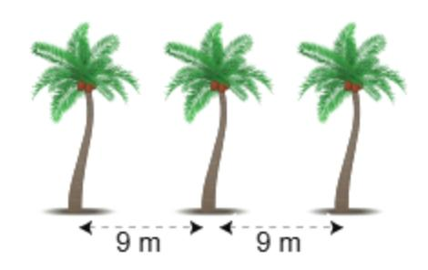

*[Hình ảnh: 12___page_2_Picture_2.jpeg]*

#### Dấu hiệu chia hết cho 3

Cho các số 42; 80; 191; 234.

- HĐ5 Hãy sắp xếp các số trên thành hai nhóm: Nhóm các số chia hết cho 3 và nhóm các số không chia hết cho 3.
- HĐ6 Tính tổng các chữ số của mỗi số và xét tính chia hết cho 3 của các tổng đó trong mỗi nhóm.

Các số có tổng các chữ số chia hết cho 3 thì chia hết cho 3 và chỉ những số đó mới chia hết cho 3.

#### Ví dụ 4

- a) Các số 4 683; 3 576 đều chia hết cho 3 vì có tổng các chữ số chia hết cho 3.
- b) Các số 4 321; 1 975 đều không chia hết cho 3 vì có tổng các chữ số không chia hết cho 3.

## Luyện tập 3

Thay dấu \* bằng một chữ số để số 12\*5 chia hết cho 3.

#### Thử thách nhỏ

Bạn Hà cần tìm đường đến siêu thị. Biết rằng Hà chỉ có thể đi qua ô có chứa số chia hết cho 2 hoặc chia hết cho 3 và mỗi ô chỉ đi qua một lần. Em hãy giúp Hà đến được siêu thị nhé.

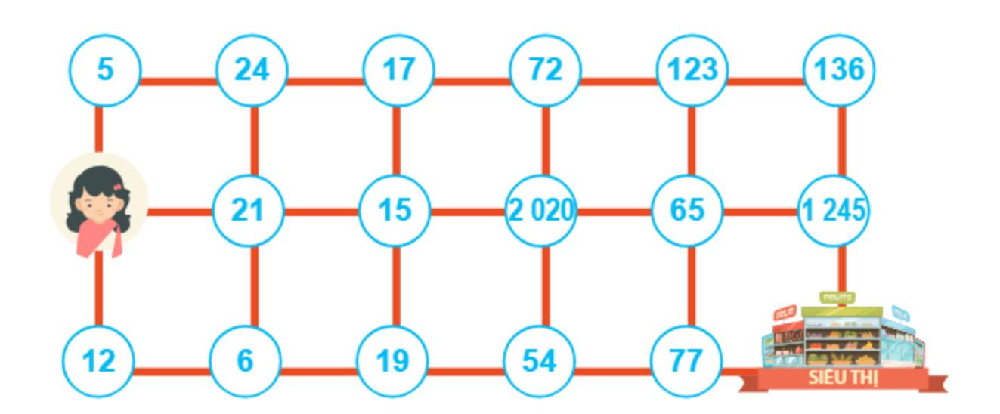

*[Hình ảnh: 12___page_2_Figure_17.jpeg]*

</section>

<section name="Bài tập cuối bài">
## **BÀI TẬP**

- 2.10. Trong các số sau, số nào chia hết cho 2, số nào chia hết cho 5? 324; 248; 2 020; 2 025.
- 2.11. Trong các số sau, số nào chia hết cho 3, số nào chia hết cho 9?

450; 123; 2 019; 2 025.

- 2.12. Khối lớp 6 của một trường có 290 học sinh đi dã ngoại. Cô phụ trách muốn chia đều số học sinh của khối 6 thành 9 nhóm. Hỏi cô có chia nhóm được như vậy không?
- 2.13. Có 162 học sinh tham gia chương trình đào tạo bóng đá, được chia thành các đội. Mỗi đội cần có 9 học sinh. Hỏi có đội nào không có đủ 9 học sinh hay không?
- 2.14. Thay dấu \* bởi một chữ số để số 345\*:
- a) Chia hết cho 2; b) Chia hết cho 3;
- c) Chia hết cho 5; d) Chia hết cho 9.
- 2.15. Dùng ba chữ số 3; 0; 4, hãy viết các số tự nhiên có ba chữ số khác nhau và thoả mãn một trong hai điều kiên:
- a) Các số đó chia hết cho 2;
- b) Các số đó chia hết cho 5.
- 2.16. Từ các chữ số 5; 0; 4; 2, viết các số tự nhiên có ba chữ số khác nhau sao cho mỗi số đó chia hết cho 3.

## EM CÓ BIẾT?

Xét số 234, ta thấy 234 =  $2 \cdot 100 + 3 \cdot 10 + 4$ .

Viết 100 thành 99 + 1, 10 thành 9 + 1, ta được

$$234 = 2(99 + 1) + 3(9 + 1) + 4 = 2 \cdot 99 + 2 + 3 \cdot 9 + 3 + 4$$

 $= 2 \cdot 9 \cdot 11 + 2 + 3 \cdot 9 + 3 + 4$ 

$$= (2 + 3 + 4) + (2 \cdot 9 \cdot 11 + 3 \cdot 9)$$

Tổng các chữ số Số chia hết cho 9

Vậy số 234 được viết thành tổng các chữ số của nó và một số chia hết cho 9.

Các số tự nhiên khác cũng như vậy. Từ đó ta suy ra được dấu hiệu chia hết cho 9 và cho 3.

Một số tự nhiên luôn viết được thành tổng các chữ số của nó và một số chia hết cho 9.

</section>

---

# BÀI HỌC 13: 13_Bài 10. Số nguyên tố_(page 38_42)

[Video]: https://youtu.be/I2Ej185zw4E

# Số NGUYÊN Tố

### KHÁI NIỆM, THUẬT NGỮ

Số nguyên tố Hợp số

### KIẾN THỨC, KĨ NĂNG

- Nhận biết khái niệm số nguyên tố và hợp số.
- Phân tích một số tự nhiên lớn hơn 1 ra thừa số nguyên tố trong những trường hợp đơn giản.

Mẹ mua một bó hoa có 11 bông hoa hồng. Bạn Mai giúp mẹ cắm các bông hoa này vào các lọ nhỏ sao cho số hoa trong mỗi lọ là như nhau. Mai nhận thấy không thể cắm đều số bông hoa này vào các lọ hoa (mỗi lọ có nhiều hơn 1 bông) cho dù số lọ hoa là 2; 3; 4; 5;... Nhưng nếu bỏ ra 1 bông còn 10 bông thì lại cắm đều được vào 2 lọ, mỗi lọ có 5 bông hoa.

*[Hình ảnh: 13___page_0_Picture_8.jpeg]*

Vậy, số 11 và số 10 có gì khác nhau, điều này có liên quan gì đến số các ước của chúng không?

<section name="1. Số nguyên tố và hợp số">
## 1. Số NGUYÊN TỐ VÀ HỢP SỐ

## Chia nhóm các số tự nhiên theo số ước

- HĐ1 Tìm các ước và số ước của các số trong Bảng 2.1.
- HĐ2 Hãy chia các số cho trong Bảng 2.1 thành hai nhóm: nhóm A gồm các số chỉ có hai ước, nhóm B gồm các số có nhiều hơn hai ước.
- HĐ3 Suy nghĩ và trả lời câu hỏi:
  - a) Số 1 có bao nhiêu ước?
  - b) Số 0 có chia hết cho 2; 5; 7; 2 017; 2 018 không? Em có nhận xét gì về số ước của 0?

| Số     | Các ước     | Số ước |  |  |
|--------|-------------|--------|--|--|
| 2      | ?           | ?      |  |  |
| 3      | ?           | ?      |  |  |
| 4 5 | ?           | ?      |  |  |
|        | ?           | ?      |  |  |
| 6      | ?           | ?      |  |  |
| 7      | ?           | ?      |  |  |
| 8      | ?           | ?      |  |  |
| 9      | ?           | ?      |  |  |
| 10     | 1; 2; 5; 10 | 4      |  |  |
| 11     | 1; 11       | 2      |  |  |

Bảng 2.1

Số 11 chỉ có hai ước, số 10 lại có bốn ước.

- Số nguyên tố là số tự nhiên lớn hơn 1, chỉ có hai ước là 1 và chính nó.
- Hợp số là số tự nhiên lớn hơn 1, có nhiều hơn hai ước.

Số 0 và số 1 không là số nguyên tố và không là hợp số.

### Luyện tập 1

Em hãy tìm nhà thích hợp cho các số trong Bảng 2.1.

Số nguyên tố 11;... Hợp số 10;...

### Ví dy 1

Số nào dưới đây là số nguyên tố, số nào là hợp số? Vì sao?

a) 1 975;

b) 17.

### Giải

a) Số 1 975 có tận cùng là 5 nên nó chia hết cho 5. Do đó, ngoài hai ước là 1 và 1 975 nó còn có thêm ước là 5. Vậy, 1 975 là hợp số.

b) Số 17 chỉ có hai ước là 1 và 17 nên nó là số nguyên tố.

Để khẳng định một số là hợp số, ta thường sử dụng các dấu hiệu chia hết để tìm ra một ước khác 1 và chính nó.

### Luyện tập 2

Trong các số cho dưới đây, số nào là số nguyên tố, số nào là hợp số? Vì sao? a) 1 930; b) 23.

### Thử thách nhỏ

Bạn Hà đang ở ô tìm đường đến phòng chiếu phim . Biết rằng chỉ có thể đi từ một ô sang ô chung cạnh có chứa số nguyên tố. Em hãy giúp Hà đến được phòng chiếu phim nhé.

|    | RAP CHIẾU PHIM |     |       |       |           |       |   |  |  |  |
|----|----------------|-----|-------|-------|-----------|-------|---|--|--|--|
| ı  | 2 000          | 43  | 135   | 105   | 111       | 89    |   |  |  |  |
|    | 104            | 251 | 29    | 31    | 41        | 57    |   |  |  |  |
| 7  | 73             | 423 | 23    | 1 945 | 17        | 62    |   |  |  |  |
| И, | 102            | 13  | 11    | 81    | <u></u> 2 | 71    |   |  |  |  |
|    | 7              | 19  | 35    | 1 954 | 51        | 63    | _ |  |  |  |
| V  | <b>†</b>       | 5   | 2 018 | 53    | 37        | 1 975 | M |  |  |  |

Để biết một số tự nhiên nhỏ hơn 1 000 có là số nguyên tố hay không, bạn có thể tra bảng số nguyên tố ở cuối sách.

</section>

<section name="2. Phân tích một số ra thừa số nguyên tố">
## 2. PHÂN TÍCH MỘT SỐ RA THÙA SỐ NGUYÊN TỐ

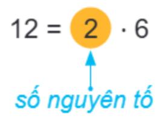

*[Hình ảnh: 13___page_1_Picture_22.jpeg]*

2 là ước nguyên tố của 12 hay 2 là một thừa số nguyên tố của tích 2 · 6.

## Phân tích một số tự nhiên ra thừa số nguyên tố

 Mọi hợp số đều có thể phân tích được thành tích của các thừa số nguyên tố. Ví dụ, ta phân tích số 24 như sau:

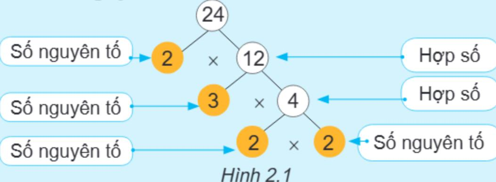

*[Hình ảnh: 13___page_2_Picture_3.jpeg]*

Ta nói rằng ta đã phân tích số 24 ra thừa số nguyên tố, được kết quả

 $24 = 2 \cdot 3 \cdot 2 \cdot 2 = 2 \cdot 2 \cdot 2 \cdot 3$  và được viết gọn là  $24 = 2^3 \cdot 3$ .

- Người ta quy ước dạng phân tích ra thừa số nguyên tố của một số nguyên tố là chính nó.
- Khi phân tích một số ra thừa số nguyên tố, trong kết quả ta thường viết các thừa số theo thứ tự từ bé đến lớn và viết tích các thừa số giống nhau dưới dạng luỹ thừa.

Bạn Việt phân tích số 60 ra thừa số nguyên tố và cho kết quả 60 = 3 ⋅ 4 ⋅ 5. Kết quả của Việt đúng hay sai? Nếu sai, em hãy sửa lại cho đúng.

Bạn nào đúng nhỉ?

Số 7 không phân tích được thành tích các thừa số nguyên tố.

Phân tích ra thừa số nguyên tố của số 7 là 7.

## Phương pháp phân tích theo sơ đồ cây

Quá trình phân tích số 24 ra thừa số nguyên tố như trên có thể được trình bày dưới dạng một sơ đồ như Hình 2.1 gọi là sơ đồ cây.

Số 24 còn có thể phân tích ra thừa số nguyên tố theo sơ đồ cây khác như Hình 2.2.

Vậy, 
$$24 = 2 \cdot 2 \cdot 2 \cdot 3 = 2^3 \cdot 3$$
.

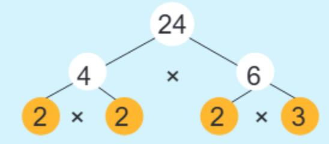

*[Hình ảnh: 13___page_2_Picture_20.jpeg]*

Hình 2.2

Tìm các số còn thiếu trong phân tích số 18 ra thừa số nguyên tố theo sơ đồ cây ở Hình 2.3.

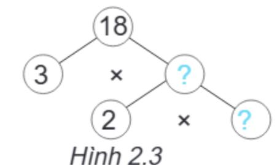

*[Hình ảnh: 13___page_2_Picture_24.jpeg]*

## Phương pháp phân tích theo sơ đồ cột

Ta còn có thể phân tích một số ra thừa số nguyên tố theo sơ đồ cột. Ví dụ, ta phân tích số 24 thành tích các thừa số nguyên tố theo cách làm như sau:

Vây,  $24 = 2^3 \cdot 3$ .

Sơ đồ phân tích số 24 thành tích các thừa số nguyên tố như trên được gọi là sơ đồ cột.

Nhận xét. Trong hai cách phân tích số 24 ra thừa số nguyên tố, nếu viết các thừa số nguyên tố theo thứ tự từ bé đến lớn và tích các thừa số nguyên tố giống nhau dưới dạng luỹ thừa thì dù phân tích bằng cách nào, ta cũng nhận được cùng một kết quả.

🚰 Tìm các số còn thiếu trong phân tích số 30 ra thừa số nguyên tố theo sơ đồ côt ở hình bên.

## 30 2 3 5

70 |

35

7

1

2

5

7

### Ví dy 2

Phân tích số 70 ra thừa số nguyên tố theo sơ đồ cột. Vậy,  $70 = 2 \cdot 5 \cdot 7$ .

## Luyện tập 3

Phân tích các số sau ra thừa số nguyên tố theo sơ đồ cột:

- a) 36;
- b) 105.

</section>

<section name="Bài tập cuối bài">
# **BÀI TẬP**

- tố: 70; 115.
- 2.18. Kết quả phân tích các số 120; 102 ra thừa số nguyên tố của bạn Nam như sau:

$$120 = 2 \cdot 3 \cdot 4 \cdot 5$$
;  $102 = 2 \cdot 51$ .

Theo em, kết quả của Nam đúng hay sai? Nếu sai, em hãy sửa lại cho đúng.

2.17. Phân tích các số sau ra thừa số nguyên 2.19. Các khẳng định sau đúng hay sai? Vì sao?

- a) Ước nguyên tổ của 30 là 5 và 6;
- b) Tích của hai số nguyên tố bất kì luôn là số lẻ;
- c) Ước nguyên tố nhỏ nhất của số chẵn là 2;
- d) Mọi bội của 3 đều là hợp số;
- e) Mọi số chẵn đều là hợp số.

2.20. Kiểm tra xem các số sau là số nguyên tố hay hợp số bằng cách dùng dấu hiệu chia hết hoặc tra bảng số nguyên tố:

89; 97; 125; 541; 2 013; 2 018.

- **2.21.** Hãy phân tích A ra thừa số nguyên tố:  $A = 4^4 \cdot 9^5$ .
- 2.22. Tìm các số còn thiếu trong các sơ đồ phân tích một số ra thừa số nguyên tố sau:

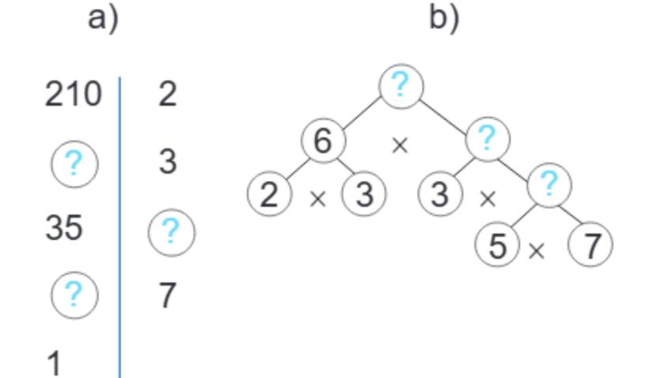

*[Hình ảnh: 13___page_4_Figure_4.jpeg]*

- 2.23. Một lớp có 30 học sinh. Cô giáo muốn chia lớp thành các nhóm để thực hiện các dự án học tập nhỏ. Biết rằng, các nhóm đều có số người bằng nhau và có nhiều hơn 1 người trong mỗi nhóm. Hỏi mỗi nhóm có thể có bao nhiều người?
- 2.24. Trong nghi lễ thượng cờ lúc 6 giờ sáng và hạ cờ lúc 21 giờ hằng ngày ở Quảng trường Ba Đình, đội tiêu binh có 34 người gồm 1 sĩ quan chỉ huy đứng đầu và 33 chiến sĩ. Hỏi có bao nhiêu cách sắp xếp 33 chiến sĩ thành các hàng, sao cho mỗi hàng có số người như nhau?

*[Hình ảnh: 13___page_4_Picture_7.jpeg]*

Lễ thượng cờ ở Quảng trường Ba Đình

## EM CÓ BIÉT?

Sàng Eratosthenes (đọc là O'-ra-tô-xten) là một thuật toán cổ để tìm các số nguyên tố nhỏ hơn hoặc bằng một số tự nhiên N cho trước. Thuật toán này dựa theo ý tưởng của nhà toán học cổ Hi Lạp là Eratosthenes. Chẳng hạn, để tìm các số nguyên tố nhỏ hơn 50, ta làm như sau:

Bước 1. Lập bảng các số từ 1 đến 50.

Bước 2. Gạch bỏ số 1. Ta có 2 là số nguyên tố. Gạch tất cả các số lớn hơn 2 và là bội của 2.

Bước 3. Số nguyên tố tiếp theo là 3. Gạch tất cả các số lớn hơn 3 và là bội của 3.

Bước 4. Số nguyên tố tiếp theo là 5. Gạch tất cả các số lớn hơn 5 và là bội của 5.

Bước 5. Số nguyên tố tiếp theo là 7. Gạch tất cả các số lớn hơn 7 và là bội của 7. Các số không bị gạch trong bảng chính là các số nguyên tố.

| 1  | 2   | 3   | *4_  | 5    | 6_  | 7  | 8_  | 9   | 10_ |
|----|-----|-----|------|------|-----|----|-----|-----|-----|
| 11 | 12_ | 13  | 714_ | 715_ | 16_ | 17 | 18_ | 19  | 20_ |
| 24 | 22  | 23  |      |      |     |    |     |     | 30_ |
| 31 | 32  | 33_ | 34_  | 35_  | 36_ | 37 | 38_ | 39_ | 40_ |
| 41 | 42  | 43  | *44_ | 45_  | 46_ | 47 | 48_ | 49_ | 50_ |

Cách làm như trên giống như việc dùng một cái sàng để loại bỏ số 1 và các hợp số. Do đó nó có tên là sàng Eratosthenes.

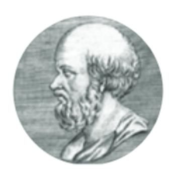

*[Hình ảnh: 13___page_4_Picture_18.jpeg]*

Eratosthenes sinh năm 276 trước Công nguyên

</section>

---

# BÀI HỌC 14: 14_Luyện tập chung_(page 43_43)

[Video]: https://youtu.be/g4KV-mwb6TI

## LUYỆN TẬP CHUNG

Ví dụ 1. Đội văn nghệ có 36 bạn, được xếp thành các hàng có số người bằng nhau. Hỏi có thể có những cách xếp hàng nào, biết mỗi hàng có từ 3 đến 12 bạn?

**Giải.** Do xếp 36 bạn thành các hàng đều nhau nên số bạn trong mỗi hàng phải là ước của 36. Ta có Ư(36) = {1; 2; 3; 4; 6; 9; 12; 18; 36}.

Vì mỗi hàng có từ 3 đến 12 bạn nên số bạn trong mỗi hàng chỉ có thể là: 3; 4; 6; 9; 12. Do đó, ta có 5 cách xếp thoả mãn yêu cầu đề bài, cụ thể:

| Số bạn ở mỗi hàng | 3  | 4 | 6 | 9 | 12 |
|-------------------|----|---|---|---|----|
| Số hàng           | 12 | 9 | 6 | 4 | 3  |

Ví du 2. Sử dụng dấu hiệu chia hết, hãy cho biết số 1 872 có chia hết cho 2; 3; 5; 9; 10 không.

Giải. 1872 có chữ số tận cùng là số chẵn nên 1872:2.

1 872 có tổng các chữ số là 1 + 8 + 7 + 2 = 18 và 18:3, nên 1 872:3.

Chữ số tận cùng của 1 872 khác 0 và 5 nên 1 872 / 5.

1 872 có tổng các chữ số là 18 và 18:9, nên 1 872:9.

Chữ số tận cùng của 1 872 khác 0 nên 1 872 / 10.

Ví dụ 3. Phân tích số 140 thành tích các thừa số nguyên tố theo sơ đồ cây và sơ đồ cột. Giải.

Sơ đồ cây

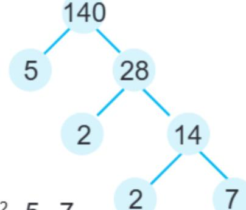

*[Hình ảnh: 14___page_0_Figure_13.jpeg]*

Vậy 140 = 22 · 5 · 7.

Sơ đồ cột 140 | 2

 $V_{ay} 140 = 2^2 \cdot 5 \cdot 7.$ 

<section name="Bài tập cuối bài">
## **BÀI TẬP**

- 2.25. Từ các chữ số 5; 0; 1; 3, viết các số tự nhiên có ba chữ số khác nhau thoả mãn:
- a) Các số đó chia hết cho 5;
- b) Các số đó chia hết cho 3.
- **2.26.** Hãy phân tích các số *A*, *B* ra thừa số nguyên tố:

$$A = 4^2 \cdot 6^3$$
;

$$B = 9^2 \cdot 15^2$$
.

- **2.27.** Tìm các số tự nhiên *x* không vượt quá 22 sao cho:
- a) 100 x chia hết cho 4;
- b) 18 + 90 + x chia hết cho 9.

- 2.28. Lớp 6B có 40 học sinh. Để thực hiện dự án học tập nhỏ, cô giáo muốn chia lớp thành các nhóm có số người như nhau, mỗi nhóm nhiều hơn 3 người. Hỏi mỗi nhóm có thể có bao nhiêu người?
- 2.29. Hai số nguyên tố được gọi là sinh đôi nếu chúng hơn kém nhau 2 đơn vị. Ví dụ 17 và 19 là hai số nguyên tố sinh đôi. Em hãy liệt kê hết các cặp các số nguyên tố sinh đôi nhỏ hơn 40.

</section>

---

# BÀI HỌC 15: 15_Bài 11. Ước chung. Ước chung lớn nhất_(page 44_48)

[Video]: https://youtu.be/4BEZZU5fF9c

# ƯỚC CHUNG. ƯỚC CHUNG LỚN NHẤT

#### KHÁI NIỆM, THUẬT NGỮ

Ước chung Ước chung lớn nhất Hai số nguyên tố cùng nhau Phân số tối giản

#### KIẾN THỨC, KĨ NĂNG

- Xác định ước chung, ước chung lớn nhất của hai hoặc ba số tư nhiên đã cho.
- Nhận biết phân số tối giản.

Một bác thợ mộc muốn làm kệ để đồ từ hai tấm gỗ dài 18 dm và 30 dm. Bác muốn cắt hai tấm gỗ này thành các thanh gỗ có cùng độ dài mà không để thừa mẩu gỗ nào. Em hãy giúp bác thợ mộc tìm độ dài lớn nhất có thể của mỗi thanh gỗ được cắt.

*[Hình ảnh: 15___page_0_Picture_8.jpeg]*

<section name="1. Ước chung và ước chung lớn nhất">
# 1. ƯỚC CHUNG VÀ ƯỚC CHUNG LỚN NHẤT

😈 Ước chung và ước chung lớn nhất của hai hay nhiều số

HĐ1 Tìm các tập hợp Ư(24) và Ư(28).

HĐ2 Gọi ƯC(24, 28) là tập hợp các số vừa là ước của 24, vừa là ước của 28. Hãy viết tập hợp ƯC(24, 28).

HĐ3 Tìm số lớn nhất trong tập ƯC(24, 28).

Ước chung của hai hay nhiều số là ước của tất cả các số đó. Ước chung lớn nhất của hai hay nhiều số là số lớn nhất trong tập hợp các ước chung của các số đó. ƯC(a, b) là một tập hợp; ƯCLN(a, b) là một số.

Ta kí hiệu:  $U^{C}(a, b)$  là tập hợp các ước chung của a và b;

 UCLN(a, b)
 là ước chung lớn nhất của a và b.

Chú ý. Ta chỉ xét ước chung của các số khác 0.

#### Ví dụ 1

Ta có  $U'(18) = \{1; 2; 3; 6; 9; 18\},\$   $U'(30) = \{1; 2; 3; 5; 6; 10; 15; 30\}.$ 

Các số 1; 2; 3; 6 đều là ước của hai số 18 và 30 nên

 $U^{*}C(18, 30) = \{1; 2; 3; 6\}.$ 

Vì 6 là số lớn nhất trong các ước chung nên ƯCLN(18, 30) = 6.

 $x \in U^{\circ}C(a, b, c)$ 

# Ví dụ 2

Trở lại bài toán mở đầu, độ dài lớn nhất (đơn vị dm) của mỗi thanh gỗ được cắt chính là ước chung lớn nhất của 18 và 30. Vậy, bác thợ mộc nên cắt các tấm gỗ thành các thanh gỗ dài 6 dm.

# Tìm ƯCLN trong trường hợp đặc biệt

Các em hãy tìm ƯCLN(6, 18).

Em có cách khác ngắn hơn

Vì 18:6 nên ta có U'CLN(6, 18) = 6. Ta có Ư(6) = {1; 2; 3; 6}, Ư(18) = {1; 2; 3; 6; 9; 18} nên ƯC(6, 18) = {1; 2; 3; 6}, do đó ƯCLN(6, 18) = 6.

. . . . . . . .

Em sẽ chọn cách làm của bạn nào?

#### Nhận xét

 Trong các số đã cho, nếu số nhỏ nhất là ước của các số còn lại thì ƯCLN của các số đã cho chính là số nhỏ nhất ấy.

Nếu a : b thì UCLN(a, b) = b.

Số 1 chỉ có một ước là 1. Do đó với mọi số tự nhiên a và b, ta có
 ƯCLN(a, 1) = 1; ƯCLN(a, b, 1) = 1.

Tìm ƯCLN(90, 10).

#### Luyện tập 1

Bố có 12 quả bóng màu xanh và 15 quả bóng màu đỏ. Bố muốn chia số bóng cho ba anh em Việt, Hà và Nam đều như nhau gồm cả bóng màu xanh và bóng màu đỏ. Hỏi bố có thực hiện được điều đó hay không?

# Vận dụng 1

Tuần này lớp 6A và 6B gồm 40 học sinh nữ và 36 học sinh nam được phân công đi thu gom rác làm sạch bờ biển ở địa phương. Nếu chia nhóm sao cho số học sinh nam và nữ trong các nhóm bằng nhau thì:

- a) Có thể chia được thành bao nhiêu nhóm học sinh?
- b) Có thể chia nhiều nhất bao nhiều nhóm học sinh?

</section>

<section name="2. Cách tìm ước chung lớn nhất">
# 2. CÁCH TÌM ƯỚC CHUNG LỚN NHẤT

UCLN(a, b) là ước của a và b nên các thừa số nguyên tố của UCLN(a, b) là thừa số nguyên tố chung của a và b. Vì vậy, để tìm UCLN(a, b) ta cần phân tích a và b ra thừa số nguyên tố.

# Tìm ước chung lớn nhất bằng cách phân tích các số ra thừa số nguyên tố Để tìm ƯCLN(24, 60), ta làm như sau:

• Phân tích các số 24 và 60 ra thừa số nguyên tố, ta được:

$$24 = 2 \cdot 2 \cdot 2 \cdot 3 = 2^3 \cdot 3;$$

$$60 = 2 \cdot 2 \cdot 3 \cdot 5 = 2^2 \cdot 3 \cdot 5.$$

- 2 Ta thấy 2 và 3 là các thừa số nguyên tố chung của 24 và 60.
- 3 Trong các phân tích ra thừa số nguyên tố của 24 và 60, số mũ nhỏ nhất của thừa số chung 2 là 2, số mũ nhỏ nhất của thừa số chung 3 là 1 nên  $UCLN(24, 60) = 2^2 \cdot 3 = 12$ .

Các bước tìm ƯCLN của hai hay nhiều số lớn hơn 1:

- Phân tích mỗi số ra thừa số nguyên tố;
- 2 Chọn ra các thừa số nguyên tố chung;
- Đ Lập tích các thừa số đã chọn, mỗi thừa số lấy với số mũ nhỏ nhất. Tích đó là ƯCLN phải tìm.

**?** Tìm U'CLN(45, 150), biết  $45 = 3^2 \cdot 5$  và  $150 = 2 \cdot 3 \cdot 5^2$ .

#### Ví du 3

Tìm ƯCLN(56, 140, 168) bằng cách phân tích ra thừa số nguyên tố.

Giải. Phân tích các số 56, 140 và 168 ra thừa số nguyên tố ta được:

$$56 = 2^3 \cdot 7$$
;  $140 = 2^2 \cdot 5 \cdot 7$ ;

Ta thấy 2 và 7 là các thừa số nguyên tố chung của 56, 140 và 168. Số mũ nhỏ nhất của 2 là 2 và số mũ nhỏ nhất của 7 là 1 nên

 $168 = 2^3 \cdot 3 \cdot 7$ .

$$U^{\circ}CLN(56, 140, 168) = 2^2 \cdot 7 = 28.$$

#### Luyện tập 2

Tìm U'CLN(36, 84).

#### Vận dụng 2

Một đại đội bộ binh có ba trung đội: trung đội I có 24 chiến sĩ, trung đội II có 28 chiến sĩ, trung đội III có 36 chiến sĩ. Trong cuộc diễu binh, cả ba trung đội phải xếp thành các hàng dọc đều nhau mà không có chiến sĩ nào trong mỗi trung đội bị lẻ hàng. Hỏi có thể xếp được nhiều nhất bao nhiêu hàng dọc?

# Tìm ước chung từ ước chung lớn nhất

Ta đã biết ƯC(24, 28) = {1; 2; 4} và ƯCLN(24, 28) = 4.

Ta thấy 1; 2; 4 là tất cả ước của 4.

Để tìm ước chung của các số, ta có thể làm như sau:

- 1 Tìm ƯCLN của các số đó.
- 2 Tìm các ước của ƯCLN đó.

Biết ƯCLN(75, 105) = 15, hãy tìm ƯC(75, 105).

# Ví dụ 4

Tìm ƯC(75, 105, 120).

Giải. Phân tích các số 75; 105 và 120 ra thừa số nguyên tố:

$$75 = 3 \cdot 5^2$$
;

$$105 = 3 \cdot 5 \cdot 7$$
;

$$120 = 2^3 \cdot 3 \cdot 5$$
.

Ta chọn ra các thừa số nguyên tố chung, đó là 3 và 5.

Số mũ nhỏ nhất của 3 là 1, số mũ nhỏ nhất của 5 là 1. Khi đó  $U^{\circ}CLN(75,105,120) = 3 \cdot 5 = 15$ . Các ước của 15 là 1; 3; 5; 15.

Vậy ƯC(75, 105, 120) = {1; 3; 5; 15}.

Khi tìm ước chung của các số, người ta thường dựa vào ƯCLN của chúng.

Vào ngày thứ Bảy, cô Lan tổ chức cho học sinh đi tham quan Bảo tàng Dân tộc học. Các học sinh đóng tiền mua vé, mỗi em một vé. Số tiền cô Lan thu được từng ngày được ghi lại ở bảng bên. a) Hỏi số tiền để mua một vé (giá vé được tính theo đơn vị nghìn đồng) có thể là bao nhiêu, biết giá vé lớn hơn 2 nghìn đồng? b) Có bao nhiêu học sinh tham gia chuyến đi, biết số học sinh tham gia trong khoảng từ 20 đến 40 người?

| Ngày    | Số tiền đóng (nghìn đồng) |
|---------|------------------------------|
| Thứ Hai | 56                           |
| Thứ Ba  | 28                           |
| Thứ Tư  | 42                           |
| Thứ Năm | 98                           |

</section>

<section name="3. Rút gọn về phân số tối giản">
# 3. RÚT GỌN VỀ PHÂN SỐ TỐI GIẢN

# Vận dụng ƯCLN để rút gọn về phân số tối giản

- Ta rút gọn phân số bằng cách chia cả tử và mẫu của phân số đó cho một ước chung khác 1 (nểu có).
- Phân số a/b được gọi là phân số tối giản nếu a và b không có ước chung nào khác 1, nghĩa là U'CLN(a, b) = 1.

Chẳng hạn, rút gọn phân số  $\frac{18}{30}$  bằng cách chia cả tử và mẫu cho 3, ta được  $\frac{6}{10}$ . Ta thấy  $\frac{6}{10}$  chưa là phân số tối giản, ta rút gọn tiếp bằng cách chia cả tử và mẫu cho 2. Khi đó ta được phân số tối giản  $\frac{3}{5}$ .

• Để đưa một phân số chưa tối giản  $\frac{a}{b}$  về phân số tối giản, ta chia cả tử và mẫu cho UCLN(a, b).

Chẳng hạn, phân số  $\frac{18}{30}$  chưa là phân số tối giản và ƯCLN(18, 30) = 6 nên

$$\frac{18}{30} = \frac{18:6}{30:6} = \frac{3}{5}$$
. Ta có  $\frac{3}{5}$  là phân số tối giản.

Phân số  $\frac{16}{10}$  đã là phân số tối giản chưa? Nếu chưa, hãy rút gọn về phân số tối giản.

#### Ví dy 5

Các phân số sau đã là phân số tối giản chưa? Nếu chưa, hãy rút gọn về phân số tối giản:

a) 
$$\frac{8}{5}$$
; b)  $\frac{36}{54}$ .

#### Giải

- a) Ta có ƯCLN(8, 5) = 1, nên  $\frac{8}{5}$  là phân số tối giản.
- b) U'CLN(36, 54) = 18, nên  $\frac{36}{54}$  không là phân số tối giản.

Ta có 
$$\frac{36}{54} = \frac{36:18}{54:18} = \frac{2}{3}$$
. Ta được  $\frac{2}{3}$  là phân số tối giản.

Nếu ƯCLN(a, b) = 1 thì hai số a, b được gọi là hai số nguyên tố cùng nhau.

#### Luyện tập 3

Rút gọn về phân số tối giản: a)  $\frac{90}{27}$ ; b)  $\frac{50}{125}$ .

</section>

<section name="Bài tập cuối bài">
# **BÀI TẬP**

2.30. Tìm tập hợp ước chung của:

a) 30 và 45;

b) 42 và 70.

2.31. Tìm ƯCLN của hai số:

a) 40 và 70;

b) 55 và 77.

2.32. Tìm ƯCLN của:

a) 22 · 5 và 2 · 3 · 5;

b)  $2^4 \cdot 3$ ;  $2^2 \cdot 3^2 \cdot 5$  và  $2^4 \cdot 11$ .

**2.33.** Cho hai số a = 72 và b = 96.

a) Phân tích a và b ra thừa số nguyên tố;

b) Tìm ƯCLN(a, b), rồi tìm ƯC(a, b).

2.34. Các phân số sau đã là phân số tối giản chưa? Nếu chưa, hãy rút gọn về phân số tối giản:

a)  $\frac{50}{85}$ ;

b)  $\frac{23}{81}$ .

2.35. Hãy cho hai ví dụ về hai số có ƯCLN bằng 1 mà cả hai đều là hợp số.

# EM CÓ BIÉT?

Tìm ước chung lớn nhất bằng nhận xét sau:

Nếu a, b là hai số tự nhiên với  $a \ge b$  và a = bq + r, r là số dư của phép chia a cho b thì UCLN(a, b) = UCLN(b, r).

# THUẬT TOÁN EUCLID (Ơ-CLÍT)

Bước 1. Thực hiện phép chia a cho b:

a = bq + r với r < b là số dư của phép chia này.

Nếu r = 0 thì a : b, do đó ƯCLN(a, b) = b.

Nếu  $r \neq 0$  thì ƯCLN(a, b) = ƯCLN(b, r).

Sau Bước 1, chúng ta đã chuyển việc tìm ƯCLN của hai số a và b về việc tìm ƯCLN của hai số nhỏ hơn là b và r.

 $Bu\acute{o}c$  2. Thực hiện các phép toán như  $Bu\acute{o}c$  1, tức là thực hiện phép chia b cho r:

 $b = rs + t \, v \dot{o} i \, t < r$ .

Nếu t = 0 thì b : r, do đó ƯCLN(b, r) = r.

Nếu  $t \neq 0$  thì ƯCLN(b, r) = UCLN(r, t).

Quá trình này tiếp tục đến khi phép chia không còn dư. Khi đó ƯCLN chính là số chia của phép chia không còn dư đó.

Ví dụ, để tìm ƯCLN(4 836, 234) người ta thực hiện các phép chia 4 836 cho 234 (dư 156); Thực hiện phép chia 234 cho 156 (dư 78). Vì 156 chia hết cho 78, suy ra ƯCLN(4 836, 234) = 78.

Thuật toán Euclid là thuật toán thông dụng được dùng để tìm ƯCLN. Thuật toán này được viết bởi Euclid - nhà toán học người Hi Lạp, sinh vào khoảng năm 325 trước Công nguyên.

*[Hình ảnh: 15___page_4_Picture_35.jpeg]*

</section>

---

# BÀI HỌC 16: 16_Bài 12. Bội chung. Bội chung nhỏ nhất_(page 49_53)

[Video]: https://youtu.be/aFodV0EILi0

# BỘI CHUNG. BỘI CHUNG NHỎ NHẤT

#### KHÁI NIỆM, THUẬT NGỮ

Bội chung Bội chung nhỏ nhất

#### KIẾN THỨC, KĨ NĂNG

- Tìm bội chung, bội chung nhỏ nhất của hai hoặc ba số tư nhiên.
- Sử dụng bội chung nhỏ nhất để quy đồng mẫu các phân số và cộng, trừ phân số.

Mai cần mua đĩa giấy, cốc giấy để chuẩn bị cho một bữa tiệc sinh nhật. Đĩa và cốc được đóng thành từng gói với số lượng mỗi loại khác nhau: gói 4 cái đĩa và gói 6 cái cốc. Cửa hàng chỉ bán từng gói mà không bán lẻ. Mai muốn mua số đĩa và số cốc bằng nhau thì phải mua ít nhất bao nhiều gói mỗi loại?

*[Hình ảnh: 16___page_0_Picture_8.jpeg]*

<section name="1. Bội chung và bội chung nhỏ nhất">
# 1. BỘI CHUNG VÀ BỘI CHUNG NHỎ NHẤT

*[Hình ảnh: 16___page_0_Picture_10.jpeg]*

Bội chung và bội chung nhỏ nhất của hai hay nhiều số

HĐ1 Tìm các tập hợp B(6), B(9).

HĐ2 Gọi BC(6, 9) là tập hợp các số vừa là bội của 6, vừa là bội của 9. Hãy viết tập BC(6, 9).

HĐ3 Tìm số nhỏ nhất khác 0 trong tập BC(6, 9).

Bội chung của hai hay nhiều số là bội của tất cả các số đó.

Bội chung nhỏ nhất của hai hay nhiều số là số nhỏ nhất khác 0 trong tập hợp các bội chung của các số đó.

Ta kí hiệu: BC(a, b) là tập hợp các bội chung của a và b;

BCNN(a, b) là bội chung nhỏ nhất của a và b.

Chú ý. Ta chỉ xét bội chung của các số khác 0.

#### Ví dy 1

Tìm bội chung và bội chung nhỏ nhất của 4 và 6.

Giải

Ta có:  $B(4) = \{0; 4; 8; 12; 16; 20; 24; 28; ...\};$ 

 $B(6) = \{0; 6; 12; 18; 24; 30; ...\}.$ 

Các số 0; 12; 24;...vừa là bội của 4, vừa là bội của 6 nên

 $BC(4, 6) = \{0; 12; 24; ...\}.$ 

Số nhỏ nhất khác 0 trong tập hợp các bội chung của 4 và 6 là 12 nên BCNN(4, 6) = 12.

•  $x \in BC(a, b)$  nếu x : a, x : b.

• $x \in BC(a, b, c)$  nếu x : a, x : b, x : c.

#### Ví dy 2

*Trở lại tình huống mở đầu của bài,* để mua cùng số lượng n cái mỗi loại thì  $n \in BC(4, 6)$ . Để mua ít nhất thì n = BCNN(4, 6) = 12.

Vậy bạn Mai có thể mua ít nhất 12 cái mỗi loại hay mua 3 gói đĩa và 2 gói cốc.

### Tìm bội chung nhỏ nhất trong trường hợp đặc biệt

Các em hãy tìm BCNN(7, 21)?

Em có cách khác ngắn hơn

*[Hình ảnh: 16___page_1_Picture_8.jpeg]*

BCNN(7, 21) = 21.

Ta có

B(7) = {0; 7; 14; 21; 28; 35; 42; 49;...} B(21) = {0; 21; 42; 63;...} nên BC(7, 21) = {0; 21; 42;...}

Tròn và Vuông đều làm rất tốt!

# Nhận xét

 Trong các số đã cho, nếu số lớn nhất là bội của các số còn lại thì BCNN của các số đã cho chính là số lớn nhất đó.

Nếu a : b thì BCNN(a, b) = a.

Mọi số tự nhiên đều là bội của 1. Do đó với mọi số tự nhiên a và b (khác 0), ta có:
BCNN(a, 1) = a; BCNN(a, b, 1) = BCNN(a, b).

Tìm BCNN(36, 9).

### Luyện tập 1

Tìm bội chung nhỏ nhất của:

a) 6 và 8;

b) 8; 9; 72.

# Vận dụng

Có hai chiếc máy A và B. Lịch bảo dưỡng định kì đối với máy A là 6 tháng và đối với máy B là 9 tháng. Hai máy vừa cùng được bảo dưỡng vào tháng 5. Hỏi sau ít nhất bao nhiêu tháng nữa thì hai máy lại được bảo dưỡng trong cùng một tháng?

</section>

<section name="2. Cách tìm bội chung nhỏ nhất">
# 2. CÁCH TÌM BỘI CHUNG NHỎ NHẤT

Ta có BCNN(4, 6) =  $12 = 2^2 \cdot 3$ , trong đó 2 và 3 là các ước nguyên tố chung và riêng của 4 và 6. Vậy có sự liên hệ gì giữa BCNN của các số và các ước nguyên tố chung và riêng của chúng? Chúng ta cùng tìm hiểu nhé.

Ta phân tích mỗi số ra thừa số nguyên tố để tìm các ước nguyên tố chung và riêng của các số đó.

Tìm bội chung nhỏ nhất bằng cách phân tích các số ra thừa số nguyên tố Để tìm BCNN(75, 90) ta làm như sau:

1 Phân tích các số 75 và 90 ra thừa số nguyên tố, ta được:

$$75 = 3 \cdot 5 \cdot 5 = 3 \cdot 5^2$$
,

$$90 = 2 \cdot 3 \cdot 3 \cdot 5 = 2 \cdot 3^2 \cdot 5$$
.

- 2 Ta thấy các thừa số chung là 3 và 5; thừa số riêng là 2.
- 3 Số mũ lớn nhất của 3 là 2, số mũ lớn nhất của 5 là 2, số mũ lớn nhất của 2 là 1. Khi đó BCNN(75, 90) =  $2 \cdot 3^2 \cdot 5^2 = 450$ .

Các bước tìm BCNN của hai hay nhiều số lớn hơn 1:

- Phân tích mỗi số ra thừa số nguyên tố;
- Chọn ra các thừa số nguyên tố chung và riêng;
- 6 Lập tích các thừa số đã chọn, mỗi thừa số lấy với số mũ lớn nhất. Tích đó là BCNN cần tìm.

Tìm bội chung nhỏ nhất của 9 và 15, biết:  $9 = 3^2$  và  $15 = 3 \cdot 5$ .

### Ví dụ 3

Tìm BCNN(18, 24, 40) bằng cách phân tích các số ra thừa số nguyên tố.

#### Giải

Phân tích các số 18; 24; 40 ra thừa số nguyên tố, ta được:

$$18 = 2 \cdot 3^2$$
;  $24 = 2^3 \cdot 3$ ;  $40 = 2^3 \cdot 5$ .

Thừa số nguyên tố chung là 2 và riêng là 3 và 5.

Khi đó BCNN(18, 24, 40) =  $2^3 \cdot 3^2 \cdot 5 = 360$ .

Ta thấy 18; 24; 40 có thừa số chung là 2 và các thừa số riêng là 3 và 5.

# Tìm bội chung từ bội chung nhỏ nhất

Ta đã biết BC(4, 6) = {0; 12; 24;...}, BCNN(4, 6) = 12 và nhận thấy các số là bội chung của 4 và 6 đều là bội của 12.

Để tìm bội chung của các số đã cho ta có thể làm như sau:

- Tìm BCNN của các số.
- 2Tìm các bội của BCNN đó.

Biết bội chung nhỏ nhất của 8 và 6 là 24. Tìm các bội chung nhỏ hơn 100 của 8 và 6.

#### Ví du 4

Ta có BCNN(18, 24, 40) = 360.

Từ đó, ta suy ra BC(18, 24, 40) = {0; 360; 720; 1 080;...} nên bội chung nhỏ hơn 900 của 18; 24 và 40 là 0; 360; 720.

#### Luyện tập 2

Tìm bội chung nhỏ nhất của 15 và 54. Từ đó, hãy tìm các bội chung nhỏ hơn 1 000 của 15 và 54.

Lịch xuất bến của một số xe buýt tại bến xe Mỹ Đình (Hà Nội) được ghi ở bảng bên. Giả sử các xe buýt xuất bến cùng lúc vào 10 giờ 35 phút. Hỏi vào các thời điểm nào trong ngày (từ 10 giờ 35 phút đến 22 giờ) các xe buýt này lại xuất bến cùng một lúc?

| Bến xe Mỹ Đình |                |  |  |  |  |  |  |  |
|----------------|----------------|--|--|--|--|--|--|--|
| Số xe          | Thời gian      |  |  |  |  |  |  |  |
| Xe 16          | 15 phút/chuyến |  |  |  |  |  |  |  |
| Xe 34          | 9 phút/chuyến  |  |  |  |  |  |  |  |
| Xe 30          | 10 phút/chuyến |  |  |  |  |  |  |  |

</section>

<section name="3. Quy đồng mẫu các phân số">
# 3. QUY ĐỒNG MẤU CÁC PHÂN SỐ

# Vận dụng BCNN để tìm mẫu chung của hai phân số

Để quy đồng mẫu hai phân số  $\frac{a}{b}$  và  $\frac{c}{d}$ , ta phải tìm mẫu chung của hai phân số đó.

Thông thường ta nên chọn mẫu chung là bội chung nhỏ nhất của hai mẫu.

Chẳng hạn, để quy đồng mẫu hai phân số  $\frac{5}{8}$  và  $\frac{7}{12}$ , ta làm như sau:

Ta có BCNN(8, 12) = 24, nên 
$$\frac{5}{8} = \frac{5 \cdot 3}{8 \cdot 3} = \frac{15}{24}$$
 và  $\frac{7}{12} = \frac{7 \cdot 2}{12 \cdot 2} = \frac{14}{24}$ .

Quy đồng mẫu hai phân số:  $\frac{7}{9}$  và  $\frac{4}{15}$ .

# Ví dy 5

Quy đồng mẫu các phân số sau:  $\frac{3}{8}$ ,  $\frac{5}{9}$  và  $\frac{1}{6}$ .

#### Giải

Ta có 6 =  $2 \cdot 3$ ; 8 =  $2^3$ ; 9 =  $3^2$  nên BCNN(6, 8, 9) =  $2^3 \cdot 3^2$  = 72. Ta có thể lấy mẫu chung của ba phân số trên là 72. Do đó

$$\frac{3}{8} = \frac{3 \cdot 9}{8 \cdot 9} = \frac{27}{72}; \quad \frac{5}{9} = \frac{5 \cdot 8}{9 \cdot 8} = \frac{40}{72}; \quad \frac{1}{6} = \frac{1 \cdot 12}{6 \cdot 12} = \frac{12}{72}.$$

#### Có thể chọn một bội chung khác 0 bất kì của các mẫu làm mẫu chung. Tuy nhiên, người ta thường lây bội chung nhỏ nhất làm mấu chung.

### Ví dy 6

Thực hiện phép tính: a)  $\frac{1}{4} + \frac{1}{6}$ ; b)  $\frac{11}{12} - \frac{3}{8}$ .

b) 
$$\frac{11}{12} - \frac{3}{8}$$
.

#### Giải

a) Ta có BCNN(4, 6) = 12 nên ta có thể lấy mẫu chung của hai phân sô là 12 và:

$$\frac{1}{4} = \frac{1 \cdot 3}{4 \cdot 3} = \frac{3}{12},$$
  $\frac{1}{6} = \frac{1 \cdot 2}{6 \cdot 2} = \frac{2}{12}.$ 

$$\frac{1}{6} = \frac{1 \cdot 2}{6 \cdot 2} = \frac{2}{12}$$

$$V_{q}^2y - \frac{1}{4} + \frac{1}{6} = \frac{3}{12} + \frac{2}{12} = \frac{5}{12}$$

b) Ta có BCNN(8, 12) = 24 nên: 
$$\frac{11}{12} - \frac{3}{8} = \frac{11 \cdot 2}{12 \cdot 2} - \frac{3 \cdot 3}{8 \cdot 3} = \frac{22}{24} - \frac{9}{24} = \frac{13}{24}$$
.

#### Luyện tập 3

- 1 Quy đồng mẫu các phân số sau: a)  $\frac{5}{12}$  và  $\frac{7}{15}$ ; b)  $\frac{2}{7}$ ,  $\frac{4}{9}$  và  $\frac{7}{12}$ .

- Thực hiện các phép tính sau:
- a)  $\frac{3}{8} + \frac{5}{24}$ ; b)  $\frac{7}{16} \frac{5}{12}$ .

</section>

<section name="Bài tập cuối bài">
# **BÀI TẬP**

- 2.36. Tìm bội chung nhỏ hơn 200 của:
  - a) 5 và 7;
  - b) 3, 4 và 10.
- 2.37. Tìm BCNN của:
  - a)  $2 \cdot 3^3$  và  $3 \cdot 5$ ;
  - b)  $2 \cdot 5 \cdot 7^2$  và  $3 \cdot 5^2 \cdot 7$ .
- 2.38. Tìm BCNN của các số sau:
  - a) 30 và 45;
- b) 18, 27 và 45.
- 2.39. Tìm số tự nhiên a nhỏ nhất khác 0, biết rằng a: 28 và a: 32.
- 2.40. Học sinh lớp 6A khi xếp thành 3 hàng, 4 hàng hay 9 hàng đều vừa đủ. Biết số học sinh của lớp từ 30 đến 40. Tính số học sinh lớp 6A.

- 2.41. Hai đội công nhân trồng được một số cây như nhau. Mỗi công nhân đôi I đã trồng 8 cây, mỗi công nhân đội II đã trồng 11 cây. Tính số cây mỗi đội đã trồng, biết rằng số cây đó trong khoảng từ 100 đến 200 cây.
- 2.42. Cứ 2 ngày, Hà đi dạo cùng bạn cún yêu quý của mình. Cứ 7 ngày, Hà lại tắm cho cún. Hôm nay, cún vừa được đi dạo, vừa được tắm. Hỏi sau ít nhất bao nhiêu ngày nữa thì cún vừa được đi dạo, vừa được tắm?
- 2.43. Quy đồng mẫu các phân số sau:

  - a)  $\frac{9}{12}$  và  $\frac{7}{15}$ ; b)  $\frac{7}{10}$ ,  $\frac{3}{4}$  và  $\frac{9}{14}$ .
- 2.44. Thực hiện các phép tính sau:

  - a)  $\frac{7}{11} + \frac{5}{7}$ ; b)  $\frac{7}{20} \frac{2}{15}$ .

# EM CÓ BIẾT?

# LICH CAN CHI

Nhiều nước phương Đông trong đó có Việt Nam, gọi tên năm âm lịch bằng cách ghép 10 can theo thứ tự (Giáp, Ất, Bính, Đinh, Mậu, Kỉ, Canh, Tân, Nhâm, Quý) với 12 *chi* (Tí, Sửu, Dần, Mão, Thìn, Tị, Ngọ, Mùi, Thân, Dậu, Tuất, Hợi). Đầu tiên Giáp được ghép với Tí thành năm Giáp Tí. Cứ 10 năm Giáp lại được lặp lại; cứ 12 năm Tí lại được lặp lại:

| Giáp | Át  | Bính | Đinh | Mậu  | Κỉ | Canh | Tân | Nhâm | Quý | Giáp | Át  | Bính | Đinh |  |
|------|-----|------|------|------|----|------|-----|------|-----|------|-----|------|------|--|
| Τí   | Sửu | Dần  | Mão  | Thìn | Τį | Ngọ  | Mùi | Thân | Dậu | Tuất | Hợi | Τí   | Sửu  |  |

Như vậy, cứ sau 60 năm (60 là BCNN của 10 và 12), năm Giáp Tí lại được lặp lại. Tên của các năm âm lịch khác cũng được lặp lại sau 60 năm.

</section>

---

# BÀI HỌC 17: 17_Luyện tập chung_(page 54_55)

[Video]: https://youtu.be/Gdfswi42srU

# LUYỆN TẬP CHUNG

## Ví dụ 1

Tìm ước chung lớn nhất của 60 và 90.

#### Giải

Phân tích 60 và 90 ra thừa số nguyên tố, ta có:

$$60 = 2^2 \cdot 3 \cdot 5$$
,

$$90 = 2 \cdot 3^2 \cdot 5$$
.

Do đó U'CLN(60, 90) =  $2 \cdot 3 \cdot 5 = 30$ .

## Ví dy 2

Tìm số tự nhiên a lớn nhất sao cho 18: a, 45: a và 135: a.

#### Giải

Số tự nhiên a lớn nhất cần tìm chính là ƯCLN(18, 45, 135).

Phân tích ra thừa số nguyên tố, ta có:

$$18 = 2 \cdot 3^2$$
,

$$45 = 3^2 \cdot 5$$
,

$$135 = 3^3 \cdot 5$$
.

Do đó U'CLN(18, 45, 135) =  $3^2$  = 9.

Vậy *a* = 9.

# Ví dụ 3

Có ba loại đèn trang trí, chúng phát sáng cùng lúc vào 6 giờ sáng. Đèn thứ nhất cứ 6 giây phát sáng một lần, đèn thứ hai cứ 8 giây phát sáng một lần và đèn thứ ba cứ 10 giây phát sáng một lần. Hỏi khi nào thì ba đèn cùng phát sáng lần tiếp theo?

#### Giải

Gọi thời gian để sau đó ba đèn cùng phát sáng lần tiếp theo là x (giây). Khi đó x = BCNN(6, 8,10).

Phân tích ra thừa số nguyên tố, ta có:  $6 = 2 \cdot 3$ ;  $8 = 2^3$  và  $10 = 2 \cdot 5$  nên BCNN(6, 8, 10) =  $2^3 \cdot 3 \cdot 5 = 120$ .

*[Hình ảnh: 17___page_0_Picture_23.jpeg]*

Ta có x = 120 giây.

Do đó sau 120 giây = 2 phút, tức là vào lúc 6 giờ 2 phút thì ba đèn lại cùng phát sáng lần tiếp theo.

<section name="Bài tập cuối bài">
# **BÀI TẬP**

## 2.45. Cho bảng sau:

| а                        | 9   | 34 | 120 | 15 | 2 987 |
|--------------------------|-----|----|-----|----|-------|
| b                        | 12  | 51 | 70  | 28 | 1     |
| U'CLN(a, b)              | 3   | ?  | ?   | ?  | ?     |
| BCNN(a, b)               | 36  | ?  | ?   | ?  | ?     |
| U'CLN(a, b) · BCNN(a, b) | 108 | ?  | ?   | ?  | ?     |
| a · b                    | 108 | ?  | ?   | ?  | ?     |

- a) Tìm các số thích hợp thay vào ô trống của bảng;
- b) So sánh tích UCLN(a, b) · BCNN(a, b) và a · b. Em rút ra kết luận gì?
- 2.46. Tìm ƯCLN và BCNN của:
- a)  $3 \cdot 5^2 \text{ và } 5^2 \cdot 7$ ;
- b)  $2^2 \cdot 3 \cdot 5$ ;  $3^2 \cdot 7$  và  $3 \cdot 5 \cdot 11$ .
- 2.47. Các phân số sau đã tối giản chưa? Nếu chưa, hãy rút gọn về phân số tối giản.

a) 
$$\frac{15}{17}$$
;

b) 
$$\frac{70}{105}$$
.

- 2.48. Hai vận động viên chạy xung quanh một sân vận động. Hai vận động viên xuất phát tại cùng một thời điểm, cùng vị trí và chạy cùng chiều. Vận động viên thứ nhất chạy một vòng sân hết 360 giây, vận động viên thứ hai chạy một vòng sân mất 420 giây. Hỏi sau bao nhiêu phút họ gặp lại nhau, biết tốc độ di chuyển của họ không đối?
- 2.49. Quy đồng mẫu các phân số sau:

a) 
$$\frac{4}{9}$$
 và  $\frac{7}{15}$ 

a) 
$$\frac{4}{9}$$
 và  $\frac{7}{15}$ ; b)  $\frac{5}{12}$ ,  $\frac{7}{15}$  và  $\frac{4}{27}$ .

- 2.50. Từ ba tấm gỗ có độ dài là 56 dm, 48 dm và 40 dm, bác thợ mộc muốn cắt thành các thanh gỗ có độ dài như nhau mà không để thừa mẩu gỗ nào. Hỏi bác cắt như thế nào để được các thanh gỗ có độ dài lớn nhất có thể?
- 2.51. Học sinh lớp 6A khi xếp thành hàng 2, hàng 3, hàng 7 đều vừa đủ hàng. Hỏi số học sinh lớp 6A là bao nhiều, biết rằng số học sinh nhỏ hơn 45?
- 2.52. Hai số có BCNN là 23 · 3 · 53 và ƯCLN là 22 · 5. Biết một trong hai số bằng 22 · 3 · 5, tìm số còn lại.

</section>

---

# BÀI HỌC 18: 18_Bài tập cuối chương II_(page 56_56)

[Video]: https://youtu.be/IkWPTSpuiAs

<section name="Bài tập cuối bài">
## BÀI TẬP CUỐI CHƯƠNG II

- **2.53.** Tìm  $x \in \{50; 108; 189; 1 234; 2 019; 2 020\}$  sao cho:
- a) x 12 chia hết cho 2;
- b) x 27 chia hết cho 3;
- c) x + 20 chia hết cho 5;
- d) x + 36 chia hết cho 9.
- 2.54. Thực hiện phép tính sau rồi phân tích kết quả ra thừa số nguyên tố:
- a)  $14^2 + 5^2 + 2^2$ ;
- b) 400 : 5 + 40.
- 2.55. Tìm ƯCLN và BCNN của:
- a) 21 và 98;

- b) 36 và 54.
- 2.56. Các phân số sau đã là phân số tối giản chưa? Nếu chưa, hãy rút gọn về phân số tối giản.
- a)  $\frac{27}{123}$ ;

- b)  $\frac{33}{77}$ .
- 2.57. Thực hiện phép tính:
- a)  $\frac{5}{12} + \frac{3}{16}$ ;
- b)  $\frac{4}{15} \frac{2}{9}$ .
- 2.58. Có 12 quả cam, 18 quả xoài và 30 quả bơ. Mẹ muốn Mai chia đều mỗi loại quả đó vào các túi quà sao cho mỗi túi đều có cả cam, xoài và bơ. Hỏi Mai có thể chia được nhiều nhất là mấy túi quà?
- 2.59. Bác Nam định kì 3 tháng một lần thay dầu, 6 tháng một lần xoay lốp xe ô tô của mình. Hỏi nếu bác ấy làm hai việc đó cùng lúc vào tháng 4 năm nay, thì lần gần nhất tiếp theo bác ấy sẽ cùng làm hai việc đó vào tháng nào?
- 2.60. Biết rằng 79 và 97 là hai số nguyên tố. Hãy tìm ƯCLN và BCNN của hai số này.
- **2.61.** Biết hai số  $3^a \cdot 5^2$  và  $3^3 \cdot 5^b$  có ƯCLN là  $3^3 \cdot 5^2$  và BCNN là  $3^4 \cdot 5^3$ . Tìm a và b.
- 2.62. Bài toán cổ.

Bác kia chăn vịt khác thường
Buộc đi cho được chẵn hàng mới ưa
Hàng 2 xếp thấy chưa vừa
Hàng 3 xếp vẫn còn thừa một con
Hàng 4 xếp vẫn chưa tròn
Hàng 5 xếp thiếu một con mới đầy
Xếp thành hàng 7, đẹp thay
Vịt bao nhiêu? Tính được ngay mới tài.

(Biết số vịt chưa đến 200 con)

</section>

---

# BÀI HỌC 19: 19_Bài 13. Tập hợp các số nguyên_(page 57_61)

[Video]: https://youtu.be/Hq3pA8yITHc

CHƯƠNG

Số Học

# Số NGUYÊN

Số âm được cho là lần đầu xuất hiện trong khoảng từ năm 202 trước Công nguyên đến năm 220. Số dương và số âm dùng để biểu thị các đại lượng đối lập nhau. Người ta cũng coi số âm là kết quả của việc lấy số nhỏ trừ đi số lớn.

Chương này sẽ giúp các em tìm hiểu về số nguyên âm, số nguyên dương và các quy tắc tính toán liên quan đến số nguyên nói chung. Nếu hiểu rõ về số âm, các em sẽ thấy số âm không có gì bí ẩn. Trái lại số âm còn làm cho thế giới các con số thêm thú vị và hữu ích.

## TẬP HỢP CÁC SỐ NGUYÊN

#### KHÁI NIỆM, THUẬT NGỮ

Số nguyên Số nguyên dương Số nguyên âm Tập hợp số nguyên Trục số, chiều dương, chiều âm

#### KIẾN THỨC, KĨ NĂNG

- Nhận biết, đọc và viết số nguyên.
- Nhận biết tập hợp số nguyên.
- Nhận biết ý nghĩa của số nguyên âm trong một số tình huống thực tế.
- Biểu diễn số nguyên trên trục số.
- So sánh hai số nguyên.

*[Hình ảnh: 19___page_0_Picture_15.jpeg]*

Hình 3.1

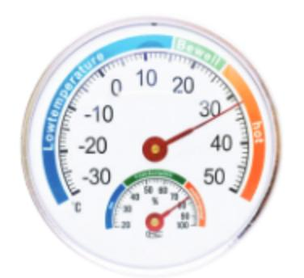

*[Hình ảnh: 19___page_0_Picture_17.jpeg]*

Hình 3.2

Quan sát Hình 3.1 và 3.2, các em thấy ngoài các số quen thuộc như 2 hay 10 gọi là những số dương, còn có các số với dấu "-" đứng trước, đó là các số âm. Vậy số âm có ý nghĩa gì trong đời sống và có quan hệ như thế nào với các số đã học?

<section name="1. Làm quen với số nguyên âm">
#### 1. LÀM QUEN VỚI SỐ NGUYÊN ÂM

#### Số nguyên dương, số nguyên âm

HĐ1 Số –3 đọc là "âm 3". Tương tự, hãy đọc các số âm mà em thấy trên bản đồ thời tiết (H.3.1) và trên chiếc nhiệt kế (H.3.2).

HĐ2 Bằng cách sử dụng dấu "-", hãy viết các số âm được nói đến trong Hình 3.3.

- Độ cao trung bình của thèm lục địa Việt Nam so với mực nước biển là âm 65 mét

- Độ cao của đáy vịnh Cam Ranh so với mực nước biển là khoảng âm 30 mét.

Hình 3.3

- Các số tự nhiên (khác 0) 1; 2; 3; 4; ... còn được gọi là các số nguyên dương.
- Các số –1; –2; –3; ... gọi là các số nguyên âm.
- Tập hợp  $\mathbb Z$  gồm các số nguyên âm, số 0 và các số nguyên dương gọi là tập hợp số nguyên.

$$\mathbb{Z} = \{\ldots; -4; -3; -2; -1; 0; 1; 2; 3; 4; \ldots\}$$

#### Chú ý

- 1. Số 0 không là số nguyên dương, cũng không là số nguyên âm.
- Đôi khi ta còn viết thêm dấu "+" ngay trước một số nguyên dương. Chẳng hạn số 6 còn viết là +6 (đọc là "dương sáu").

#### Luyện tập 1

- a) Viết ba số nguyên dương và ba số nguyên âm;
- b) Đọc các số mà em đã viết.

#### Khi nào người ta dùng số âm?

Số dương và số âm được dùng để biểu thị các đại lượng đối lập nhau, hoặc có hướng ngược nhau:

| Số dương biểu thị                | Số âm biểu thị                           |
|----------------------------------|------------------------------------------|
| Nhiệt độ <i>trên</i> 0°C         | Nhiệt độ <i>dưới</i> 0°C                 |
| Độ cao <i>trên</i> mực nước biển | Độ cao <i>dưới</i> mực nước biển (H.3.4) |
| Số tiền hiện <del>có</del>       | Số tiền còn <i>nợ</i>                    |
| Số tiền <i>lãi</i>               | Số tiền <i>lỗ</i>                        |
| Độ <i>viễn thị</i>               | Độ <i>cận thị</i>                        |
|                                  |                                          |

*[Hình ảnh: 19___page_1_Picture_22.jpeg]*

Sau khi đo đạc bằng các phương pháp hiện đại, cơ quan chức năng đã xác định được độ cao của đỉnh Phan-xi-păng là 3 147,3 m.

Độ cao này cao hơn so với kết quả vẫn được sử dụng trên nhiều tài liệu từ 110 năm qua là 3 143 m. (Theo *Pháp luật Việt Nam*)

#### Ví du

- Đỉnh Phan-xi-păng (Việt Nam) cao khoảng 3 143 m (trên mực nước biến). Độ cao của rãnh Mariana (Tây Bắc Thái Bình Dương) là -10 971 m, nghĩa là rãnh này sâu 10 971 m (dưới mực nước biển). (Người ta quy ước độ cao của mực nước biển là 0 m).
- Kính 1 dioptre (đi-ốp) là kính viễn thị; Kính –1 dioptre là kính cận thị.

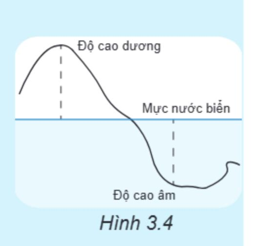

*[Hình ảnh: 19___page_2_Figure_3.jpeg]*

🔼 Khi được hỏi còn tiền không, Nam hóm hỉnh đáp: "Mình còn âm mười nghìn đồng". Em hiểu câu nói đó của Nam có nghĩa là gì?

#### Vận dụng 1

Ông M nhận được hai tin nhắn từ một ngân hàng với nội dung như sau:

- 1. "Tài khoản ...010. Số tiền giao dịch: +160 000. ..."
- 2. "Tài khoản ...010. Số tiền giao dịch: 4 000 000. ..."

Em hãy giải thích ý nghĩa của số âm và số dương trong mỗi tin nhắn trên.

*[Hình ảnh: 19___page_2_Picture_11.jpeg]*

</section>

<section name="2. Thứ tự trong tập số nguyên">
#### 2. THỨ TỰ TRONG TẬP SỐ NGUYÊN

Cho hai số tự nhiên a và b. Ta đã biết trên tia số nếu điểm a nằm trước điểm b thì a < b (H.3.5).

Đối với số nguyên, điều đó còn đúng hay không?

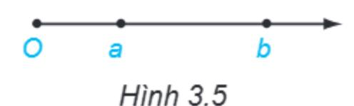

*[Hình ảnh: 19___page_2_Picture_15.jpeg]*

#### Trục số

 Ta biểu diễn các số 0; 1; 2; 3;... và các số nguyên âm –1; –2; –3;... như Hình 3.6. Khi đó ta được một trục số gốc O.

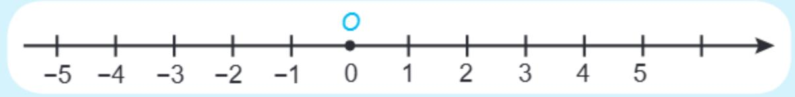

*[Hình ảnh: 19___page_2_Figure_19.jpeg]*

Hình 3.6

- · Chiều từ trái sang phải là chiều dương; chiều ngược lại là chiều âm.
- Điểm biểu diễn số nguyên a gọi là điểm a.
- Cho hai số nguyên a và b. Trên trục số, nếu điểm a nằm trước điểm b thì số a nhỏ hơn số b, kí hiệu a < b.

Chú ý. Ta cũng có thể vẽ trục số như Hình 3.7.

Trên trục số, mỗi điểm sau nằm cách gốc O bao nhiêu đơn vị?

- a) Điểm 2;
- b) Điểm -4.

#### Luyện tập 2

Xuất phát từ gốc O, ta sẽ đi đến điểm nào nếu:

- a) Di chuyển 5 đơn vị theo chiều dương?
- b) Di chuyển 5 đơn vị theo chiều âm?

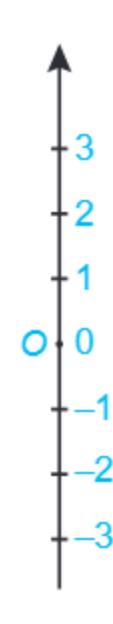

*[Hình ảnh: 19___page_3_Figure_8.jpeg]*

Hình 3.7

## So sánh hai số nguyên

HĐ3 Trên trục số, điểm biểu diễn các số nguyên âm nằm trước hay sau gốc O? Từ đó em hãy sắp xếp ba số 0, 1 và -1 theo thứ tự từ nhỏ đến lớn.

HĐ4 Quan sát trên trục số (H.3.6), ta thấy:

$$3 < 5$$
 nhưng  $-3 > -5$ ;

$$4 > 1$$
 nhưng  $-4 < -1$ .

Theo em, trong hai số – 12 và – 15, số nào lớn hơn?

- 1. Mọi số nguyên âm đều nhỏ hơn 0, do đó nhỏ hơn mọi số nguyên dương.
- 2. Nếu a, b là hai số nguyên dương và a > b thì -a < -b.

**Chú ý.** Kí hiệu  $a \le b$  có nghĩa là "a < b hoặc a = b".

#### Ví dụ 1

- a) 10 là số nguyên dương, -29 là số nguyên âm nên -29 < 10;
- b) Vì 57 > 1 nên -57 < -1.

#### Luyện tập 3

- Sắp xếp các số sau theo thứ tự tăng dần: 2; -4; 0; 5; -11; -3; 9.
- ② Trong tập  $\{x \in \mathbb{Z} \mid -5 < x \le 2\}$ , những số nào lớn hơn -1?

#### Vận dụng 2

Nhiệt độ trung bình vào tháng Giêng của ba thành phố lớn của nước Nga được ghi lại trong bảng bên (theo Wikipedia).

Hãy sắp xếp ba thành phố trên theo thứ tự giảm dần về nhiệt độ. Theo em thời tiết ở nơi nào lanh hơn cả?

| Thành phố                         | Nhiệt độ |
|-----------------------------------|----------|
| Moscow (Ma-xco-va)                | −9°C     |
| Saint Peterburg (Xanh Pê-téc-bua) | –8°C     |
| Vladivostok (Vơ-la-đi-vô-xtốc)    | −12°C    |

Giả sử một con kiến bò trên sợi dây (giống như một trục số). Nếu nó đi được 4 đơn vị theo chiều dương, ta nói kiến bò được 4 đơn vị; nếu nó đi được 4 đơn vị nhưng theo chiều âm, ta nói kiến bò được –4 đơn vị.

- a) Em hiểu thế nào nếu nói: "Kiến A bò được 12 đơn vị" và "Kiến B bò được 15 đơn vị"?
- b) Từ nhận xét rằng 12 > -15, An kết luận: Kiến A bò được quãng đường dài hơn kiến B. Em có đồng ý với An không?

</section>

<section name="Bài tập cuối bài">
## **BÀI TẬP**

3.1. Mỗi nhiệt kế dưới đây chỉ bao nhiêu độ C?

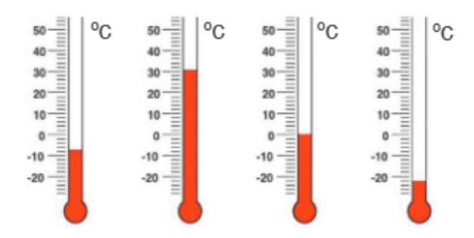

*[Hình ảnh: 19___page_4_Figure_6.jpeg]*

- 3.2. Hãy sử dụng số nguyên âm để diễn tả lại ý nghĩa của các câu sau đây:
- a) Độ sâu trung bình của vịnh Thái Lan khoảng 45 m và độ sâu lớn nhất là 80 m dưới mực nước biển;
- b) Mùa đông ở Siberia (Nga) dài và khắc nghiệt, với nhiệt độ trung bình tháng 1 là 25°C dưới 0°C;
- c) Năm 2012, núi lửa Havre (Bắc New Zealand) phun ra cột tro từ độ sâu 700 m dưới mực nước biển.
- 3.3. Em hiểu ý nghĩa của mỗi câu sau như thế nào (diễn tả bằng một câu không sử dụng số âm):
- a) Khi máy bay ở độ cao 10 000 m, nhiệt độ bên ngoài có thể xuống đến −50°C;
- b) Cá voi xanh có thể lặn được –2 500 m.
- 3.4. Hãy biểu diễn các số sau đây trên cùng một trục số: 3; -3; -5; 6; -4; 4.
- 3.5. Các điểm A, B, C, D và E trong hình dưới đây biểu diễn những số nào?

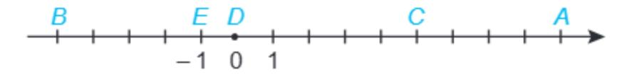

*[Hình ảnh: 19___page_4_Figure_16.jpeg]*

3.6. Hãy sắp xếp các số sau theo thứ tự tăng dần.

$$-3$$
; +4; 7;  $-7$ ; 0;  $-1$ ; +15;  $-8$ ; 25.

- 3.7. So sánh hai số:
- a) -39 và -54;
- b) -3 179 và -3 279.
- 3.8. Liệt kê các phần tử của mỗi tập hợp sau:
- a)  $\mathbf{A} = \{x \in \mathbb{Z} \mid -2 \le x < 4\};$
- b)  $\mathbf{B} = \{x \in \mathbb{Z} \mid -2 < x \le 4\}.$

</section>

---

# BÀI HỌC 20: 20_Bài 14. Phép cộng và phép trừ số nguyên_(page 62_66)

[Video]: https://youtu.be/VKGiaH27L3c

# PHÉP CỘNG VÀ PHÉP TRỪ SỐ NGUYÊN

#### KHÁI NIỆM, THUẬT NGỮ

Tính chất giao hoán của phép cộng Tính chất kết hợp của phép cộng Số đối

#### KIẾN THỨC, KĨ NĂNG

- Thực hiện phép cộng, trừ hai số nguyên.
- Vận dụng các tính chất của phép cộng để tính nhẩm, tính hợp lí.
- Giải toán thực tiễn liên quan đến phép cộng hay trừ hai số nguyên.

Nhiệt độ ban ngày ở đỉnh Mẫu Sơn (Lạng Sơn) vào một ngày mùa đông là  $-3^{\circ}$ C. Nếu ban đêm giảm thêm  $5^{\circ}$ C nữa thì nhiệt độ ở đó sẽ là bao nhiêu?

<section name="1. Cộng hai số nguyên cùng dấu">
# 1. CỘNG HAI SỐ NGUYÊN CÙNG DẤU

Em đã biết phép cộng hai số nguyên dương, chẳng hạn 3 + 5 = 8, có thể minh hoạ trên tia số (H.3.8).

Chú ý rằng mỗi số nguyên (dương hoặc âm) có hai phần: phần dấu và phần số tự nhiên (H.3.9).

*[Hình ảnh: 20___page_0_Figure_12.jpeg]*

Hình 3.9

Có thể hiểu "giảm  $5^{\circ}$ C" có nghĩa là "tăng  $-5^{\circ}$ C". Do đó để biết nhiệt độ ban đêm ở đỉnh Mẫu Sơn trong tình huống trên, ta cần tính tổng (-3) + (-5).

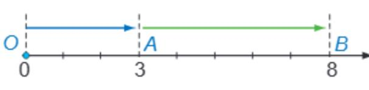

*[Hình ảnh: 20___page_0_Picture_15.jpeg]*

Hình 3.8

Phần dấu của số 5 là gì nhỉ?

# Cộng hai số nguyên âm

HĐ1 Từ gốc O trên trục số, di chuyển *sang trái* 3 đơn vị đến điểm A (H.3.10). Điểm A biểu diễn số nào?

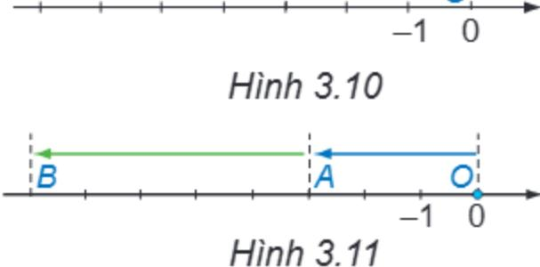

*[Hình ảnh: 20___page_0_Figure_22.jpeg]*

# Quy tắc cộng hai số nguyên âm

Muốn cộng hai số nguyên âm, ta cộng phần số tự nhiên của chúng với nhau rồi đặt dấu "-" trước kết quả.

# Ví dụ 1

$$(-28) + (-37) = -(28 + 37) = -65.$$

# Luyện tập 1

Thực hiện các phép cộng sau:

$$(-12) + (-48);$$

$$(-236) + (-1025)$$
.

Tổng của hai số nguyên âm là một số nguyên âm.

### Vận dụng 1

Sử dụng phép cộng hai số nguyên âm để giải bài toán sau (H.3.12):

Một chiếc tàu ngầm cần lặn (coi là theo phương thẳng đứng) xuống điểm A dưới đáy biển. Khi tàu đến điểm B ở độ cao – 135 m, máy đo báo rằng tàu còn cách A một khoảng 45 m. Hỏi điểm A nằm ở đô cao bao nhiêu mét?

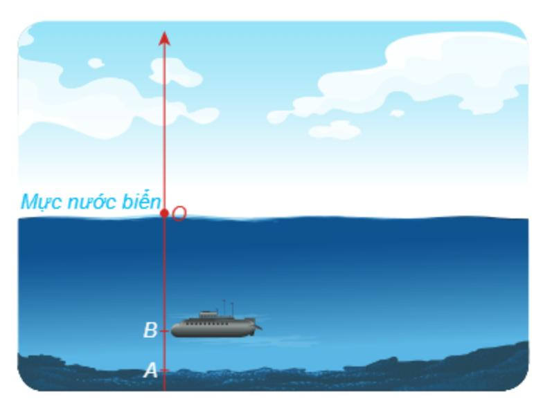

*[Hình ảnh: 20___page_1_Figure_3.jpeg]*

Hình 3.12

</section>

<section name="2. Cộng hai số nguyên khác dấu">
# 2. CỘNG HAI SỐ NGUYÊN KHÁC DẤU

#### Hai số đối nhau

Trên trục số (H.3.13), hai điểm 3 và –3 có cùng khoảng cách đến gốc O. Ta gọi 3 và -3 là hai số đối nhau (-3 là số đối của 3 và 3 là số đối của −3). Tương tự 1 và −1 cũng là hai số đối nhau.

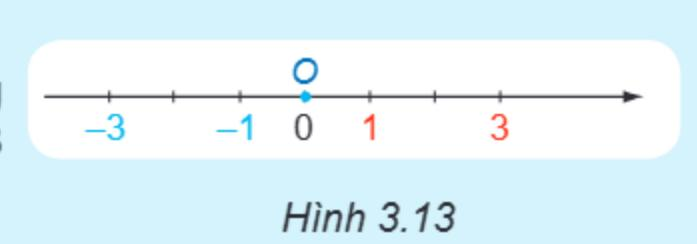

*[Hình ảnh: 20___page_1_Figure_9.jpeg]*

Muốn tìm số đối của một số, ta

🙀 Tìm số đối của 4; – 5; 9; – 11.

# Chú ý

- 1. Ta quy ước số đối của 0 là chính nó.
- 2. Trên Hình 3.14, ta thấy (-5) + 5 = 0.

Một cách tổng quát: Tổng của hai số đối nhau luôn bằng 0.

3. Kí hiệu số đối của số nguyên a là -a. Ta có số đối của -a  $l\dot{a} - (-a) = a$ . Chẳng hạn số đối của -5  $l\dot{a} - (-5) = 5$ .

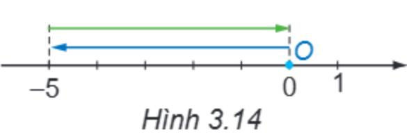

*[Hình ảnh: 20___page_1_Figure_19.jpeg]*

# Luyện tập 2

Tìm số đối của mỗi số 5 và -2 rồi biểu diễn chúng trên cùng một trục số.

# Tổng của hai số nguyên khác dấu

Một ngày tại Paris có nhiệt độ là -5°C. Theo dự báo thời tiết ngày hôm sau tăng thêm 3°C.

- a) Hỏi nhiệt độ dự báo của ngày hôm sau sẽ là bao nhiêu?
- b) Thực tế, nhiệt độ ngày hôm sau lại tăng thêm 8°C. Hỏi nhiệt độ thực tế ngày hôm sau là bao nhiêu?
- HĐ3) Từ điểm A biểu diễn số –5 trên trục số di chuyển sang phải 3 đơn vị (H.3.15) đến điểm B. Điểm B biểu diễn kết quả phép cộng nào?

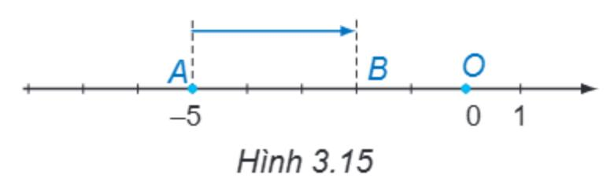

*[Hình ảnh: 20___page_1_Figure_28.jpeg]*

Từ điểm A di chuyển sang phải 8 đơn vị (H.3.16) đến điểm C. Điểm C biểu diễn kết quả của phép cộng nào?

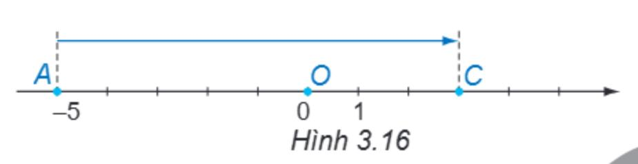

*[Hình ảnh: 20___page_1_Figure_30.jpeg]*

# Quy tắc cộng hai số nguyên khác dấu

- 1. Hai số nguyên đối nhau thì có tổng bằng 0.
- 2. Muốn cộng hai số nguyên khác dấu (không đối nhau), ta tìm hiệu hai phần số tự nhiên của chúng (số lớn trừ số nhỏ) rồi đặt trước hiệu tìm được dấu của số có phần số tự nhiên lớn hơn.

### Ví dụ 2

- a) 9 + (-9) = 0.
- b) 9 + (-5) = 9 5 = 4 (do 9 > 5).
- c) (-12) + 9 = -(12 9) = -3 (do 12 > 9).

#### Luyên tập 3

Thực hiện các phép tính: a) 203 + (-195); b) (-137) + 86.

#### Vận dụng 2

Sử dụng phép cộng hai số nguyên khác dấu để giải bài toán sau:

Một máy thăm dò đáy biển ngày hôm trước hoạt động ở độ cao –946 m (so với mực nước biển). Ngày hôm sau người ta cho máy nổi lên 55 m so với hôm trước. Hỏi ngày hôm sau máy thăm dò đáy biển hoạt động ở độ cao nào?

#### ranh luận

Đố bạn: tổng của hai số nguyên khác dấu là số dương hay số âm?

Em hãy trả lời giúp Vuông.

</section>

<section name="3. Tính chất của phép cộng">
# 3. TÍNH CHẤT CỦA PHÉP CỘNG

HĐ5 Tính và so sánh giá trị của a + b và b + a với a = -7, b = 11.

**HĐ6**) Tính và so sánh giá trị của (a + b) + c và a + (b + c) với a = 2, b = -4, c = -6.

Phép cộng số nguyên có các tính chất:

- Giao hoán: a + b = b + a;
- Kết hợp: (a + b) + c = a + (b + c).

Mỗi số cộng với 0 thì bằng chính số đó: a + 0 = 0 + a = a.

### Chú ý

Ta cũng nói đến tổng của nhiều số nguyên tương tự như số tự nhiên.

#### Ví du 3

Tính một cách hợp lí:

a) 
$$137 + (-40) + 2020 + (-157)$$
; b)  $5 + (-7) + 9 + (-11) + 13 + (-15)$ .

Giải

a) 
$$137 + (-40) + 2 020 + (-157) = 137 + (-157) + (-40) + 2 020$$
  $\leftarrow$  Tính chất giao hoán  $= [137 + (-157)] + [(-40) + 2 020]$   $\leftarrow$  Tính chất kết hợp  $= -(157 - 137) + (2 020 - 40) = (-20) + 1 980 = 1 980 - 20 = 1 960.$   $\leftarrow$  Cộng hai số khác dấu b)  $5 + (-7) + 9 + (-11) + 13 + (-15) = [5 + (-7)] + [9 + (-11)] + [13 + (-15)] \leftarrow$  Tính chất kết hợp  $= (-2) + (-2) + (-2) = -(2 + 2 + 2) = -6.$   $\leftarrow$  Cộng ba số âm

### Luyên tập 4

Tính một cách hợp lí:

a) 
$$(-2\ 019) + (-550) + (-451)$$
; b)  $(-2) + 5 + (-6) + 9$ .

</section>

<section name="4. Trừ hai số nguyên">
# 4. TRỪ HAI SỐ NGUYÊN

Nửa tháng đầu một cửa hàng bán lẻ lãi được 5 triệu đồng, nửa tháng sau bị lỗ 2 triệu đồng. Hỏi tháng đó cửa hàng lãi hay lỗ bao nhiêu triệu đồng?

Giải bài toán trên bằng hai cách:

Cách 1. Tính hiệu giữa số tiền lãi và số tiền lỗ.

Cách 2. Hiểu lỗ 2 triệu là "lãi" –2 triệu để quy về tính tổng của hai số nguyên.

HĐ8 Hãy quan sát ba dòng đầu và dự đoán kết quả ở hai dòng cuối:

$$3 - 1 = 3 + (-1)$$

$$3-2=3+(-2)$$

$$3 - 3 = 3 + (-3)$$

$$3 - 4 = ?$$

$$3 - 5 = ?$$

# Quy tắc trừ hai số nguyên

Muôn trừ số nguyên a cho số nguyên b, ta cộng a với số đối của b:

$$a-b=a+(-b).$$

# Ví dụ 4

a) 
$$7 - 10 = 7 + (-10) = -(10 - 7) = -3$$
.

b) Trở lại HĐ7, ta có: 
$$5-2=5+(-2)=3$$
. Vậy cửa hàng lãi 3 triệu đồng.

# Luyện tập 5

Tính các hiệu sau: a) 5 - (-3); b) (-7) - 8.

# Vận dụng 3

Nhiệt độ bên ngoài của một máy bay ở độ cao 10 000 m là -48°C. Khi hạ cánh, nhiệt độ ở sân bay là 27°C. Hỏi nhiệt độ bên ngoài của máy bay khi ở độ cao 10 000 m và khi hạ cánh chênh lệch bao nhiêu độ C?

</section>

<section name="Bài tập cuối bài">
# **BÀI TẬP**

3.9. Tính tổng hai số cùng dấu:

a) (-7) + (-2); b) (-8) + (-5);

c) (-11) + (-7); d) (-6) + (-15).

3.10. Tính tổng hai số khác dấu:

a) 6 + (-2); b) 9 + (-3);

c) (-10) + 4; d) (-1) + 8.

3.11. Biểu diễn -4 và số đối của nó trên cùng một trục số.

3.12. Thực hiện các phép trừ sau:

a) 9 - (-2); b) (-7) - 4;

c) 27 - 30; d) (-63) - (-15).

3.13. Hai ca nô cùng xuất phát từ C đi về phía A hoặc B như hình vẽ. Ta quy ước chiều từ C đến B là chiều dương (nghĩa là vận tốc và quãng đường đi từ C về phía B được biểu thị bằng số dương và theo chiều ngược lại là số âm). Hỏi sau một giờ hai ca nô cách nhau bao nhiêu kilômét nếu vận tốc của chúng lần lượt là

- a) 11 km/h và 6 km/h?
- b) 11 km/h và -6 km/h?

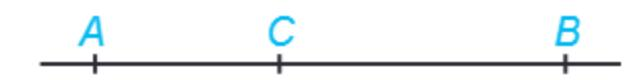

*[Hình ảnh: 20___page_4_Figure_24.jpeg]*

3.14. Mỗi hình sau đây mô phỏng phép tính nào?

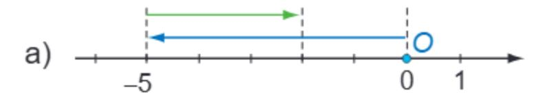

*[Hình ảnh: 20___page_4_Figure_26.jpeg]*

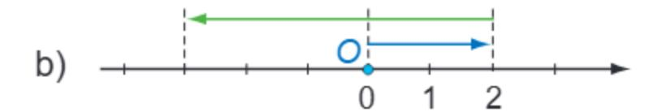

*[Hình ảnh: 20___page_4_Figure_27.jpeg]*

**3.15.** Tính nhẩm:

a) (-3) + (-2); b) (-8) - 7;

c) (-35) + (-15); d) 12 - (-8).

3.16. Tính một cách hợp lí:

a) 152 + (-73) - (-18) - 127;

b) 7 + 8 + (-9) + (-10).

3.17. Tính giá trị của biểu thức (-156) - x, khi:

a) x = -26;

b) x = 76;

c) x = (-28) - (-143).

3.18. Thay mỗi dấu "\*" bằng một chữ số thích hợp để có:

a)  $(-\overline{6^*}) + (-34) = -100$ ;

b)  $(-789) + \overline{2^{**}} = -515$ .

</section>

---

# BÀI HỌC 21: 21_Bài 15. Quy tắc dấu ngoặc_(page 67_68)

[Video]: https://youtu.be/BbC0LzAI03E

# QUY TẮC DẤU NGOẶC

#### KHÁI NIỆM, THUẬT NGỮ

Quy tắc dấu ngoặc

#### KIẾN THỨC, KĨ NĂNG

Nhận biết và áp dụng quy tắc dấu ngoặc trong tính toán, nhất là để tính nhẩm hay tính hợp lí.

Đối với một biểu thức có dấu ngoặc, ta thường thực hiện các phép tính trong dấu ngoặc trước. Nhưng đôi khi việc *bỏ đi các dấu ngoặc* sẽ làm cho việc tính toán trở nên thuận lợi hơn.

<section name="Bỏ dấu ngoặc trong trường hợp đơn giản">
#### Bỏ dấu ngoặc trong trường hợp đơn giản

Các số âm (hay dương) trong một dãy tính thường được viết trong dấu ngoặc.
Nhờ quy tắc cộng hay trừ số nguyên, ta có thể viết dãy tính dưới dạng không có dấu ngoặc. Ví dụ:

$$2 + (-9) = 2 - 9$$

$$(-2) - (-9) = -2 + 9$$

$$3 - (+7) + (-4) - (-8) = 3 - 7 - 4 + 8$$
.

 Vì phép trừ chuyển được về phép cộng nên các dãy tính như trên cũng được gọi là một tổng.

Viết tổng sau dưới dạng không có dấu ngoặc:

$$(-23) - 15 - (-23) + 5 + (-10)$$
.

</section>

<section name="Dấu của một số hạng khi bỏ dấu ngoặc">
### Dấu của một số hạng khi bỏ dấu ngoặc

HĐ1 Tính và so sánh kết quả của:

HĐ2 Hãy nhận xét về sự thay đổi dấu của các số hạng trong dấu ngoặc trước và sau khi bỏ dấu ngoặc.

#### Quy tắc dấu ngoặc

- Khi bỏ dấu ngoặc có dấu "+" đằng trước, ta giữ nguyên dấu của các số hạng trong ngoặc;
- Khi bỏ dấu ngoặc có dấu "-" đằng trước, ta phải đổi dấu tất cả các số hạng trong dấu ngoặc: dấu "+" đổi thành "-" và dấu "-" đổi thành "+".

#### Ví dụ

$$794 + [136 - (136 + 794)] = 794 + [136 - 136 - 794]$$
 ← Bổ dấu ngoặc tròn =  $794 + (-794) = 0$ .

#### Luyện tập 1

Bỏ dấu ngoặc rồi tính các tổng sau:

a) 
$$(-385 + 210) + (385 - 217)$$
;

a) 
$$(-385 + 210) + (385 - 217)$$
; b)  $(72 - 1956) - (-1956 + 28)$ .

#### Chú ý

Áp dụng các tính chất giao hoán, kết hợp và quy tắc dấu ngoặc, trong một biểu thức, ta có thể:

Thay đổi tuỳ ý vị trí của các số hạng kèm theo dấu của chúng.

$$a - b - c = -b + a - c = -c - b + a$$
.

Chẳng hạn, 
$$50 - 90 - 30 = -90 + 50 - 30 = -30 - 90 + 50 = -70$$
.

• Đặt dấu ngoặc để nhóm các số hạng một cách tuỳ ý. Nếu trước dấu ngoặc là dấu "-" thì phải đối dấu tất cả các số hang trong ngoặc.

$$a - b - c = (a - b) - c = a - (b + c)$$
.

Chẳng hạn, 
$$50 - 90 - 30 = (50 - 90) - 30 = 50 - (90 + 30) = -70$$
.

#### Luyện tập 2

Tính một cách hợp lí:

a) 
$$12 + 13 + 14 - 15 - 16 - 17$$
; b)  $(35 - 17) - (25 - 7 + 22)$ .

b) 
$$(35-17)-(25-7+22)$$
.

Cho bảng 3 × 3 ô vuông như Hình 3.17.

- a) Biết rằng tổng các số trong mỗi hàng, mỗi cột, mỗi đường chéo đều bằng 0. Tính tổng các số trong bảng đó.
- b) Hãy thay các chữ cái trong bảng bởi số thích hợp sao cho tổng các số trong mỗi hàng, mỗi cột, mỗi đường chéo đều bằng 0.

| а  | -2 | <b>–</b> 1 |
|----|----|------------|
| -4 | b  | С          |
| d  | е  | g          |

Hình 3.17

</section>

<section name="Bài tập cuối bài">
## **BÀI TẬP**

3.19. Bỏ dấu ngoặc và tính các tổng sau:

a) 
$$-321 + (-29) - 142 - (-72)$$
;

3.20. Tính một cách hợp lí:

a) 
$$21 - 22 + 23 - 24$$
;

3.21. Bỏ dấu ngoặc rồi tính:

a) 
$$(56 - 27) - (11 + 28 - 16)$$
;

b) 
$$28 + (19 - 28) - (32 - 57)$$
.

3.22. Tính một cách hợp lí:

3.23. Tính giá trị của các biểu thức sau:

a) 
$$(23 + x) - (56 - x)$$
 với  $x = 7$ ;

b) 
$$25 - x - (29 + y - 8)$$
 với  $x = 13, y = 11$ .

</section>

---

# BÀI HỌC 22: 22_Luyện tập chung_(page 69_69)

[Video]: https://youtu.be/tp7cH3-9ODo

## LUYỆN TẬP CHUNG

### Ví dụ 1

Tính giá trị của biểu thức: A = 25 - (-115) - [315 + (-105)].

#### Giải

$$A = 25 + 115 - [315 - 105]$$

$$= (25 + 115) - 210$$

$$= 140 - 210 = -(210 - 140) = -70.$$

### Ví dụ 2

Tính nhanh: 283 - 286 - 83 + 86.

#### Giải

$$283 - 286 - 83 + 86$$

$$= 283 - 83 - 286 + 86$$

$$= (283 - 83) - (286 - 86)$$

$$= 200 - 200 = 0.$$

<section name="Bài tập cuối bài">
# **BÀI TẬP**

- **3.24.** Dùng số nguyên âm hoặc số nguyên dương để diễn tả các thông tin sau:
- a) Khi đọc sách, bạn Quang thường đưa trang sách lại quá gần mắt. Bạn ấy đã phải mang kính cận 1 dioptre.
- b) Ông của bạn Quang đã già nên phải dùng kính lão 2 dioptre để đọc sách báo.
- 3.25. Điểm A nằm trên trục số và cách gốc O một khoảng bằng 12 đơn vị (trục số nằm ngang và có chiều dương từ trái sang phải). Hỏi điểm A biểu diễn số nguyên nào nếu:
- a) A nằm ở bên phải gốc O;
- b) A nằm ở bên trái gốc O.
- 3.26. Liệt kê các phần tử của tập hợp sau rồi tính tổng của chúng:

a) 
$$S = \{x \in \mathbb{Z} \mid -3 < x \le 3\};$$

b) 
$$T = \{ x \in \mathbb{Z} \mid -7 < x \le -2 \}.$$

3.27. Tính giá trị của biểu thức:

a) 
$$(27 + 86) - (29 - 5 + 84)$$
;

b) 
$$39 - (298 - 89) + 299$$
.

3.28. Tính giá trị của biểu thức

$$(-314) - (75 + x)$$
 nếu:

a) 
$$x = 25$$
:

b) 
$$x = -313$$
.

3.29. Tính một cách hợp lí:

b) 
$$(11 + 12 + 13) - (1 + 2 + 3)$$
.

3.30. Có ba chiếc hộp đựng những miếng bìa. Trên mỗi miếng bìa có ghi một số như đã cho trong hình dưới đây. Hãy chuyển một miếng bìa từ hộp này sang hộp khác sao cho tổng các số ghi trên các miếng bìa trong mỗi hộp đều bằng nhau.

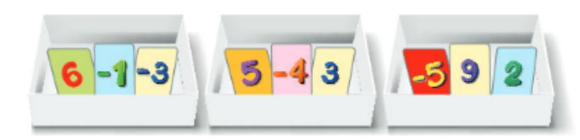

*[Hình ảnh: 22___page_0_Picture_35.jpeg]*

3.31. Trong một trò chơi, bạn Minh nhận được yêu cầu: "Hãy tính tổng của tất cả các số trong tập hợp

$$\{x \in \mathbb{Z} \mid -25 \le x \le 25\}$$
".

Minh trả lời ngay: "Bằng 0". Em có thể giải thích tại sao Minh tính nhanh thế không?

</section>

---

# BÀI HỌC 23: 23_Bài 16. Phép nhân số nguyên_(page 70_72)

[Video]: https://youtu.be/uf0oUIZhXF4

# PHÉP NHÂN SỐ NGUYÊN

#### THUẬT NGỮ, KHÁI NIỆM

Tính chất *giao hoán*Tính chất *kết hợp*Tính chất *phân phối* của phép
nhân đối với phép cộng

#### KIẾN THỨC, KĨ NĂNG

- Thực hiện phép nhân hai số nguyên.
- Vận dụng các tính chất của phép nhân để tính nhẩm, tính hợp lí.
- Giải toán thực tiễn liên quan đến phép nhân số nguyên.

Để quản lí chi tiêu cá nhân, bạn Cao dùng số nguyên âm để ghi vào sổ tay các khoản chi của mình. Cuối tháng, bạn Cao thấy trong sổ có ba lần ghi –15 000 đồng. Trong ba lần ấy, bạn Cao đã chi tất cả bao nhiêu tiền?

Em có thể giải bài toán trên mà không dùng phép cộng các số âm hay không?

<section name="1. Nhân hai số nguyên khác dấu">
## 1. NHÂN HAI SỐ NGUYÊN KHÁC DẤU

• Nếu a và b là hai số tự nhiên thì:

1 · a = a · 1 = a; và a · b = b · a = 
$$\underbrace{a + a + ... + a}_{(b \text{ số hạng a})}$$
 (b ≥ 2),

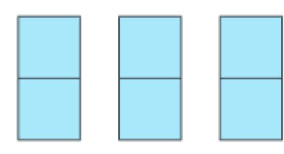

*[Hình ảnh: 23___page_0_Picture_13.jpeg]*

 $2 \cdot 3 = 2 + 2 + 2$ 

Ta có thể làm tương tự đối với phép nhân hai số nguyên khác dấu.

# Tích của hai số nguyên khác dấu

HĐ1 Dựa vào phép cộng các số âm, hãy tính tích (-11) · 3 rồi so sánh kết quả với -(11 · 3).

HĐ2 Hãy dự đoán kết quả của các phép nhân 5 · (-7) và (-6) · 8.

#### Quy tắc nhân hai số nguyên khác dấu

Muốn nhân hai số nguyên khác dấu, ta nhân phần số tự nhiên của hai số đó với nhau rồi đặt dấu "-" trước kết quả nhận được.

Nếu  $m, n \in \mathbb{N}^*$  thì  $m \cdot (-n) = (-n) \cdot m = -(m \cdot n)$ .

## Ví dụ 1

a) 
$$25 \cdot (-4) = -(25 \cdot 4) = -100$$
;  
b)  $(-10) \cdot 11 = -(10 \cdot 11) = -110$ .

#### Luyện tập 1

- 1 Thực hiện các phép nhân sau: a) (−12) · 12;
   b) 137 · (−15).
- ② Tính nhẩm: 5 · (−12).

### Vận dụng 1

Sử dụng phép nhân hai số nguyên khác dấu để giải bài toán mở đầu.

Tích của hai số nguyên khác dấu luôn là một số nguyên âm.

</section>

<section name="2. Nhân hai số nguyên cùng dấu">
## 2. NHÂN HAI SỐ NGUYÊN CÙNG DẤU

Ta đã biết cách nhân hai số nguyên dương (cũng là hai số tự nhiên). Dưới đây ta sẽ tìm hiểu cách nhân hai số nguyên âm.

## Tích của hai số nguyên âm

Quy tắc nhân hai số nguyên âm

- HĐ3 Quan sát ba dòng đầu và nhận xét về dấu của tích mỗi khi đổi dấu một thừa số và giữ nguyên thừa số còn lại.
- HĐ4 Dựa vào nhận xét ở HĐ3, hãy dự đoán kết quả của (–3) · (–7).

## $(-3) \cdot 7 = -21$ ↓ (đổi dấu) $3 \cdot 7 = 21$ ↓ (đổi dấu) $3 \cdot (-7) = -21$ ↓ (đổi dấu)

## $(-3) \cdot (-7) = ?$

#### Muốn nhân hai số nguyên âm, ta nhân phần số tự nhiên của hai số đó với nhau.

Nếu  $m, n \in \mathbb{N}^*$  thì  $(-m) \cdot (-n) = (-n) \cdot (-m) = m \cdot n$ .

Tích của hai số nguyên cùng dấu luôn là số nguyên dương.

#### Ví dy 2

$$(-10) \cdot (-15) = 10 \cdot 15 = 150.$$

#### Luyện tập 2

Thực hiện các phép nhân sau:

Chú ý. Tích của một số nguyên với 0 luôn bằng 0:

$$a \cdot 0 = 0 \cdot a = 0$$
.

#### ử thách nhỏ

Thay mỗi dấu "?" bằng số sao cho số trong mỗi ô ở hàng trên bằng tích các số trong hai ô kề với nó ở hàng dưới (H.3.18).

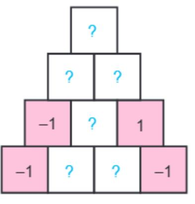

*[Hình ảnh: 23___page_1_Figure_22.jpeg]*

Hình 3.18

</section>

<section name="3. Tính chất của phép nhân">
## 3. TÍNH CHẤT CỦA PHÉP NHÂN

Tương tự như phép nhân các số tự nhiên:

Phép nhân các số nguyên có các tính chất:

Giao hoán:  $a \cdot b = b \cdot a$ 

Kết hợp:  $a \cdot (b \cdot c) = (a \cdot b) \cdot c$ 

Phân phối của phép nhân đối với phép cộng:  $a \cdot (b + c) = a \cdot b + a \cdot c$ .

**1** Tính a(b + c) và ab + ac khi a = -2, b = 14, c = -4.

Chú ý. Tích của nhiều số nguyên cũng được hiểu tương tự như tích của nhiều số tự nhiên.

#### Ví du 3

Thực hiện các phép tính: a)  $(-25) \cdot (-17) \cdot 4$ ; b)  $(-2) \cdot (150 + 14)$ .

b) 
$$(-2) \cdot (150 + 14)$$

Giải

b) 
$$(-2) \cdot (150 + 14) = (-2) \cdot 150 + (-2) \cdot 14 \leftarrow T$$
ính chất phân phối đối với phép cộng =  $(-300) + (-28) = -328$ .

#### Luyên tập 3

- **1** a) Tính giá trị của tích  $P = 3 \cdot (-4) \cdot 5 \cdot (-6)$ ; b) Tích P sẽ thay đổi thế nào nếu ta đổi dấu tất cả các thừa số?
- 2 Tính 4 · (-39) 4 · (-14).

Phép nhân cũng có tính chất phân phối đối với phép trừ:

$$a(b-c) = ab - ac$$
.

</section>

<section name="Bài tập cuối bài">
# **BÀI TẬP**

- 3.32. Nhân hai số khác dấu:
- a) 24 · (-25);
- b) (-15) · 12.
- 3.33. Nhân hai số cùng dấu:
- a)  $(-298) \cdot (-4)$ ;
- b) (-10) · (-135).
- 3.34. Một tích nhiều thừa số sẽ mang dấu dương hay âm nếu trong tích đó có
- a) Ba thừa số mang dấu âm, các thừa số khác đều dương?
- b) Bốn thừa số mang dấu âm, các thừa số khác đều dương?
- 3.35. Tính một cách hợp lí:
- a)  $4 \cdot (1930 + 2019) + 4 \cdot (-2019)$ ;
- b)  $(-3) \cdot (-17) + 3 \cdot (120 17)$ .
- 3.36. Cho biết tích của hai số tự nhiên n và m là 36. Môi tích  $n \cdot (-m)$  và  $(-n) \cdot (-m)$  bằng bao nhiêu?
- 3.37. Tính giá trị của biểu thức sau một cách hợp lí:
- a)  $(-8) \cdot 72 + 8 \cdot (-19) (-8)$ ;
- b)  $(-27) \cdot 1011 27 \cdot (-12) + 27 \cdot (-1)$ .

3.38. Ba ban An, Bình, Cường chơi ném tiêu với bia gồm năm vòng như Hình 3.19. Kết quả được ghi lại trong bảng sau:

| Vòng  | 10 điểm | 7 điểm | 3 điểm | −1 điểm | −3 điểm |
|-------|------------|-----------|-----------|------------|------------|
| An    | 1          | 2         | 0         | 1          | 1          |
| Bình  | 2          | 0         | 1         | 0          | 2          |
| Cường | 0          | 3         | 1         | 1          | 0          |

Hỏi trong ba bạn, bạn nào đạt điểm cao nhất?

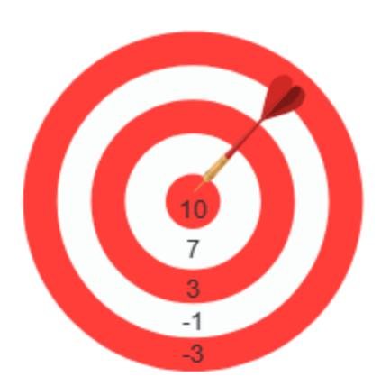

*[Hình ảnh: 23___page_2_Picture_33.jpeg]*

Hình 3.19

</section>

---

# BÀI HỌC 24: 24_Bài 17. Phép chia hết. Ước và bội của một số nguyên_(page 73_74)

[Video]: https://youtu.be/AtCvaYABS80

# PHÉP CHIA HẾT. ƯỚC VÀ BỘI CỦA MỘT SỐ NGUYÊN

### KHÁI NIỆM, THUẬT NGỮ

Phép chia hết

ľо́с

Bôi

### KIẾN THỨC, KĨ NĂNG

- Thực hiện phép chia hết đối với số nguyên.
- Nhận biết quan hệ chia hết trong tập số nguyên.
- Nhân biết, tìm ước và bôi của môt số nguyên.

Ước và bội của một số nguyên có gì giống và khác ước và bội của một số tự nhiên mà chúng ta đã học?

Bài này sẽ giúp chúng ta tìm hiểu điều đó.

<section name="1. Phép chia hết">
# 1. PHÉP CHIA HẾT

Cho  $a, b \in \mathbb{Z}$  với  $b \neq 0$ . Nếu có số nguyên q sao cho a = bq thì ta có phép chia hết a:b=q (trong đó ta cũng gọi a là số bị chia, b là số chia và q là thương). Khi đó ta nói a chia hết cho b, kí hiệu là a : b.

### Ví dy 1

a) 12 : (-3) vi  $12 = (-3) \cdot (-4)$ . Ta có 12 : (-3) = -4.

b) (-35) : 7 vì  $-35 = 7 \cdot (-5)$ . Ta có -35 : 7 = -5.

### Nhân xét

Từ 12 : 3 = 4, ta suy ra được những phép chia hết sau:

12: 
$$(-3) = -4$$
;  $(-12)$ :  $3 = -4$  và  $(-12)$ :  $(-3) = 4$ .

### Dấu của thương

 $(+):(+)\to(+)$ 

 $(-):(-)\to(+)$ 

 $(+):(-)\to(-)$ 

 $(-): (+) \to (-)$ 

## Luyện tập 1

10 Thực hiện phép chia 135 : 9. Từ đó suy ra thương của các phép chia 135 : (-9) và (-135): (-9).

2 Tính:

a) (-63): 9; b) (-24): (-8).

</section>

<section name="2. Ước và bội">
# 2. ƯỚC VÀ BỘI

Khi a : b  $(a, b \in \mathbb{Z}, b \neq 0)$ , ta còn gọi a là một bội của b và b là một ước của a.

## Ví dy 2

- a) 3 là một ước của -12 vì (-12) : 3.
- b) –35 là một bội của –7 vì (–35) : (–7).

### Nhận xét

- 1. Nếu a là một bội của b thì -a cũng là một bội của b.
- Nếu b là một ước của a thì –b cũng là một ước của a.

### Ví dy 3

Tìm các ước của 4 và các ước của 6.

Giải

- Ta có các ước dương của 4 là 1; 2; 4. Do đó tất cả các ước của 4 là: 1; -1; 2; -2; 4; -4.
- Ta có các ước dương của 6 là 1; 2; 3; 6. Do đó tất cả các ước của 6 là: 1; -1; 2; -2; 3; -3; 6; -6.

Để tìm các ước của số nguyên a, ta tìm các ước dương của a cùng với các số đối của chúng.

### Chú ý

Ta thấy các số –2; –1; 1 và 2 vừa là ước của 6, vừa là ước của 4. Chúng được gọi là những ước chung của 6 và 4.

### Ví du 4

Tìm các bội của 7.

#### Giải

Lần lượt nhân 7 với 0; 1; 2; 3;..., ta được các bội không âm của 7 là: 0; 7; 14; 21;... Do đó các bội của 7 là 0; 7; –7; 14; –14; 21; –21;...

### Luyện tập 2

- a) Tìm các ước của -9;
- b) Tìm các bội của 4 lớn hơn -20 và nhỏ hơn 20.

Có hai số nguyên a, b khác nhau nào mà a : b và b : a không?

Sao mà thế được!

A ha, tớ vừa tìm thấy hai số như vậy đấy!...

Không biết Tròn tìm được hai số nguyên nào nhỉ?

</section>

<section name="Bài tập cuối bài">
# **BÀI TẬP**

3.39. Tính các thương:

a) 297 : (-3);

b) (-396): (-12);

c) (-600): 15.

3.40.

- a) Tìm các ước của mỗi số: 30; 42; -50;
- b) Tìm các ước chung của 30 và 42.

3.41. Viết tập hợp sau bằng cách liệt kê phần tử:

 $M = \{x \in \mathbb{Z} \mid x : 4 \text{ và } -16 \le x < 20\}.$ 

3.42. Tìm hai ước của 15 có tổng bằng -4.

3.43. Giải thích tại sao: Nếu hai số cùng chia hết cho –3 thì tổng và hiệu của hai số đó cũng chia hết cho –3. Hãy thử phát biểu một kết luận tổng quát.

</section>

---

# BÀI HỌC 25: 25_Luyện tập chung_(page 75_75)

[Video]: https://youtu.be/dPhI1mxGmLM

## LUYỆN TẬP CHUNG

## Ví dụ 1

Tính một cách hợp lí: (-154) · (-235) + 154 · (-35).

#### Giải

$$(-154) \cdot (-235) + 154 \cdot (-35) = 154 \cdot 235 + 154 \cdot (-35)$$
  
=  $154 \cdot (235 - 35)$   
=  $154 \cdot 200 = 30800$ .

### Ví dy 2

Sử dụng các phép tính với số nguyên để giải bài toán:

Một xí nghiệp mỗi ngày may được 200 bộ quần áo nữ và 150 bộ quần áo nam. Khi may theo mẫu mới, với cùng khổ vải, chiều dài vải để may mỗi bộ quần áo nữ tăng thêm 2 dm; chiều dài vải để may mỗi bộ quần áo nam giảm 3 dm. Hỏi chiều dài vải (với cùng khổ vải) dùng để may 200 bộ quần áo nữ và 150 bộ quần áo nam tăng hay giảm bao nhiều mét so với trước khi may theo mẫu mới? Hãy viết lời giải thành một biểu thức số, sau đó tính giá trị của biểu thức đó.

#### Giải

Khi may theo mẫu mới:

- Chiều dài vải để may 200 bộ quần áo nữ tăng 2 ⋅ 200 (dm).
- Giảm 3 dm có thể hiểu là "tăng" –3 dm nên chiều dài vải để may 150 bộ quần áo nam "tăng"
  (-3) · 150 (dm).
- Chiều dài vải để may 200 bộ quần áo nữ và 150 bộ quần áo nam "tăng":

Ta có:  $2 \cdot 200 + (-3) \cdot 150 = 400 - 450 = -50$  (dm).

"Tăng" –50 dm tức là giảm 50 dm. Ta có 50 dm = 5 m. Vậy khi may theo mẫu mới, chiều dài vải để may 200 bộ quần áo nữ và 150 bộ quần áo nam giảm 5 mét.

<section name="Bài tập cuối bài">
# **BÀI TẬP**

**3.44.** Cho 
$$P = (-1) \cdot (-2) \cdot (-3) \cdot (-4) \cdot (-5)$$
.

- a) Xác định dấu của tích P.
- b) Dấu của P thay đổi thế nào nếu đổi dấu ba thừa số của nó?
- 3.45. Tính giá trị của biểu thức:

a) 
$$(-12) \cdot (7 - 72) - 25 \cdot (55 - 43)$$
;

3.46. Tính giá trị của biểu thức:

$$A = 5ab - 3(a + b)$$
 với  $a = 4$ ,  $b = -3$ .

3.47. Tính một cách hợp lí:

3.48.

- a) Tìm các ước của 15 và các ước của -25;
- b) Tìm các ước chung của 15 và –25.
- 3.49. Sử dụng các phép tính với số nguyên để giải bài toán sau:

Công nhân của một xưởng sản xuất được hưởng lương theo sản phẩm như sau:

- Làm ra một sản phẩm đạt chất lượng thì được 50 000 đồng.
- Làm ra một sản phẩm không đạt chất lượng thì bị phạt 10 000 đồng.

Tháng vừa qua một công nhân làm được 230 sản phẩm đạt chất lượng và 8 sản phẩm không đạt chất lượng. Hỏi công nhân đó được lĩnh bao nhiêu tiền lương?

</section>

---

# BÀI HỌC 26: 26_Bài tập cuối chương III_(page 76_76)

[Video]: https://youtu.be/QuYzgEgn8zg

<section name="Bài tập cuối bài">
## BÀI TẬP CUỐI CHƯƠNG III

- 3.50. Dùng số âm để diễn tả các thông tin sau:
- a) Ở nơi lạnh nhất thế giới, nhiệt độ có thể xuống đến 60°C dưới 0°C.
- b) Do dịch bệnh, một công ty trong một tháng đã bị lỗ 2 triệu đồng.
- 3.51. Trong các số a, b, c, d, số nào dương, số nào âm nếu:

$$a > 0$$
:

$$b < 0$$
;

$$a > 0$$
;  $b < 0$ ;  $c \ge 1$ ;  $d \le -2$ .

3.52. Liệt kê các phần tử của tập hợp sau rồi tính tổng của chúng:

a) 
$$S = \{x \in \mathbb{Z} \mid -5 < x \le 5\};$$

b) 
$$T = \{x \in \mathbb{Z} \mid -7 \le x < 1\}.$$

- 3.53. Tính một cách hợp lí:
- a) 15 · (-236) + 15 · 235;
- b)  $237 \cdot (-28) + 28 \cdot 137$ ;
- c)  $38 \cdot (27 44) 27 \cdot (38 44)$ .
- **3.54.** Tính giá trị của biểu thức  $P = (-35) \cdot x (-15) \cdot 37$  trong mỗi trường hợp sau:

a) 
$$x = 15$$
;

b) 
$$x = -37$$
.

- 3.55. Có hay không hai số nguyên a và b mà hiệu a b:
- a) lớn hơn cả a và b?
- b) lớn hơn a nhưng nhỏ hơn b?

Trong mỗi trường hợp, hãy cho ví dụ minh hoạ bằng số.

3.56. Cho 15 số có tính chất: Tích của 5 số bất kì trong chúng đều âm. Hỏi tích của 15 số đó mang dấu gì?

</section>

---

# BÀI HỌC 27: 27_Bài 18. Hình tam giác đều. Hình vuông. Hình lục giác đều_(page 77_82)

[Video]: https://youtu.be/67V62ORTl8Q

Hình vuông, hình chữ nhật, hình tam giác đều, hình thoi,... là các hình phẳng quen thuộc trong thực tế. Trong chương này, chúng ta sẽ cùng nhau quan sát, đo đạc, gấp, cắt và ghép hình để tìm hiểu về các đặc điểm cơ bản, thú vị của những hình đó.

# HÌNH TAM GIÁC ĐỀU. HÌNH VUÔNG. HÌNH LỤC GIÁC ĐỀU

#### KHÁI NIỆM, THUẬT NGỮ

Hình tam giác đều Hình vuông Hình lục giác đều Cạnh, đỉnh, góc, đường chéo

#### KIẾN THỨC, KĨ NĂNG

- Nhận dạng các hình trong bài.
- Mô tả một số yếu tố cơ bản của hình tam giác đều, hình vuông, hình lục giác đều.
- Vẽ hình tam giác đều, hình vuông bằng dụng cụ học tập.
- Tạo lập được hình lục giác đều thông qua việc lắp ghép các hình tam giác đều.

Người ta có thể sử dụng các viên gạch hình tam giác đều, hình vuông hay hình lục giác đều để lát kín một nền phẳng, chẳng hạn lát nền nhà như hình bên.

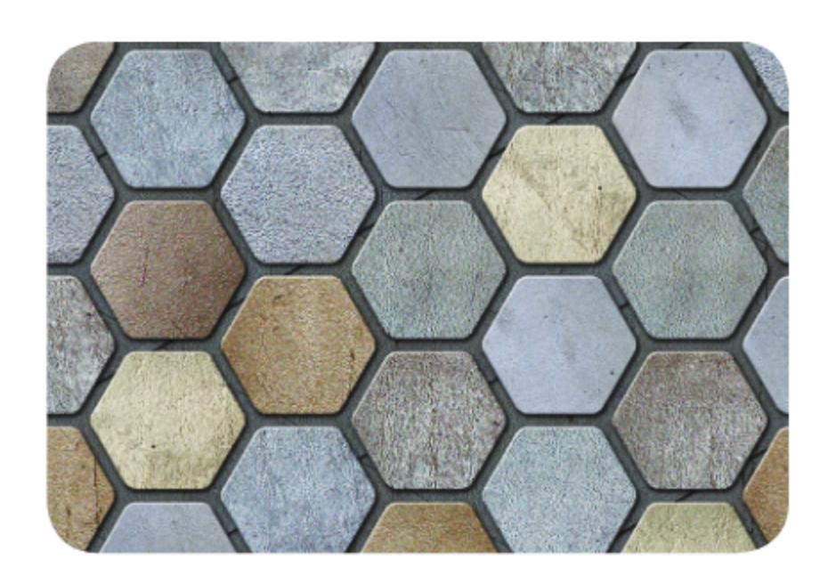

*[Hình ảnh: 27___page_0_Picture_12.jpeg]*

<section name="1. Hình tam giác đều">
## 1. HÌNH TAM GIÁC ĐỀU

Một số yếu tố cơ bản của hình tam giác đều

HĐ1 Trong các hình dưới đây (H.4.1), hình nào là tam giác đều?

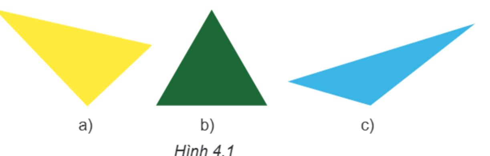

*[Hình ảnh: 27___page_1_Picture_3.jpeg]*

Em hãy tìm một số hình ảnh hình tam giác đều trong thực tế.

*[Hình ảnh: 27___page_1_Picture_5.jpeg]*

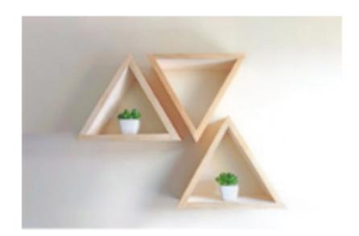

*[Hình ảnh: 27___page_1_Picture_6.jpeg]*

HĐ2 Cho tam giác đều ABC như Hình 4.2.

- 1 Gọi tên các đỉnh, cạnh, góc của tam giác đều ABC.
- ② Dùng thước thẳng để đo và so sánh các cạnh của tam giác ABC.
- 3 Sử dụng thước đo góc để đo và so sánh các góc của tam giác *ABC*.

*[Hình ảnh: 27___page_1_Picture_11.jpeg]*

#### Nhận xét

Trong tam giác đều:

- Ba cạnh bằng nhau.
- Ba góc bằng nhau và bằng 60°.

### Thực hành 1

Vẽ tam giác đều ABC cạnh 3 cm theo hướng dẫn sau:

Bước 1. Vẽ đoạn thẳng AB = 3 cm.

Bước 2. Dùng ê ke có góc 60° vẽ góc BAx bằng 60°.

*[Hình ảnh: 27___page_1_Picture_20.jpeg]*

Liệu có cách nào khác để vẽ hình tam giác đều không nhỉ?

Bước 3. Vẽ góc ABy bằng 60°. Ta thấy Ax và By cắt nhau tại C, ta được tam giác đều ABC.

Em hãy kiểm tra lại hình vừa vẽ, xem các cạnh của tam giác ABC có bằng nhau không? Các góc có bằng nhau không?

</section>

<section name="2. Hình vuông">
## 2. HÌNH VUÔNG

000

## Một số yếu tố cơ bản của hình vuông

HĐ3

Em hãy tìm một số hình ảnh của hình vuông trong thực tế.

HĐ4

Quan sát Hình 4.3a.

*[Hình ảnh: 27___page_2_Picture_7.jpeg]*

Hình 4.3a

*[Hình ảnh: 27___page_2_Picture_9.jpeg]*

Hình 4.3b

- 1 Nêu tên các đỉnh, cạnh, đường chéo của hình vuông ABCD (H.4.3b).
- ② Dùng thước thẳng đo và so sánh độ dài các cạnh của hình vuông; hai đường chéo của hình vuông.
- 3 Dùng thước đo góc để đo và so sánh các góc của hình vuông.

#### Nhận xét

Trong hình vuông:

- Bốn cạnh bằng nhau.
- Bốn góc bằng nhau và bằng 90°.
- Hai đường chéo bằng nhau.

## Thực hành 2

Vẽ hình vuông ABCD có cạnh 4 cm theo hướng dẫn sau:

Bước 1. Vẽ đoạn thẳng AB = 4 cm.

Bước 2. Vẽ đường thẳng vuông góc với AB tại A. Xác định điểm D trên đường thẳng đó sao cho AD = 4 cm.

Bước 3. Vẽ đường thẳng vuông góc với AB tại B. Xác định điểm C trên đường thẳng đó sao cho BC = 4 cm.

Bước 4. Nối C với D ta được hình vuông ABCD.

*[Hình ảnh: 27___page_2_Picture_25.jpeg]*

Kim tự tháp Kheops (đọc là Kê-ốp) ở Ai Cập được xây dựng bằng đá và có dạng hình chóp có đáy là hình vuông, bốn mặt bên là hình tam giác đều. Kim tự tháp Kheops là kim tự tháp lớn nhất thế giới.

*[Hình ảnh: 27___page_2_Picture_27.jpeg]*

- Em hãy kiểm tra lại hình vừa vẽ, xem các cạnh có bằng nhau không? Các góc có bằng nhau không?
- a) Hãy gấp và cắt một hình vuông từ tờ giấy hình chữ nhất như hình bên.
  - b) Cắt hình vuông đó theo hai đường chéo thành bốn phần rồi ghép thành hai hình vuông.

*[Hình ảnh: 27___page_3_Picture_3.jpeg]*

</section>

<section name="3. Hình lục giác đều">
## 3. HÌNH LỤC GIÁC ĐỀU

Một số yếu tố cơ bản của hình lục giác đều

#### HĐ5

- Oắt sáu hình tam giác đều giống nhau và ghép lại như Hình 4.4a để được hình lục giác đều như Hình 4.4b.
- Kể tên các đỉnh, cạnh, góc của hình lục giác đều ABCDEF.

*[Hình ảnh: 27___page_3_Picture_12.jpeg]*

HĐ6 Hãy quan sát Hình 4.5.

- 1 Hãy kể tên các đường chéo chính của hình lục giác đều ABCDEF.
- 2 Hãy so sánh độ dài các đường chéo chính với nhau.

# Đường chéo chính A B C

Hình 4.5

#### Nhận xét

Hình lục giác đều có:

- Sáu cạnh bằng nhau.
- Sáu góc bằng nhau, mỗi góc bằng 120°.
- Ba đường chéo chính bằng nhau.

## Luyện tập

Cho hình lục giác đều như Hình 4.6.

Ta đã biết, 6 hình tam giác đều ghép lại thành hình lục giác đều, đó là những tam giác đều nào? Ngoài 6 tam giác đều đó, trong hình em còn thấy những tam giác đều nào khác?

*[Hình ảnh: 27___page_3_Picture_26.jpeg]*

Hình 4.6

AC, BD, CE, DF, EA, FB còn gọi là đường chéo phụ của hình lục giác đều ABCDEF.

#### Vận dụng

Hãy tìm một số hình ảnh có dạng hình lục giác đều trong thực tế.

*[Hình ảnh: 27___page_4_Picture_2.jpeg]*

Qua tìm hiểu về hình tam giác đều, hình vuông, hình lục giác đều, em có nhận xét gì về đặc điểm chung (cạnh, góc) của các hình nói trên?

*[Hình ảnh: 27___page_4_Picture_5.jpeg]*

Nhìn bề mặt tổ ong ta thấy các hình lục giác đều xếp liền kề nhau. Cấu trúc này tiết kiệm nguyên liệu và tận dụng được không gian. Ngày nay con người đang ứng dụng rộng rãi cấu trúc này trong các lĩnh vực như kiến trúc, hàng không,...

## Thử thách nhỏ

Mặt trên của một cái bánh có dạng hình lục giác đều (như Hình 4.7). Em hãy cắt bánh để chia đều cho:

- a) 6 bạn;
- b) 12 bạn;
- c) 4 bạn.

*[Hình ảnh: 27___page_4_Picture_13.jpeg]*

Hình 4.7

</section>

<section name="Bài tập cuối bài">
## **BÀI TẬP**

- 4.1. Hãy kể tên một số vật dụng, hoạ tiết, công trình kiến trúc,... có hình ảnh của hình tam giác đều, hình vuông, hình lục giác đều.
- 4.2. Vẽ hình tam giác đều có cạnh bằng 2 cm.
- 4.3. Vẽ hình vuông có cạnh bằng 5 cm.
- 4.4. Cắt và ghép để được một cái hộp có nắp theo hình gợi ý dưới đây:

*[Hình ảnh: 27___page_4_Picture_20.jpeg]*

4.5. Có nhiều cách để trang trí một hình vuông, chẳng hạn như hình dưới. Em hãy vẽ một hình vuông trên tờ giấy A4 và trang trí theo cách của mình.

*[Hình ảnh: 27___page_4_Picture_22.jpeg]*

**4.6.** Quan sát hình dưới đây và chỉ ra ít nhất hai cách, để một con kiến bò từ *A* đến *B* theo đường chéo của các hình vuông nhỏ.

*[Hình ảnh: 27___page_5_Picture_1.jpeg]*

4.7. Gấp và cắt hình tam giác đều từ một tờ giấy hình vuông theo hướng dẫn sau:

*[Hình ảnh: 27___page_5_Picture_3.jpeg]*

4.8. Người ta muốn đặt một trạm biến áp để đưa điện về sáu ngôi nhà. Phải đặt trạm biến áp ở đâu để khoảng cách từ trạm biến áp đến sáu ngôi nhà bằng nhau, biết rằng sáu ngôi nhà ở vị trí sáu đỉnh của hình lục giác đều?

*[Hình ảnh: 27___page_5_Picture_5.jpeg]*

</section>

---

# BÀI HỌC 28: 28_Bài 19. Hình chữ nhật. Hình thoi. Hình bình hành. Hình thang cân_(page 83_89)

[Video]: https://youtu.be/iOF23JpBsCg

### KHÁI NIỆM, THUẬT NGỮ

Hình chữ nhật Hình thoi Hình bình hành Hình thang cân Cạnh đối, cạnh bên, góc đối

### KIẾN THỨC, KĨ NĂNG

- Mô tả một số yếu tố cơ bản (cạnh, đỉnh, góc) của hình chữ nhật, hình thoi, hình bình hành, hình thang cân.
- Vẽ hình chữ nhật, hình thoi, hình bình hành bằng các dụng cụ học tập.

Hình chữ nhật, hình bình hành, hình thoi, hình thang cân là các hình mà chúng ta thường gặp trong đời sống thực tế và đã được làm quen ở Tiểu học. Bài này sẽ giúp chúng ta tìm hiểu thêm về các hình như thế, từ đó chúng ta có thể vẽ, cắt, ghép các hình để làm một số đồ dùng hoặc trang trí nơi học tập của mình.

<section name="1. Hình chữ nhật">
# 1. HÌNH CHỮ NHẬT

000

# Một số yếu tố cơ bản của hình chữ nhật

HĐ1 Em hãy tìm một số hình ảnh của hình chữ nhật trong thực tế.

*[Hình ảnh: 28___page_0_Picture_11.jpeg]*

*[Hình ảnh: 28___page_0_Picture_12.jpeg]*

HĐ2 Quan sát hình chữ nhật ở Hình 4.8a.

*[Hình ảnh: 28___page_0_Picture_14.jpeg]*

*[Hình ảnh: 28___page_0_Picture_15.jpeg]*

- 1 Nêu tên đỉnh, cạnh, đường chéo, hai cạnh đối của hình chữ nhật ABCD (H.4.8b).
- ② Dùng thước đo góc để đo và so sánh các góc của hình chữ nhật ABCD.
- **1** Dùng thước thẳng hoặc compa để so sánh hai cạnh đối, hai đường chéo của hình chữ nhật *ABCD*.

### Nhận xét

Trong hình chữ nhật:

- Bốn góc bằng nhau và bằng 90°.
- Các cạnh đối bằng nhau.
- Hai đường chéo bằng nhau.

### Thực hành 1

Vẽ hình chữ nhật ABCD có một cạnh bằng 5 cm, một cạnh bằng 3 cm theo hướng dẫn sau:

Bước 1. Vẽ đoạn thẳng AB = 5 cm.

Bước 2. Vẽ đường thẳng vuông góc với AB tại A. Trên đường thẳng đó lấy điểm D sao cho AD = 3 cm.

Bước 3. Vẽ đường thẳng vuông góc với AB tại B. Trên đường thẳng đó lấy điểm C sao cho BC = 3 cm.

Bước 4. Nối D với C ta được hình chữ nhật ABCD.

Liệu có cách nào khác để vẽ hình chữ nhật không nhỉ?

*[Hình ảnh: 28___page_1_Picture_13.jpeg]*

② Em hãy kiểm tra lại hình vừa vẽ xem các cạnh đối có bằng nhau không? Các góc có bằng nhau không?

</section>

<section name="2. Hình thoi">
# 2. HÌNH THOI

Một số yếu tố cơ bản của hình thoi

# HĐ3

- 1 Trong các đồ vật có ở Hình 4.9, đồ vật nào có dạng hình thoi?
- 2 Em hãy tìm thêm một số hình ảnh khác của hình thoi trong thực tế.

*[Hình ảnh: 28___page_1_Picture_21.jpeg]*

*[Hình ảnh: 28___page_1_Picture_22.jpeg]*

*[Hình ảnh: 28___page_1_Picture_23.jpeg]*

Hình 4.9

HĐ4 Quan sát hình thoi ở Hình 4.10a.

*[Hình ảnh: 28___page_2_Picture_1.jpeg]*

Hình 4.10a

- Dùng thước thẳng hoặc compa so sánh các cạnh của hình thoi (H.4.10b).
- 2 Kiểm tra xem hai đường chéo của hình thoi có vuông góc với nhau không?
- Oác cạnh đối của hình thoi có song song với nhau không?
- 4 Các góc đối của hình thoi ABCD có bằng nhau không?

# Có thể kiểm tra xem hai đường thẳng có song song với nhau hay

В

0

### Nhận xét

Trong một hình thoi:

- Bốn cạnh bằng nhau.
- Hai đường chéo vuông góc với nhau.
- Các cạnh đối song song với nhau.
- Các góc đối bằng nhau.

không như hình bên.

Quan sát hình vẽ bên. Hãy tìm điểm *E* trên đoạn thẳng *BC*, điểm *F* trên đoạn thẳng *AD* để tứ giác *ABEF* là hình thoi.

*[Hình ảnh: 28___page_2_Figure_16.jpeg]*

### Thực hành 2

Vẽ hình thoi ABCD có cạnh bằng 3 cm theo hướng dẫn sau:

Bước 1. Vẽ đoạn thẳng AB = 3 cm.

Bước 2. Vẽ đường thẳng đi qua B. Lấy điểm C trên đường thẳng đó sao cho BC = 3 cm.

Bước 3. Vẽ đường thẳng đi qua C và song song với cạnh AB. Vẽ đường thẳng đi qua A và song song với cạnh BC.

Bước 4. Hai đường thẳng này cắt nhau tại D, ta được hình thoi ABCD.

*[Hình ảnh: 28___page_2_Picture_23.jpeg]*

*[Hình ảnh: 28___page_3_Picture_0.jpeg]*

- 2 Em hãy kiểm tra lại hình vừa vẽ xem các cạnh có bằng nhau không?
- Sấp, cắt hình thoi từ tờ giấy hình chữ nhật theo hướng dẫn sau:

Bước 1. Gấp đôi tờ giấy, sau đó lại gấp đôi một lần nữa sao cho xuất hiện một góc vuông với cạnh là các nếp gấp.

Bước 2. Vẽ một đoạn thẳng nối hai điểm tuỳ ý trên hai cạnh của góc vuông.

Bước 3. Dùng kéo cắt theo đoạn thẳng vừa vẽ rồi mở ra, ta được một hình thoi.

*[Hình ảnh: 28___page_3_Picture_6.jpeg]*

### Vận dụng

Em hãy vẽ đường trang trí theo mẫu dưới đây rồi tô màu tuỳ ý.

*[Hình ảnh: 28___page_3_Picture_9.jpeg]*

</section>

<section name="3. Hình bình hành">
# 3. HÌNH BÌNH HÀNH

*[Hình ảnh: 28___page_3_Picture_11.jpeg]*

1 Hình bình hành có trong hình ảnh nào dưới đây (H.4.11)?

*[Hình ảnh: 28___page_3_Picture_13.jpeg]*

2 Em hãy tìm thêm một số hình ảnh khác của hình bình hành trong thực tế.

### HĐ6 Quan sát hình bình hành ở Hình 4.12a.

*[Hình ảnh: 28___page_4_Picture_1.jpeg]*

Hình 4.12a

- 10 Đo và so sánh độ dài các cạnh đối của hình bình hành ABCD (H.4.12b).
- 2 Đo và so sánh OA với OC, OB với OD.
- 6 Các cạnh đối của hình bình hành ABCD có song song với nhau không?
- 4 Các góc đối của hình bình hành ABCD có bằng nhau không?

### Nhận xét

Trong hình bình hành:

- Các cạnh đối bằng nhau.
- Hai đường chéo cắt nhau tại trung điểm của mỗi đường.
- Các cạnh đối song song với nhau.
- Các góc đối bằng nhau.

### Thực hành 3

Vẽ hình bình hành ABCD có AB = 5 cm; BC = 3 cm theo hướng dẫn sau:

Bước 1. Vẽ đoạn thẳng AB = 5 cm.

Bước 2. Vẽ đường thẳng đi qua B. Trên đường thẳng đó lấy điểm C sao cho BC = 3 cm.

Bước 3. Vẽ đường thẳng đi qua A và song song với BC, đường thẳng qua C và song song với AB. Hai đường thẳng này cắt nhau tại D, ta được hình bình hành ABCD.

*[Hình ảnh: 28___page_4_Picture_18.jpeg]*

</section>

<section name="4. Hình thang cân">
# 4. HÌNH THANG CÂN

Một số yếu tố cơ bản của hình thang cân

HĐ7 Mặt bàn ở hình bên là hình ảnh của một hình thang cân. Em hãy tìm thêm một số hình ảnh khác của hình thang cân trong thực tế.

*[Hình ảnh: 28___page_5_Picture_3.jpeg]*

HĐ8 Quan sát hình thang cân ở Hình 4.13a.

*[Hình ảnh: 28___page_5_Picture_5.jpeg]*

*[Hình ảnh: 28___page_5_Picture_6.jpeg]*

Hình 4.13b

- Oọi tên các đỉnh, đáy lớn, đáy nhỏ, đường chéo, cạnh bên của hình thang cân ABCD (H.4.13b).
- Sử dụng thước thẳng hoặc compa để so sánh hai cạnh bên, hai đường chéo của hình thang cân ABCD.
- 8 Hai đáy của hình thang cân ABCD có song song với nhau không?
- 4 Hai góc kề một đáy của hình thang cân ABCD có bằng nhau không?

### Nhận xét

Trong hình thang cân:

- Hai cạnh bên bằng nhau.
- Hai đường chéo bằng nhau.
- Hai cạnh đáy song song với nhau.
- Hai góc kề một đáy bằng nhau.

## Luyện tập

Hình nào trong các hình đã cho là hình thang cân? Hãy cho biết tên hình thang cân đó.

*[Hình ảnh: 28___page_5_Picture_20.jpeg]*

*[Hình ảnh: 28___page_5_Picture_21.jpeg]*

Các thanh ngang tạo với hai trụ bên thành các hình thang cân để cái thang có thể cân đối và vững chắc khi sử dụng.

### Thực hành 4

Gấp, cắt hình thang cân từ tờ giấy hình chữ nhật.

Bước 1. Gấp đôi tờ giấy.

Bước 2. Vẽ một đoạn thẳng nối hai điểm tuỳ ý trên hai cạnh đối diện (cạnh không chứa nếp gấp).

Bước 3. Cắt theo đường vừa vẽ.

Bước 4. Mở tờ giấy ra ta được một hình thang cân.

*[Hình ảnh: 28___page_6_Picture_6.jpeg]*

</section>

<section name="Bài tập cuối bài">
# **BÀI TẬP**

- 4.9. Vẽ hình chữ nhật có một cạnh dài 6 cm, một canh dài 4 cm.
- 4.10. Vẽ hình thoi có canh 4 cm.
- 4.11. Vẽ hình bình hành có độ dài một cạnh bằng 6 cm, một cạnh bằng 3 cm.
- **4.12.** Hãy kể tên các hình thang cân, hình chữ nhật có trong hình lục giác đều sau:

*[Hình ảnh: 28___page_6_Picture_12.jpeg]*

4.13. Cho hình bình hành ABCD, hai đường chéo AC và BD cắt nhau tại điểm I. Sử dụng compa hoặc thước thẳng kiểm tra xem điểm I có là trung điểm của hai đường chéo AC và BD không?

*[Hình ảnh: 28___page_6_Picture_14.jpeg]*

- 4.14. Vẽ và cắt từ giấy một hình thoi tuỳ ý. Sau đó cắt hình thoi theo hai đường chéo của nó để được bốn mảnh. Ghép lại bốn mảnh đó để được một hình chữ nhất.
- **4.15.** "Bàn làm việc đa năng": Hãy cắt 6 hình thang cân giống nhau rồi ghép thành hình mặt chiếc bàn làm việc như hình dưới đây:

*[Hình ảnh: 28___page_6_Picture_17.jpeg]*

</section>

---

# BÀI HỌC 29: 29_Bài 20. Chu vi và diện tích của một số tứ giác đã học_(page 90_94)

[Video]: https://youtu.be/_IlFH5rgAWk

### KIẾN THỨC, KĨ NĂNG

Giải quyết được một số vấn đề thực tiễn gắn với việc tính chu vi, tính diện tích của hình chữ nhật, hình thoi, hình bình hành, hình thang.

Trong nông nghiệp, xây dựng, người ta có thể cần sử dụng kiến thức về chu vi, diện tích các hình chữ nhật, hình vuông, hình thoi, hình thang cân để tính toán vật liệu trong các công việc như căng lưới che nắng cho rau, làm hàng rào bao quanh khu vườn,... hay lát nền nhà, sơn tường, tạo khung thép,.... Bài này sẽ giúp em tìm hiểu cách vận dụng công thức tính chu vi, diện tích của một số tứ giác đã học và ứng dụng vào thực tế.

*[Hình ảnh: 29___page_0_Picture_4.jpeg]*

<section name="1. Chu vi, diện tích của hình vuông, hình chữ nhật, hình thang">
## 1. CHU VI, DIỆN TÍCH CỦA HÌNH VUÔNG, HÌNH CHỮ NHẬT, HÌNH THANG

Ở Tiểu học các em đã học và biết sử dụng các công thức tính chu vi, diện tích của một số hình sau:

*[Hình ảnh: 29___page_0_Figure_7.jpeg]*

(Kí hiệu C là chu vi, S là diện tích của hình)

#### Ví dụ 1

Một siêu thị cần treo đèn trang trí xung quanh mép một tấm biển quảng cáo hình chữ nhật có chiều rộng 5 m, chiều dài 10 m. Chi phí cho mỗi mét dài của đèn là 40 000 đồng. Hỏi siêu thị đó phải chi bao nhiêu tiền để mua đèn?

Giải. Chu vi của biển quảng cáo hình chữ nhật là:

$$2 \cdot (5 + 10) = 2 \cdot 15 = 30$$
 (m).

Vậy siêu thị cần chi số tiền mua đèn là:

## Ví dụ 2

Bác Khôi muốn lát nền cho một căn phòng hình chữ nhật có chiều dài 8 m, chiều rộng 6 m. Loại gạch lát nền được sử dụng là gạch hình vuông có cạnh dài 40 cm. Hỏi bác Khôi phải sử dụng bao nhiêu viên gạch (coi mạch vữa không đáng kể)?

*[Hình ảnh: 29___page_0_Picture_17.jpeg]*

#### Giải

Diện tích nền của căn phòng hình chữ nhật là:  $8 \cdot 6 = 48 \text{ (m}^2\text{)}$ . Diện tích của một viên gạch hình vuông cạnh 40 cm là:

$$40^2 = 1600 \text{ (cm}^2\text{)} = 0.16 \text{ (m}^2\text{)}.$$

Số viên gạch bác Khôi cần dùng là: 48: 0,16 = 300 (viên).

## Luyện tập 1

• Một người thợ phải làm các khung thép hình chữ nhật có chiều dài 35 cm, chiều rộng 30 cm để làm đai cho cột bê tông cốt thép. Nếu dùng 260 m dây thép thì người đó sẽ làm được bao nhiêu khung thép như vậy?

*[Hình ảnh: 29___page_1_Figure_6.jpeg]*

Một chiếc bàn khung thép được thiết kế như hình bên. Mặt bàn là hình thang cân có hai đáy lần lượt là 1 200 mm, 600 mm và cạnh bên 600 mm. Chiều cao bàn là 730 mm. Hỏi làm một chiếc khung bàn nói trên cần bao nhiêu mét thép (coi mối hàn không đáng kể)?

*[Hình ảnh: 29___page_1_Figure_8.jpeg]*

Một thửa ruộng có dạng như hình bên. Nếu trên mỗi mét vuông thu hoạch được 0,8 kg thóc thì thửa ruộng đó thu hoạch được bao nhiêu kilôgam thóc?

*[Hình ảnh: 29___page_1_Figure_10.jpeg]*

# Thử thách nhỏ

Một chiếc móc treo quần áo có dạng hình thang cân (hình bên) được làm từ đoạn dây nhôm dài 60 cm. Phần hình thang cân có đáy nhỏ 15 cm, đáy lớn 25 cm, cạnh bên 7 cm. Hỏi phần còn lại làm móc treo có độ dài bao nhiều (bỏ qua mối nối)?

*[Hình ảnh: 29___page_1_Picture_13.jpeg]*

</section>

<section name="2. Chu vi, diện tích của hình bình hành, hình thoi">
## 2. CHU VI, DIỆN TÍCH CỦA HÌNH BÌNH HÀNH, HÌNH THOI

*[Hình ảnh: 29___page_2_Figure_1.jpeg]*

(Kí hiệu C là chu vi của hình)

### Ví dy 3

Tính chu vi của hình bình hành có độ dài hai cạnh là 3 cm và 5 cm.

#### Giải

Chu vi của hình bình hành là:  $2 \cdot (3 + 5) = 2 \cdot 8 = 16$  (cm).

*[Hình ảnh: 29___page_2_Picture_7.jpeg]*

## Ví dy 4

Một người làm khung thép cho ô thoáng khí cửa ra vào có kích thước và hình dạng như hình sau. Khung thép bên ngoài là hình chữ nhật có chiều dài 160 cm, chiều rộng 60 cm, phía trong là hai hình thoi cạnh 50 cm. Hỏi để làm khung thép như vậy cho bốn cửa ra vào thì hết bao nhiêu mét thép? (Coi như các mối hàn không đáng kể).

#### Giải

Chu vi của hình chữ nhật là:

$$2 \cdot (60 + 160) = 440$$
 (cm).

Chu vi một hình thoi là:  $4 \cdot 50 = 200$  (cm).

Độ dài thép để làm một ô thoáng là:

$$440 + 2 \cdot 200 = 840 \text{ (cm)} = 8.4 \text{ (m)}.$$

Độ dài thép để làm bốn ô thoáng là:

$$4 \cdot 8,4 = 33,6$$
 (m).

*[Hình ảnh: 29___page_2_Figure_18.jpeg]*

## Diện tích hình bình hành

Vẽ hình bình hành trên giấy kẻ ô vuông rồi cắt, ghép thành hình chữ nhật.

*[Hình ảnh: 29___page_2_Figure_21.jpeg]*

*[Hình ảnh: 29___page_2_Picture_22.jpeg]*

HĐ2 Từ HĐ1, hãy so sánh độ dài cạnh, chiều cao tương ứng của hình bình hành với chiều dài, chiều rộng của hình chữ nhật. Từ đó, so sánh diện tích của hình bình hành với diện tích hình chữ nhật.

## Diện tích hình bình hành

S = ah

a là cạnh, h là chiều cao tương ứng.

*[Hình ảnh: 29___page_3_Picture_4.jpeg]*

(Kí hiệu S là diện tích của hình)

## Ví dụ 5

Một mảnh gỗ có dạng hình bình hành như hình bên. Tính diện tích mảnh gỗ.

Mảnh gỗ là hình bình hành có chiều cao 20 cm và độ dài cạnh tương ứng 30 cm nên có diện tích là

$$S = 20 \cdot 30 = 600 \text{ (cm}^2\text{)}.$$

Trên một mảnh đất hình chữ nhật có chiều dài 12 m, chiều rộng 10 m, người ta phân chia khu vực để trồng hoa, trồng cỏ như hình bên. Hoa sẽ được trồng ở trong khu vực hình bình hành *AMCN*, cỏ sẽ trồng ở phần đất còn lại. Tiền công để trả cho mỗi mét vuông trồng hoa là 50 000 đồng, trồng cỏ là 40 000 đồng. Tính số tiền công cần chi trả để trồng hoa và cỏ.

*[Hình ảnh: 29___page_3_Picture_13.jpeg]*

20 cm

30 cm

## Diện tích hình thoi

HĐ3 Vẽ hình thoi trên giấy kẻ ô vuông và cắt, ghép thành hình chữ nhất.

*[Hình ảnh: 29___page_3_Figure_16.jpeg]*

HĐ4 Từ HĐ3, hãy so sánh các đường chéo của hình thoi với chiều rộng và chiều dài của hình chữ nhật. Từ đó so sánh diện tích hình thoi ban đầu với diện tích hình chữ nhật.

## Diện tích hình thoi

$$S = \frac{1}{2}ab$$

a, b là độ dài hai đường chéo.

*[Hình ảnh: 29___page_3_Picture_21.jpeg]*

Ta có thể tính diện tích hình thoi theo công thức tính diện tích hình bình hành S = ah.

*[Hình ảnh: 29___page_3_Picture_23.jpeg]*

(Kí hiệu S là diện tích của hình)

#### Ví dy 6

Tính diện tích hình thoi ABCD có hai đường chéo AC = 8 cm; BD = 6 cm.

#### Giải

Diên tích hình thoi ABCD là:

$$S = \frac{1}{2}AC \cdot BD = \frac{1}{2} \cdot 8 \cdot 6 = 24 \text{ (cm}^2\text{)}.$$

# (cm²).

*[Hình ảnh: 29___page_4_Picture_6.jpeg]*

В

## Luyện tập 3

Trong mảnh vườn hình chữ nhật có chiều dài 8 m, chiều rộng 5 m, người ta trồng hoa hồng trong một mảnh đất hình thoi như hình bên. Nếu mỗi mét vuông trồng 4 cây hoa thì cần bao nhiêu cây hoa để trồng trên mảnh đất hình thoi đó?

</section>

<section name="Bài tập cuối bài">
# **BÀI TẬP**

**4.16.** Tính chu vi và diện tích của hình chữ nhật *ABCD* có *AB* = 4 cm, *BC* = 6 cm.

**4.17.** Hình thoi *MNPQ* có cạnh *MN* = 6 cm. Tính chu vi hình thoi *MNPQ*.

**4.18.** Một khu vườn hình chữ nhật có chiều dài 15 m, chiều rộng 10 m như hình dưới, cổng vào có độ rộng bằng  $\frac{1}{3}$  chiều dài, phần còn lại là hàng rào. Hỏi hàng rào của khu vườn dài bao nhiêu mét?

*[Hình ảnh: 29___page_4_Picture_13.jpeg]*

**4.19.** Một mảnh ruộng hình thang có kích thước như hình dưới. Biết năng suất lúa là 0,8 kg/m2.

*[Hình ảnh: 29___page_4_Picture_15.jpeg]*

- a) Tính diện tích mảnh ruộng.
- b) Hỏi mảnh ruộng cho sản lượng là bao nhiêu kilôgam thóc?

**4.20.** Mặt sàn của một ngôi nhà được thiết kế như hình dưới (đơn vị m). Hãy tính diện tích mặt sàn.

*[Hình ảnh: 29___page_4_Figure_19.jpeg]*

**4.21.** Tính diện tích mảnh đất hình thang *ABCD* như hình dưới, biết *AB* = 10 m; *DC* = 25 m và hình chữ nhật *ABED* có diện tích là 150 m2.

*[Hình ảnh: 29___page_4_Picture_21.jpeg]*

4.22. Một gia đình dự định mua gạch men loại hình vuông cạnh 30 cm để lát nền của căn phòng hình chữ nhật có chiều rộng 3 m, chiều dài 9 m. Tính số viên gạch cần mua để lát căn phòng đó.

</section>

---

# BÀI HỌC 30: 30_Luyện tập chung_(page 95_96)

[Video]: https://youtu.be/YOZPhcSnouQ

## LUYỆN TẬP CHUNG

## Ví dụ 1

Một ngôi nhà có bãi cỏ bao quanh như hình bên.

- a) Hãy tính diện tích của bãi cỏ.
- b) Nếu một túi hạt giống cỏ gieo vừa đủ trên 33 m² đất, thì cần bao nhiêu túi hạt giống để gieo hết bãi cỏ?

$$\frac{1}{2}$$
(30 + 42) · 24 = 864 (m2).

Diện tích khu đất làm nhà là:  $15 \cdot 18 = 270 \text{ (m}^2\text{)}$ .

Diện tích cả bãi cỏ là: 864 - 270 = 594 (m2).

Để gieo hết bãi cỏ thì cần số túi hạt giống là: 594 : 33 = 18 (túi).

Một nền nhà hình chữ nhật có chiều dài 20 m và chiều rộng bằng  $\frac{1}{4}$  chiều dài. Người ta lát nền nhà bằng những viên gạch hình vuông cạnh 4 dm. Tổng số tiền mua gạch là 11 875 000 đồng thì vừa đủ để lát. Hỏi giá mỗi viên gạch lát nền là bao nhiêu?

Chiều rộng của nền nhà là:  $\frac{1}{4} \cdot 20 = 5$  (m).

Diện tích nền nhà hình chữ nhật là:

$$20 \cdot 5 = 100 \text{ (m}^2\text{)}.$$

Đổi 4 dm = 0,4 m.

Diện tích một viên gạch lát nền là:

$$0.4 \cdot 0.4 = 0.16$$
 (m2).

Số viên gạch dùng để lát nền nhà là:

Giá mỗi viên gạch lát nền là:

*[Hình ảnh: 30___page_0_Picture_23.jpeg]*

<section name="Bài tập cuối bài">
## **BÀI TẬP**

## 4.23.

- a) Vẽ hình vuông có cạnh 5 cm.
- b) Vẽ hình chữ nhật có chiều dài 4 cm, chiều rộng 2 cm.
- c) Vẽ tam giác đều có cạnh 3 cm.
- 4.24. Cho hình thoi MPNQ như hình dưới với MN = 8 cm; PQ = 6 cm.

*[Hình ảnh: 30___page_1_Figure_6.jpeg]*

- a) Tính diện tích hình thoi MPNQ.
- b) Biết MP = 5 cm, tính chu vi của hình thoi MPNQ.

4.25. Một mảnh giấy hình chữ nhật có diện tích 96 cm². Một cạnh có độ dài 12 cm. Tính chu vi của mảnh giấy đó.
20 m

4.26. Một mảnh vườn hình vuông cạnh 20 m. Người ta làm một lối đi xung quanh vườn rộng 2 m thuộc đất của vườn. Phần đất còn lại dùng để trồng trọt. Tính diện tích trồng trọt của mảnh vườn.

*[Hình ảnh: 30___page_1_Picture_11.jpeg]*

**4.27.** Một mảnh vườn hình chữ nhật có chiều dài 25 m. Chiều rộng bằng  $\frac{3}{5}$  chiều dài. Người ta làm hai lối đi rộng 1 m như hình vẽ. Phần đất còn lại dùng để trồng cây. Tính diện tích đất dùng để trồng cây.

*[Hình ảnh: 30___page_1_Picture_13.jpeg]*

</section>

---

# BÀI HỌC 31: 31_Bài tập cuối chương IV_(page 97_97)

[Video]: https://youtu.be/4XSv8KPJ-vk

<section name="Bài tập cuối bài">
## BÀI TẬP CUỐI CHƯƠNG IV

**4.28.** Hãy đếm xem trong hình bên có bao nhiều hình vuông.

*[Hình ảnh: 31___page_0_Picture_2.jpeg]*

4.29. Hãy đếm số hình tam giác đều, số hình thang cân và số hình thoi trong hình vẽ bên.

*[Hình ảnh: 31___page_0_Picture_4.jpeg]*

4.30. Vẽ hình theo các yêu cầu sau:

- a) Hình tam giác đều có cạnh bằng 5 cm.
- b) Hình vuông có cạnh bằng 6 cm.
- c) Hình chữ nhật có chiều dài 4 cm, chiều rộng 3 cm.

4.31. a) Vẽ hình bình hành có một cạnh dài 4 cm, một cạnh dài 3 cm.

- b) Vẽ hình thoi có cạnh bằng 3 cm.
- **4.32.** Tính chu vi và diện tích hình chữ nhật có chiều dài 6 cm, chiều rộng 5 cm.
- **4.33.** Cho hình lục giác đều *ABCDEF* như hình sau, biết *OA* = 6 cm; *BF* = 10,4 cm.

*[Hình ảnh: 31___page_0_Picture_13.jpeg]*

- a) Tính diện tích hình thoi ABOF.
- b) Tính diện tích hình lục giác đều ABCDEF.

**4.34.** Một mảnh vườn có hình dạng như hình dưới đây. Tính diện tích mảnh vườn.

*[Hình ảnh: 31___page_0_Picture_17.jpeg]*

4.35. Một hình chữ nhật có chiều dài gấp đôi chiều rộng. Hãy cắt và ghép lại thành một hình vuông có diện tích tương đương.

*[Hình ảnh: 31___page_0_Picture_19.jpeg]*

**4.36.** Bản thiết kế một hiên nhà được biểu thị ở hình sau. Nếu chi phí làm mỗi 9 dm² hiên là 103 nghìn đồng thì chi phí của cả hiên nhà sẽ là bao nhiêu?

*[Hình ảnh: 31___page_0_Picture_21.jpeg]*

</section>

---

